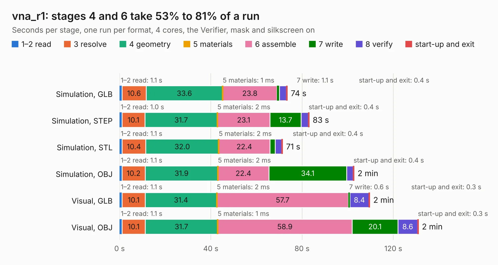

# 1563. vna_r1

Board 1,563 of the 3,110 of [Corpus Testing](../Corpus-Testing.md), on [Corpus Page 15](../CorpusTestingPages/Corpus-Testing-15.md#1563-vna_r1).

| Mode and format | 1–2 read | 3 resolve | 4 geometry | 5 materials | 6 assemble | 7 write | 8 verify | start-up and exit | Total |
|---|---:|---:|---:|---:|---:|---:|---:|---:|---:|
| Simulation, GLB | 1.1 | 10.6 | 33.6 | 1&nbsp;ms | 23.8 | 1.1 | 3.0 | 0.4 | 73.5 |
| Simulation, STEP | 1.0 | 10.1 | 31.7 | 2&nbsp;ms | 23.1 | 13.7 | 3.1 | 0.4 | 83.1 |
| Simulation, STL | 1.1 | 10.4 | 32.0 | 2&nbsp;ms | 22.4 | 2.3 | 2.8 | 0.4 | 71.5 |
| Simulation, OBJ | 1.1 | 10.2 | 31.9 | 2&nbsp;ms | 22.4 | 34.1 | 2.9 | 0.4 | 102.8 |
| Visual, GLB | 1.1 | 10.1 | 31.4 | 2&nbsp;ms | 57.7 | 0.6 | 8.4 | 0.3 | 109.7 |
| Visual, OBJ | 1.1 | 10.1 | 31.7 | 1&nbsp;ms | 58.9 | 20.1 | 8.6 | 0.3 | 131.0 |

<table align="center"><tr><td valign="top">

| Board | Repo: [loxodes/vna](https://github.com/loxodes/vna) Board: `vna_r1.kicad_pcb` |
|---|---|
| Folder | hardware / vna_rev1 / vna_r1_controller |
| Complexity | 361&nbsp;/&nbsp;1000 (size&nbsp;306, features&nbsp;55) |
| KESE&nbsp;features | through vias, slotted holes, filled zones, curved board outline |
| Tested | 9th November 2026 |
| Copper&nbsp;layers | 4 |
| File&nbsp;format | KiCad 5 (20171130) |
| Parts,&nbsp;tracks,&nbsp;vias | 428, 4,487, 806 |
| Triangles,&nbsp;simulation | 5,750,876 in 391 parts |
| Verifier | PASS in all six runs |

</td><td valign="top">

<table>
<tr><th>File type</th><th>File size</th><th>Peak memory used</th></tr>
<tr><th colspan="3" align="left">Simulation</th></tr>
<tr><td>GLB</td><td align="right">202&nbsp;MB</td><td align="right">1.7&nbsp;GB</td></tr>
<tr><td>STEP</td><td align="right">797&nbsp;MB</td><td align="right">2.1&nbsp;GB</td></tr>
<tr><td>STL</td><td align="right">288&nbsp;MB</td><td align="right">1.8&nbsp;GB</td></tr>
<tr><td>OBJ</td><td align="right">624&nbsp;MB</td><td align="right">3.7&nbsp;GB</td></tr>
<tr><th colspan="3" align="left">Visual</th></tr>
<tr><td>GLB</td><td align="right">131&nbsp;MB</td><td align="right">2.1&nbsp;GB</td></tr>
<tr><td>OBJ</td><td align="right">418&nbsp;MB</td><td align="right">2.7&nbsp;GB</td></tr>
</table>

</td></tr></table>

| Previous | Next |
|:---|---:|
| [1562. vna_mm_synth](b1562b_vna_vna-mm-synth.md) | [1564. vna_r1_demod](b1564b_vna_vna-r1-demod.md) |
