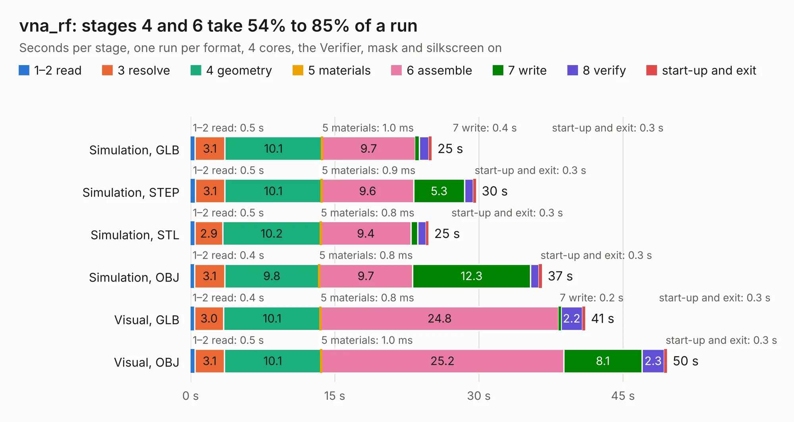

# 1563. vna_rf

Board 1,563 of the 3,128 of [Corpus Testing](../Corpus-Testing.md), on [Corpus Page 15](../CorpusTestingPages/Corpus-Testing-15.md#1563-vna_rf).

| Mode and format | 1–2 read | 3 resolve | 4 geometry | 5 materials | 6 assemble | 7 write | 8 verify | start-up and exit | Total |
|---|---:|---:|---:|---:|---:|---:|---:|---:|---:|
| Simulation, GLB | 0.5 | 3.1 | 10.1 | 1.0&nbsp;ms | 9.7 | 0.4 | 1.0 | 0.3 | 25.1 |
| Simulation, STEP | 0.5 | 3.1 | 10.1 | 0.9&nbsp;ms | 9.6 | 5.3 | 0.9 | 0.3 | 29.7 |
| Simulation, STL | 0.5 | 2.9 | 10.2 | 0.8&nbsp;ms | 9.4 | 0.7 | 0.9 | 0.3 | 24.8 |
| Simulation, OBJ | 0.4 | 3.1 | 9.8 | 0.8&nbsp;ms | 9.7 | 12.3 | 0.9 | 0.3 | 36.6 |
| Visual, GLB | 0.4 | 3.0 | 10.1 | 0.8&nbsp;ms | 24.8 | 0.2 | 2.2 | 0.3 | 41.1 |
| Visual, OBJ | 0.5 | 3.1 | 10.1 | 1.0&nbsp;ms | 25.2 | 8.1 | 2.3 | 0.3 | 49.6 |

<table align="center"><tr><td valign="top">

| Board | Repo: [loxodes/vna](https://github.com/loxodes/vna) Board: `vna_rf.kicad_pcb` |
|---|---|
| Folder | hardware / archive / vna_r0 / vna_rf |
| Complexity | 292&nbsp;/&nbsp;1000 (size&nbsp;247, features&nbsp;45) |
| KESE&nbsp;features | through vias, filled zones, curved board outline |
| Tested | 10th November 2026 |
| Copper&nbsp;layers | 4 |
| File&nbsp;format | KiCad 4 (4) |
| Parts,&nbsp;tracks,&nbsp;vias | 130, 1,060, 171 |
| Triangles,&nbsp;simulation | 2,515,716 in 103 parts |
| Verifier | PASS in all six runs |
| Run&nbsp;again | Simulation, GLB; Simulation, STEP; Simulation, STL; Simulation, OBJ; Visual, GLB; Visual, OBJ: failed in the corpus run, run again with fixes to KESE made after the corpus run, and passed |

</td><td valign="top">

<table>
<tr><th>File type</th><th>File size</th><th>Peak memory used</th></tr>
<tr><th colspan="3" align="left">Simulation</th></tr>
<tr><td>GLB</td><td align="right">86&nbsp;MB</td><td align="right">968&nbsp;MB</td></tr>
<tr><td>STEP</td><td align="right">276&nbsp;MB</td><td align="right">1.1&nbsp;GB</td></tr>
<tr><td>STL</td><td align="right">126&nbsp;MB</td><td align="right">978&nbsp;MB</td></tr>
<tr><td>OBJ</td><td align="right">264&nbsp;MB</td><td align="right">1.7&nbsp;GB</td></tr>
<tr><th colspan="3" align="left">Visual</th></tr>
<tr><td>GLB</td><td align="right">54&nbsp;MB</td><td align="right">1.0&nbsp;GB</td></tr>
<tr><td>OBJ</td><td align="right">167&nbsp;MB</td><td align="right">1.2&nbsp;GB</td></tr>
</table>

</td></tr></table>

| Previous | Next |
|:---|---:|
| [1562. vna_demod](b1562b_vna_vna-demod.md) | [1564. ecp5](b1564b_vna_ecp5.md) |
