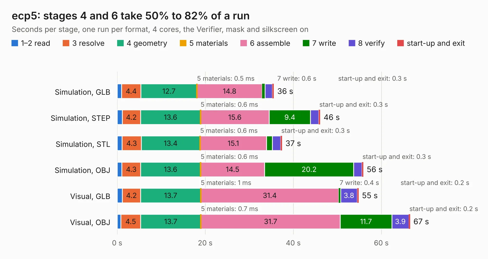

# 1564. ecp5

Board 1,564 of the 3,127 of [Corpus Testing](../Corpus-Testing.md), on [Corpus Page 15](../CorpusTestingPages/Corpus-Testing-15.md#1564-ecp5).

| Mode and format | 1–2 read | 3 resolve | 4 geometry | 5 materials | 6 assemble | 7 write | 8 verify | start-up and exit | Total |
|---|---:|---:|---:|---:|---:|---:|---:|---:|---:|
| Simulation, GLB | 1.0 | 4.4 | 12.7 | 0.5&nbsp;ms | 14.8 | 0.6 | 1.7 | 0.3 | 35.6 |
| Simulation, STEP | 1.1 | 4.2 | 13.6 | 0.6&nbsp;ms | 15.6 | 9.4 | 1.9 | 0.3 | 46.1 |
| Simulation, STL | 1.1 | 4.3 | 13.4 | 0.6&nbsp;ms | 15.1 | 1.3 | 1.9 | 0.3 | 37.4 |
| Simulation, OBJ | 1.1 | 4.3 | 13.6 | 0.6&nbsp;ms | 14.5 | 20.2 | 1.9 | 0.3 | 55.9 |
| Visual, GLB | 1.2 | 4.2 | 13.7 | 1&nbsp;ms | 31.4 | 0.4 | 3.8 | 0.2 | 54.8 |
| Visual, OBJ | 0.8 | 4.5 | 13.7 | 0.7&nbsp;ms | 31.7 | 11.7 | 3.9 | 0.2 | 66.5 |

<table align="center"><tr><td valign="top">

| Board | Repo: [loxodes/vna](https://github.com/loxodes/vna) Board: `ecp5.kicad_pcb` |
|---|---|
| Folder | hardware / mm_reflectometer / evalboards / ecp5 |
| Complexity | 405&nbsp;/&nbsp;1000 (size&nbsp;290, features&nbsp;115) |
| KESE&nbsp;features | through vias, slotted holes, rounded, trapezoid or chamfered pads, filled zones, curved board outline, stack-up, dielectric εr and tanδ, copper finish, mask and silkscreen colours |
| Tested | 9th November 2026 |
| Copper&nbsp;layers | 6 |
| File&nbsp;format | KiCad 6 (20201220) |
| Parts,&nbsp;tracks,&nbsp;vias | 195, 2,373, 498 |
| Triangles,&nbsp;simulation | 4,130,736 in 192 parts |
| Verifier | PASS in all six runs |

</td><td valign="top">

<table>
<tr><th>File type</th><th>File size</th><th>Peak memory used</th></tr>
<tr><th colspan="3" align="left">Simulation</th></tr>
<tr><td>GLB</td><td align="right">138&nbsp;MB</td><td align="right">1.1&nbsp;GB</td></tr>
<tr><td>STEP</td><td align="right">545&nbsp;MB</td><td align="right">1.6&nbsp;GB</td></tr>
<tr><td>STL</td><td align="right">207&nbsp;MB</td><td align="right">1.2&nbsp;GB</td></tr>
<tr><td>OBJ</td><td align="right">439&nbsp;MB</td><td align="right">2.7&nbsp;GB</td></tr>
<tr><th colspan="3" align="left">Visual</th></tr>
<tr><td>GLB</td><td align="right">79&nbsp;MB</td><td align="right">1.3&nbsp;GB</td></tr>
<tr><td>OBJ</td><td align="right">252&nbsp;MB</td><td align="right">1.7&nbsp;GB</td></tr>
</table>

</td></tr></table>

| Previous | Next |
|:---|---:|
| [1563. vna_rf](b1563b_vna_vna-rf.md) | [1565. ep2k1P](b1565b_vna_ep2k1P.md) |
