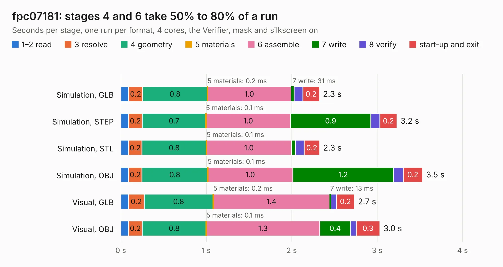

# 1565. fpc07181

Board 1,565 of the 3,124 of [Corpus Testing](../Corpus-Testing.md), on [Corpus Page 15](../CorpusTestingPages/Corpus-Testing-15.md#1565-fpc07181).

| Mode and format | 1–2 read | 3 resolve | 4 geometry | 5 materials | 6 assemble | 7 write | 8 verify | start-up and exit | Total |
|---|---:|---:|---:|---:|---:|---:|---:|---:|---:|
| Simulation, GLB | 92&nbsp;ms | 0.2 | 0.8 | 0.2&nbsp;ms | 1.0 | 31&nbsp;ms | 0.1 | 0.2 | 2.3 |
| Simulation, STEP | 91&nbsp;ms | 0.2 | 0.7 | 0.1&nbsp;ms | 1.0 | 0.9 | 0.1 | 0.2 | 3.2 |
| Simulation, STL | 90&nbsp;ms | 0.2 | 0.8 | 0.1&nbsp;ms | 1.0 | 45&nbsp;ms | 0.1 | 0.2 | 2.3 |
| Simulation, OBJ | 90&nbsp;ms | 0.2 | 0.8 | 0.1&nbsp;ms | 1.0 | 1.2 | 0.1 | 0.2 | 3.5 |
| Visual, GLB | 91&nbsp;ms | 0.2 | 0.8 | 0.2&nbsp;ms | 1.4 | 13&nbsp;ms | 66&nbsp;ms | 0.2 | 2.7 |
| Visual, OBJ | 92&nbsp;ms | 0.2 | 0.8 | 0.1&nbsp;ms | 1.3 | 0.4 | 62&nbsp;ms | 0.3 | 3.0 |

<table align="center"><tr><td valign="top">

| Board | Repo: [loxodes/vna](https://github.com/loxodes/vna) Board: `fpc07181.kicad_pcb` |
|---|---|
| Folder | hardware / mm_reflectometer / evalboards / fpc07181 |
| Complexity | 215&nbsp;/&nbsp;1000 (size&nbsp;120, features&nbsp;95) |
| KESE&nbsp;features | through vias, rounded, trapezoid or chamfered pads, filled zones, stack-up, dielectric εr and tanδ, copper finish, mask and silkscreen colours |
| Tested | 9th November 2026 |
| Copper&nbsp;layers | 4 |
| File&nbsp;format | KiCad 6 (20201220) |
| Parts,&nbsp;tracks,&nbsp;vias | 5, 20, 13 |
| Triangles,&nbsp;simulation | 192,820 in 17 parts |
| Verifier | PASS in all six runs |

</td><td valign="top">

<table>
<tr><th>File type</th><th>File size</th><th>Peak memory used</th></tr>
<tr><th colspan="3" align="left">Simulation</th></tr>
<tr><td>GLB</td><td align="right">6.3&nbsp;MB</td><td align="right">213&nbsp;MB</td></tr>
<tr><td>STEP</td><td align="right">16&nbsp;MB</td><td align="right">232&nbsp;MB</td></tr>
<tr><td>STL</td><td align="right">9.6&nbsp;MB</td><td align="right">214&nbsp;MB</td></tr>
<tr><td>OBJ</td><td align="right">19&nbsp;MB</td><td align="right">216&nbsp;MB</td></tr>
<tr><th colspan="3" align="left">Visual</th></tr>
<tr><td>GLB</td><td align="right">2.1&nbsp;MB</td><td align="right">166&nbsp;MB</td></tr>
<tr><td>OBJ</td><td align="right">6.1&nbsp;MB</td><td align="right">165&nbsp;MB</td></tr>
</table>

</td></tr></table>

| Previous | Next |
|:---|---:|
| [1564. ep2k1P](b1564b_vna_ep2k1P.md) | [1566. maam-011132](b1566b_vna_maam-011132.md) |
