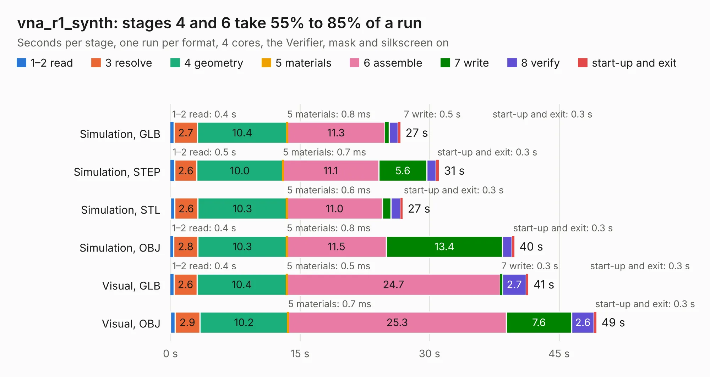

# 1565. vna_r1_synth

Board 1,565 of the 3,110 of [Corpus Testing](../Corpus-Testing.md), on [Corpus Page 15](../CorpusTestingPages/Corpus-Testing-15.md#1565-vna_r1_synth).

| Mode and format | 1–2 read | 3 resolve | 4 geometry | 5 materials | 6 assemble | 7 write | 8 verify | start-up and exit | Total |
|---|---:|---:|---:|---:|---:|---:|---:|---:|---:|
| Simulation, GLB | 0.4 | 2.7 | 10.4 | 0.8&nbsp;ms | 11.3 | 0.5 | 1.1 | 0.3 | 26.6 |
| Simulation, STEP | 0.5 | 2.6 | 10.0 | 0.7&nbsp;ms | 11.1 | 5.6 | 1.1 | 0.3 | 31.1 |
| Simulation, STL | 0.5 | 2.6 | 10.3 | 0.6&nbsp;ms | 11.0 | 1.0 | 1.1 | 0.3 | 26.9 |
| Simulation, OBJ | 0.4 | 2.8 | 10.3 | 0.8&nbsp;ms | 11.5 | 13.4 | 1.1 | 0.3 | 39.8 |
| Visual, GLB | 0.4 | 2.6 | 10.4 | 0.5&nbsp;ms | 24.7 | 0.3 | 2.7 | 0.3 | 41.4 |
| Visual, OBJ | 0.5 | 2.9 | 10.2 | 0.7&nbsp;ms | 25.3 | 7.6 | 2.6 | 0.3 | 49.3 |

<table align="center"><tr><td valign="top">

| Board | Repo: [loxodes/vna](https://github.com/loxodes/vna) Board: `vna_r1_synth.kicad_pcb` |
|---|---|
| Folder | hardware / vna_rev1 / vna_r1_synth |
| Complexity | 292&nbsp;/&nbsp;1000 (size&nbsp;247, features&nbsp;45) |
| KESE&nbsp;features | through vias, filled zones, curved board outline |
| Tested | 9th November 2026 |
| Copper&nbsp;layers | 4 |
| File&nbsp;format | KiCad 4 (4) |
| Parts,&nbsp;tracks,&nbsp;vias | 135, 1,070, 169 |
| Triangles,&nbsp;simulation | 2,886,442 in 106 parts |
| Verifier | PASS in all six runs |

</td><td valign="top">

<table>
<tr><th>File type</th><th>File size</th><th>Peak memory used</th></tr>
<tr><th colspan="3" align="left">Simulation</th></tr>
<tr><td>GLB</td><td align="right">98&nbsp;MB</td><td align="right">995&nbsp;MB</td></tr>
<tr><td>STEP</td><td align="right">312&nbsp;MB</td><td align="right">1.2&nbsp;GB</td></tr>
<tr><td>STL</td><td align="right">144&nbsp;MB</td><td align="right">1.0&nbsp;GB</td></tr>
<tr><td>OBJ</td><td align="right">302&nbsp;MB</td><td align="right">1.9&nbsp;GB</td></tr>
<tr><th colspan="3" align="left">Visual</th></tr>
<tr><td>GLB</td><td align="right">55&nbsp;MB</td><td align="right">1.1&nbsp;GB</td></tr>
<tr><td>OBJ</td><td align="right">172&nbsp;MB</td><td align="right">1.3&nbsp;GB</td></tr>
</table>

</td></tr></table>

| Previous | Next |
|:---|---:|
| [1564. vna_r1_demod](b1564b_vna_vna-r1-demod.md) | [1566. [DFR1142]Lite Carrier for LattePanda Mu](b1566b_mubook_DFR1142-Lite-Carrier-for-LattePanda-Mu.md) |
