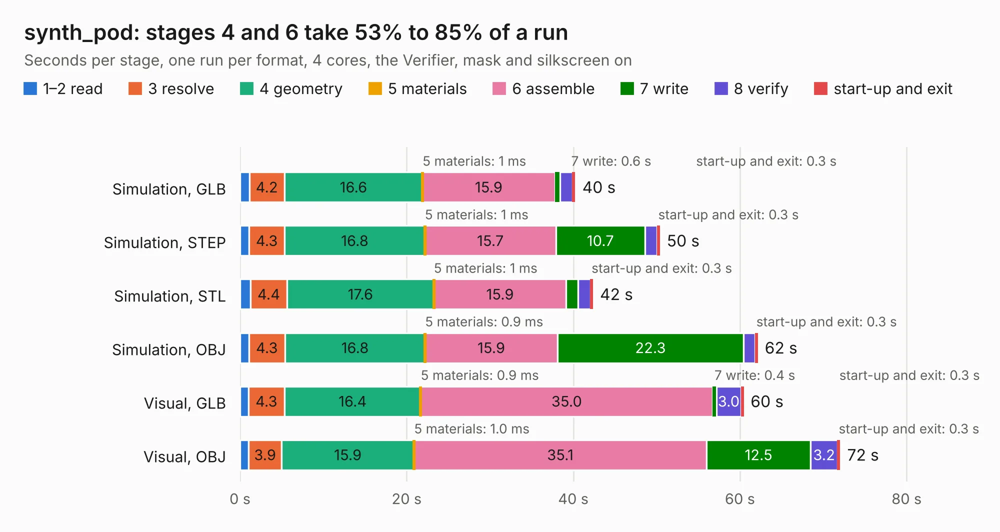

# 1566. synth_pod

Board 1,566 of the 3,117 of [Corpus Testing](../Corpus-Testing.md), on [Corpus Page 15](../CorpusTestingPages/Corpus-Testing-15.md#1566-synth_pod).

| Mode and format | 1–2 read | 3 resolve | 4 geometry | 5 materials | 6 assemble | 7 write | 8 verify | start-up and exit | Total |
|---|---:|---:|---:|---:|---:|---:|---:|---:|---:|
| Simulation, GLB | 1.1 | 4.2 | 16.6 | 1&nbsp;ms | 15.9 | 0.6 | 1.5 | 0.3 | 40.2 |
| Simulation, STEP | 1.1 | 4.3 | 16.8 | 1&nbsp;ms | 15.7 | 10.7 | 1.4 | 0.3 | 50.4 |
| Simulation, STL | 1.3 | 4.4 | 17.6 | 1&nbsp;ms | 15.9 | 1.4 | 1.5 | 0.3 | 42.3 |
| Simulation, OBJ | 1.1 | 4.3 | 16.8 | 0.9&nbsp;ms | 15.9 | 22.3 | 1.4 | 0.3 | 62.1 |
| Visual, GLB | 1.0 | 4.3 | 16.4 | 0.9&nbsp;ms | 35.0 | 0.4 | 3.0 | 0.3 | 60.4 |
| Visual, OBJ | 1.0 | 3.9 | 15.9 | 1.0&nbsp;ms | 35.1 | 12.5 | 3.2 | 0.3 | 72.0 |

<table align="center"><tr><td valign="top">

| Board | Repo: [loxodes/vna](https://github.com/loxodes/vna) Board: `synth_pod.kicad_pcb` |
|---|---|
| Folder | hardware / mm_reflectometer / synth / synth_pod |
| Complexity | 281&nbsp;/&nbsp;1000 (size&nbsp;186, features&nbsp;95) |
| KESE&nbsp;features | custom pads, rounded, trapezoid or chamfered pads, drill offsets, copper drawings, stack-up, dielectric εr and tanδ, copper finish, mask and silkscreen colours |
| Tested | 9th November 2026 |
| Copper&nbsp;layers | 8 |
| File&nbsp;format | KiCad 6 (20211014) |
| Parts,&nbsp;tracks,&nbsp;vias | 497, 0, 0 |
| Triangles,&nbsp;simulation | 4,161,276 in 367 parts |
| Note | mostly unrouted |
| Verifier | PASS in all six runs |

</td><td valign="top">

<table>
<tr><th>File type</th><th>File size</th><th>Peak memory used</th></tr>
<tr><th colspan="3" align="left">Simulation</th></tr>
<tr><td>GLB</td><td align="right">135&nbsp;MB</td><td align="right">1.2&nbsp;GB</td></tr>
<tr><td>STEP</td><td align="right">590&nbsp;MB</td><td align="right">1.8&nbsp;GB</td></tr>
<tr><td>STL</td><td align="right">208&nbsp;MB</td><td align="right">1.3&nbsp;GB</td></tr>
<tr><td>OBJ</td><td align="right">434&nbsp;MB</td><td align="right">2.6&nbsp;GB</td></tr>
<tr><th colspan="3" align="left">Visual</th></tr>
<tr><td>GLB</td><td align="right">82&nbsp;MB</td><td align="right">1.4&nbsp;GB</td></tr>
<tr><td>OBJ</td><td align="right">254&nbsp;MB</td><td align="right">1.7&nbsp;GB</td></tr>
</table>

</td></tr></table>

| Previous | Next |
|:---|---:|
| [1565. mm_synth](b1565b_vna_mm-synth.md) | [1567. vna_mm_ref](b1567b_vna_vna-mm-ref.md) |
