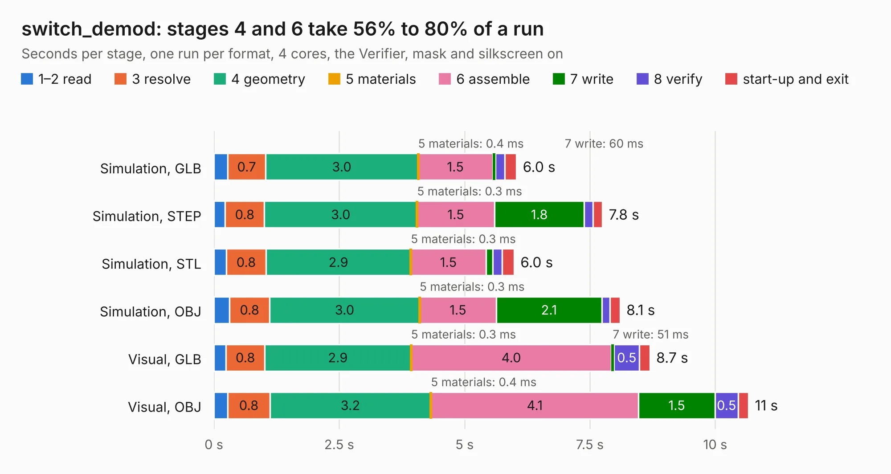

# 1568 switch_demod

Board 1,568 of the 3,138 of [Corpus Testing](../Corpus-Testing.md), on [Corpus Page 15](../CorpusTestingPages/Corpus-Testing-15.md#1568-switch_demod).

| Mode and format | 1–2 read | 3 resolve | 4 geometry | 5 materials | 6 assemble | 7 write | 8 verify | start-up and exit | Total |
|---|---:|---:|---:|---:|---:|---:|---:|---:|---:|
| Simulation, GLB | 0.3 | 0.7 | 3.0 | 0.4&nbsp;ms | 1.5 | 60&nbsp;ms | 0.2 | 0.2 | 6.0 |
| Simulation, STEP | 0.2 | 0.8 | 3.0 | 0.3&nbsp;ms | 1.5 | 1.8 | 0.2 | 0.2 | 7.8 |
| Simulation, STL | 0.2 | 0.8 | 2.9 | 0.3&nbsp;ms | 1.5 | 0.1 | 0.2 | 0.2 | 6.0 |
| Simulation, OBJ | 0.3 | 0.8 | 3.0 | 0.3&nbsp;ms | 1.5 | 2.1 | 0.2 | 0.2 | 8.1 |
| Visual, GLB | 0.2 | 0.8 | 2.9 | 0.3&nbsp;ms | 4.0 | 51&nbsp;ms | 0.5 | 0.2 | 8.7 |
| Visual, OBJ | 0.3 | 0.8 | 3.2 | 0.4&nbsp;ms | 4.1 | 1.5 | 0.5 | 0.2 | 10.7 |

<table align="center"><tr><td valign="top">

| Board | Repo: [loxodes/vna](https://github.com/loxodes/vna) Board: `switch_demod.kicad_pcb` |
|---|---|
| Folder | hardware / archive / switch_demod |
| Complexity | 172&nbsp;/&nbsp;1000 (size&nbsp;172, features&nbsp;0) |
| Tested | 9th November 2026 |
| Copper&nbsp;layers | 4 |
| File&nbsp;format | KiCad 4 (4) |
| Parts,&nbsp;tracks,&nbsp;vias | 140, 15, 0 |
| Triangles,&nbsp;simulation | 355,876 in 111 parts |
| Note | mostly unrouted |
| Verifier | PASS in all six runs |

</td><td valign="top">

<table>
<tr><th>File type</th><th>File size</th><th>Peak memory used</th></tr>
<tr><th colspan="3" align="left">Simulation</th></tr>
<tr><td>GLB</td><td align="right">13&nbsp;MB</td><td align="right">328&nbsp;MB</td></tr>
<tr><td>STEP</td><td align="right">54&nbsp;MB</td><td align="right">366&nbsp;MB</td></tr>
<tr><td>STL</td><td align="right">18&nbsp;MB</td><td align="right">340&nbsp;MB</td></tr>
<tr><td>OBJ</td><td align="right">39&nbsp;MB</td><td align="right">349&nbsp;MB</td></tr>
<tr><th colspan="3" align="left">Visual</th></tr>
<tr><td>GLB</td><td align="right">11&nbsp;MB</td><td align="right">331&nbsp;MB</td></tr>
<tr><td>OBJ</td><td align="right">31&nbsp;MB</td><td align="right">330&nbsp;MB</td></tr>
</table>

</td></tr></table>

| Previous | Next |
|:---|---:|
| [1567 trl_line](b1567b_vna_hardware-archive-oshpark-4layer-trl-cal-trl-ustrip-test_trl-line.md) | [1569 vna_control](b1569b_vna_vna-control.md) |
