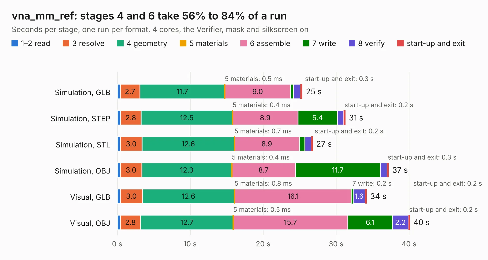

# 1568. vna_mm_ref

Board 1,568 of the 3,118 of [Corpus Testing](../Corpus-Testing.md), on [Corpus Page 15](../CorpusTestingPages/Corpus-Testing-15.md#1568-vna_mm_ref).

| Mode and format | 1–2 read | 3 resolve | 4 geometry | 5 materials | 6 assemble | 7 write | 8 verify | start-up and exit | Total |
|---|---:|---:|---:|---:|---:|---:|---:|---:|---:|
| Simulation, GLB | 0.4 | 2.7 | 11.7 | 0.5&nbsp;ms | 9.0 | 0.4 | 0.9 | 0.3 | 25.4 |
| Simulation, STEP | 0.5 | 2.8 | 12.5 | 0.4&nbsp;ms | 8.9 | 5.4 | 0.9 | 0.2 | 31.3 |
| Simulation, STL | 0.4 | 3.0 | 12.6 | 0.7&nbsp;ms | 8.9 | 0.8 | 0.9 | 0.2 | 26.8 |
| Simulation, OBJ | 0.4 | 3.0 | 12.3 | 0.4&nbsp;ms | 8.7 | 11.7 | 0.9 | 0.3 | 37.2 |
| Visual, GLB | 0.4 | 3.0 | 12.6 | 0.8&nbsp;ms | 16.1 | 0.2 | 1.6 | 0.2 | 34.2 |
| Visual, OBJ | 0.4 | 2.8 | 12.7 | 0.5&nbsp;ms | 15.7 | 6.1 | 2.2 | 0.2 | 40.1 |

<table align="center"><tr><td valign="top">

| Board | Repo: [loxodes/vna](https://github.com/loxodes/vna) Board: `vna_mm_ref.kicad_pcb` |
|---|---|
| Folder | hardware / vna_mm_ref |
| Complexity | 274&nbsp;/&nbsp;1000 (size&nbsp;219, features&nbsp;55) |
| KESE&nbsp;features | through vias, rounded, trapezoid or chamfered pads, filled zones, curved board outline |
| Tested | 9th November 2026 |
| Copper&nbsp;layers | 4 |
| File&nbsp;format | KiCad 5 (20171130) |
| Parts,&nbsp;tracks,&nbsp;vias | 221, 1,166, 395 |
| Triangles,&nbsp;simulation | 2,863,846 in 134 parts |
| Verifier | PASS in all six runs |

</td><td valign="top">

<table>
<tr><th>File type</th><th>File size</th><th>Peak memory used</th></tr>
<tr><th colspan="3" align="left">Simulation</th></tr>
<tr><td>GLB</td><td align="right">98&nbsp;MB</td><td align="right">912&nbsp;MB</td></tr>
<tr><td>STEP</td><td align="right">372&nbsp;MB</td><td align="right">1.2&nbsp;GB</td></tr>
<tr><td>STL</td><td align="right">143&nbsp;MB</td><td align="right">894&nbsp;MB</td></tr>
<tr><td>OBJ</td><td align="right">303&nbsp;MB</td><td align="right">1.9&nbsp;GB</td></tr>
<tr><th colspan="3" align="left">Visual</th></tr>
<tr><td>GLB</td><td align="right">50&nbsp;MB</td><td align="right">975&nbsp;MB</td></tr>
<tr><td>OBJ</td><td align="right">155&nbsp;MB</td><td align="right">1.1&nbsp;GB</td></tr>
</table>

</td></tr></table>

| Previous | Next |
|:---|---:|
| [1567. synth_pod](b1567b_vna_synth-pod.md) | [1569. vna_mm_synth](b1569b_vna_vna-mm-synth.md) |
