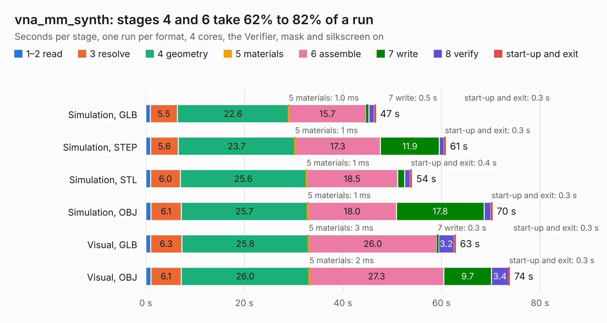

# 1569. vna_mm_synth

Board 1,569 of the 3,118 of [Corpus Testing](../Corpus-Testing.md), on [Corpus Page 15](../CorpusTestingPages/Corpus-Testing-15.md#1569-vna_mm_synth).

| Mode and format | 1–2 read | 3 resolve | 4 geometry | 5 materials | 6 assemble | 7 write | 8 verify | start-up and exit | Total |
|---|---:|---:|---:|---:|---:|---:|---:|---:|---:|
| Simulation, GLB | 0.9 | 5.5 | 22.6 | 1.0&nbsp;ms | 15.7 | 0.5 | 1.1 | 0.3 | 46.7 |
| Simulation, STEP | 1.0 | 5.6 | 23.7 | 1&nbsp;ms | 17.3 | 11.9 | 1.0 | 0.3 | 60.9 |
| Simulation, STL | 1.0 | 6.0 | 25.6 | 1&nbsp;ms | 18.5 | 1.4 | 1.1 | 0.4 | 54.0 |
| Simulation, OBJ | 1.1 | 6.1 | 25.7 | 1&nbsp;ms | 18.0 | 17.8 | 1.4 | 0.3 | 70.3 |
| Visual, GLB | 1.0 | 6.3 | 25.8 | 3&nbsp;ms | 26.0 | 0.3 | 3.2 | 0.3 | 62.9 |
| Visual, OBJ | 1.0 | 6.1 | 26.0 | 2&nbsp;ms | 27.3 | 9.7 | 3.4 | 0.3 | 73.9 |

<table align="center"><tr><td valign="top">

| Board | Repo: [loxodes/vna](https://github.com/loxodes/vna) Board: `vna_mm_synth.kicad_pcb` |
|---|---|
| Folder | hardware / vna_mm_synth |
| Complexity | 180&nbsp;/&nbsp;1000 (size&nbsp;170, features&nbsp;10) |
| KESE&nbsp;features | rounded, trapezoid or chamfered pads |
| Tested | 9th November 2026 |
| Copper&nbsp;layers | 6 |
| File&nbsp;format | KiCad 5 (20171130) |
| Parts,&nbsp;tracks,&nbsp;vias | 430, 0, 0 |
| Triangles,&nbsp;simulation | 2,684,964 in 356 parts |
| Note | mostly unrouted |
| Verifier | PASS in all six runs |

</td><td valign="top">

<table>
<tr><th>File type</th><th>File size</th><th>Peak memory used</th></tr>
<tr><th colspan="3" align="left">Simulation</th></tr>
<tr><td>GLB</td><td align="right">92&nbsp;MB</td><td align="right">1.0&nbsp;GB</td></tr>
<tr><td>STEP</td><td align="right">478&nbsp;MB</td><td align="right">1.3&nbsp;GB</td></tr>
<tr><td>STL</td><td align="right">134&nbsp;MB</td><td align="right">1.1&nbsp;GB</td></tr>
<tr><td>OBJ</td><td align="right">290&nbsp;MB</td><td align="right">1.9&nbsp;GB</td></tr>
<tr><th colspan="3" align="left">Visual</th></tr>
<tr><td>GLB</td><td align="right">54&nbsp;MB</td><td align="right">1.0&nbsp;GB</td></tr>
<tr><td>OBJ</td><td align="right">164&nbsp;MB</td><td align="right">1.2&nbsp;GB</td></tr>
</table>

</td></tr></table>

| Previous | Next |
|:---|---:|
| [1568. vna_mm_ref](b1568b_vna_vna-mm-ref.md) | [1570. vna_r1](b1570b_vna_vna-r1.md) |
