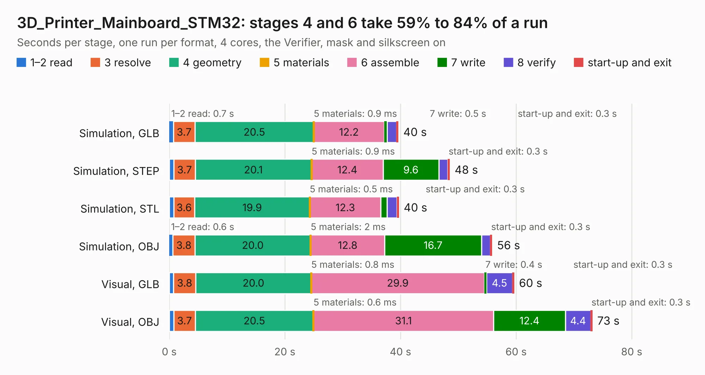

# 1570. 3D_Printer_Mainboard_STM32

Board 1,570 of the 3,108 of [Corpus Testing](../Corpus-Testing.md), on [Corpus Page 15](../CorpusTestingPages/Corpus-Testing-15.md#1570-3d_printer_mainboard_stm32).

| Mode and format | 1–2 read | 3 resolve | 4 geometry | 5 materials | 6 assemble | 7 write | 8 verify | start-up and exit | Total |
|---|---:|---:|---:|---:|---:|---:|---:|---:|---:|
| Simulation, GLB | 0.7 | 3.7 | 20.5 | 0.9&nbsp;ms | 12.2 | 0.5 | 1.6 | 0.3 | 39.6 |
| Simulation, STEP | 0.8 | 3.7 | 20.1 | 0.9&nbsp;ms | 12.4 | 9.6 | 1.6 | 0.3 | 48.5 |
| Simulation, STL | 0.8 | 3.6 | 19.9 | 0.5&nbsp;ms | 12.3 | 1.1 | 1.7 | 0.3 | 39.7 |
| Simulation, OBJ | 0.6 | 3.8 | 20.0 | 2&nbsp;ms | 12.8 | 16.7 | 1.6 | 0.3 | 55.8 |
| Visual, GLB | 0.8 | 3.8 | 20.0 | 0.8&nbsp;ms | 29.9 | 0.4 | 4.5 | 0.3 | 59.6 |
| Visual, OBJ | 0.8 | 3.7 | 20.5 | 0.6&nbsp;ms | 31.1 | 12.4 | 4.4 | 0.3 | 73.2 |

<table align="center"><tr><td valign="top">

| Board | Repo: [m47812/custom-3d-printer-controller](https://github.com/m47812/custom-3d-printer-controller) Board: `3D_Printer_Mainboard_STM32.kicad_pcb` |
|---|---|
| Folder | 3D_Printer_Mainboard_STM32 |
| Complexity | 284&nbsp;/&nbsp;1000 (size&nbsp;239, features&nbsp;45) |
| KESE&nbsp;features | through vias, rounded, trapezoid or chamfered pads, filled zones |
| Tested | 9th November 2026 |
| Copper&nbsp;layers | 2 |
| File&nbsp;format | KiCad 5 (20171130) |
| Parts,&nbsp;tracks,&nbsp;vias | 191, 1,355, 233 |
| Triangles,&nbsp;simulation | 3,389,266 in 196 parts |
| Verifier | PASS in all six runs |

</td><td valign="top">

<table>
<tr><th>File type</th><th>File size</th><th>Peak memory used</th></tr>
<tr><th colspan="3" align="left">Simulation</th></tr>
<tr><td>GLB</td><td align="right">118&nbsp;MB</td><td align="right">1.2&nbsp;GB</td></tr>
<tr><td>STEP</td><td align="right">621&nbsp;MB</td><td align="right">1.4&nbsp;GB</td></tr>
<tr><td>STL</td><td align="right">169&nbsp;MB</td><td align="right">1.2&nbsp;GB</td></tr>
<tr><td>OBJ</td><td align="right">363&nbsp;MB</td><td align="right">2.3&nbsp;GB</td></tr>
<tr><th colspan="3" align="left">Visual</th></tr>
<tr><td>GLB</td><td align="right">86&nbsp;MB</td><td align="right">1.4&nbsp;GB</td></tr>
<tr><td>OBJ</td><td align="right">267&nbsp;MB</td><td align="right">1.8&nbsp;GB</td></tr>
</table>

</td></tr></table>

| Previous | Next |
|:---|---:|
| [1569. Mupi](b1569b_custom-3d-printer-controller_Mupi.md) | [1571. 3D_Printer_Stepper_TMC2209](b1571b_custom-3d-printer-controller_3D-Printer-Stepper-TMC2209.md) |
