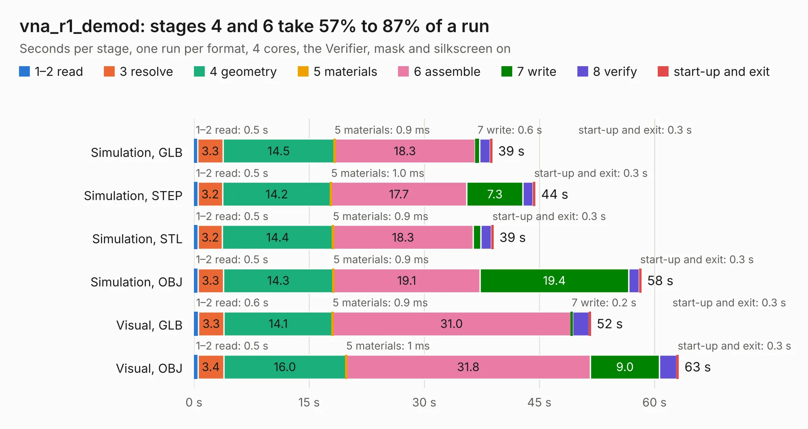

# 1573. vna_r1_demod

Board 1,573 of the 3,121 of [Corpus Testing](../Corpus-Testing.md), on [Corpus Page 15](../CorpusTestingPages/Corpus-Testing-15.md#1573-vna_r1_demod).

| Mode and format | 1–2 read | 3 resolve | 4 geometry | 5 materials | 6 assemble | 7 write | 8 verify | start-up and exit | Total |
|---|---:|---:|---:|---:|---:|---:|---:|---:|---:|
| Simulation, GLB | 0.5 | 3.3 | 14.5 | 0.9&nbsp;ms | 18.3 | 0.6 | 1.4 | 0.3 | 38.9 |
| Simulation, STEP | 0.5 | 3.2 | 14.2 | 1.0&nbsp;ms | 17.7 | 7.3 | 1.3 | 0.3 | 44.5 |
| Simulation, STL | 0.5 | 3.2 | 14.4 | 0.9&nbsp;ms | 18.3 | 1.0 | 1.3 | 0.3 | 39.0 |
| Simulation, OBJ | 0.5 | 3.3 | 14.3 | 0.9&nbsp;ms | 19.1 | 19.4 | 1.4 | 0.3 | 58.3 |
| Visual, GLB | 0.6 | 3.3 | 14.1 | 0.9&nbsp;ms | 31.0 | 0.2 | 2.1 | 0.3 | 51.7 |
| Visual, OBJ | 0.5 | 3.4 | 16.0 | 1&nbsp;ms | 31.8 | 9.0 | 2.2 | 0.3 | 63.2 |

<table align="center"><tr><td valign="top">

| Board | Repo: [loxodes/vna](https://github.com/loxodes/vna) Board: `vna_r1_demod.kicad_pcb` |
|---|---|
| Folder | hardware / vna_rev1 / vna_r1_demod |
| Complexity | 255&nbsp;/&nbsp;1000 (size&nbsp;200, features&nbsp;55) |
| KESE&nbsp;features | through vias, rounded, trapezoid or chamfered pads, filled zones, curved board outline |
| Tested | 9th November 2026 |
| Copper&nbsp;layers | 4 |
| File&nbsp;format | KiCad 4 (4) |
| Parts,&nbsp;tracks,&nbsp;vias | 111, 678, 158 |
| Triangles,&nbsp;simulation | 3,341,808 in 93 parts |
| Verifier | PASS in all six runs |

</td><td valign="top">

<table>
<tr><th>File type</th><th>File size</th><th>Peak memory used</th></tr>
<tr><th colspan="3" align="left">Simulation</th></tr>
<tr><td>GLB</td><td align="right">113&nbsp;MB</td><td align="right">1.1&nbsp;GB</td></tr>
<tr><td>STEP</td><td align="right">344&nbsp;MB</td><td align="right">1.4&nbsp;GB</td></tr>
<tr><td>STL</td><td align="right">167&nbsp;MB</td><td align="right">1.0&nbsp;GB</td></tr>
<tr><td>OBJ</td><td align="right">349&nbsp;MB</td><td align="right">2.1&nbsp;GB</td></tr>
<tr><th colspan="3" align="left">Visual</th></tr>
<tr><td>GLB</td><td align="right">52&nbsp;MB</td><td align="right">1.1&nbsp;GB</td></tr>
<tr><td>OBJ</td><td align="right">161&nbsp;MB</td><td align="right">1.2&nbsp;GB</td></tr>
</table>

</td></tr></table>

| Previous | Next |
|:---|---:|
| [1572. vna_r1](b1572b_vna_vna-r1.md) | [1574. vna_r1_synth](b1574b_vna_vna-r1-synth.md) |
