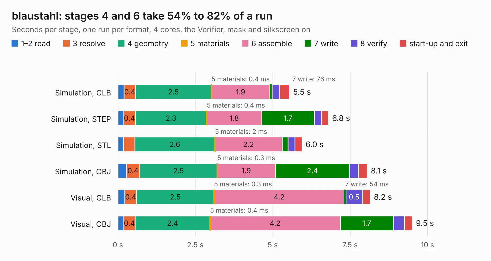

# 1574. blaustahl

Board 1,574 of the 3,110 of [Corpus Testing](../Corpus-Testing.md), on [Corpus Page 15](../CorpusTestingPages/Corpus-Testing-15.md#1574-blaustahl).

| Mode and format | 1–2 read | 3 resolve | 4 geometry | 5 materials | 6 assemble | 7 write | 8 verify | start-up and exit | Total |
|---|---:|---:|---:|---:|---:|---:|---:|---:|---:|
| Simulation, GLB | 0.2 | 0.4 | 2.5 | 0.4&nbsp;ms | 1.9 | 76&nbsp;ms | 0.2 | 0.3 | 5.5 |
| Simulation, STEP | 0.2 | 0.4 | 2.3 | 0.4&nbsp;ms | 1.8 | 1.7 | 0.2 | 0.2 | 6.8 |
| Simulation, STL | 0.2 | 0.4 | 2.6 | 2&nbsp;ms | 2.2 | 0.2 | 0.2 | 0.2 | 6.0 |
| Simulation, OBJ | 0.3 | 0.4 | 2.5 | 0.3&nbsp;ms | 1.9 | 2.4 | 0.3 | 0.3 | 8.1 |
| Visual, GLB | 0.2 | 0.4 | 2.5 | 0.3&nbsp;ms | 4.2 | 54&nbsp;ms | 0.5 | 0.3 | 8.2 |
| Visual, OBJ | 0.2 | 0.4 | 2.4 | 0.4&nbsp;ms | 4.2 | 1.7 | 0.4 | 0.3 | 9.5 |

<table align="center"><tr><td valign="top">

| Board | Repo: [machdyne/blaustahl](https://github.com/machdyne/blaustahl) Board: `blaustahl.kicad_pcb` |
|---|---|
| Folder | pcb / blaustahl_v0 |
| Complexity | 296&nbsp;/&nbsp;1000 (size&nbsp;201, features&nbsp;95) |
| KESE&nbsp;features | through vias, slotted holes, rounded, trapezoid or chamfered pads, filled zones, curved board outline, stack-up, dielectric εr and tanδ |
| Tested | 9th November 2026 |
| Copper&nbsp;layers | 2 |
| File&nbsp;format | KiCad 8 (20240108) |
| Parts,&nbsp;tracks,&nbsp;vias | 38, 388, 63 |
| Triangles,&nbsp;simulation | 388,128 in 64 parts |
| Verifier | PASS in all six runs |

</td><td valign="top">

<table>
<tr><th>File type</th><th>File size</th><th>Peak memory used</th></tr>
<tr><th colspan="3" align="left">Simulation</th></tr>
<tr><td>GLB</td><td align="right">14&nbsp;MB</td><td align="right">299&nbsp;MB</td></tr>
<tr><td>STEP</td><td align="right">75&nbsp;MB</td><td align="right">335&nbsp;MB</td></tr>
<tr><td>STL</td><td align="right">19&nbsp;MB</td><td align="right">285&nbsp;MB</td></tr>
<tr><td>OBJ</td><td align="right">40&nbsp;MB</td><td align="right">322&nbsp;MB</td></tr>
<tr><th colspan="3" align="left">Visual</th></tr>
<tr><td>GLB</td><td align="right">9.8&nbsp;MB</td><td align="right">299&nbsp;MB</td></tr>
<tr><td>OBJ</td><td align="right">29&nbsp;MB</td><td align="right">306&nbsp;MB</td></tr>
</table>

</td></tr></table>

| Previous | Next |
|:---|---:|
| [1573. 3D_Printer_Stepper_TMC2209](b1573b_custom-3d-printer-controller_3D-Printer-Stepper-TMC2209.md) | [1575. eis](b1575b_eis_eis.md) |
