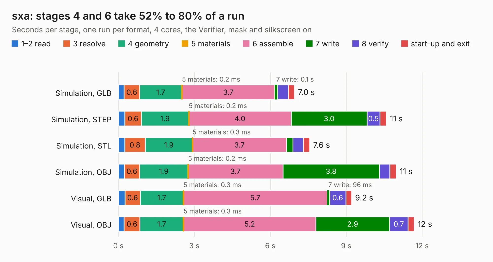

# 1574. sxa

Board 1,574 of the 3,105 of [Corpus Testing](../Corpus-Testing.md), on [Corpus Page 15](../CorpusTestingPages/Corpus-Testing-15.md#1574-sxa).

| Mode and format | 1–2 read | 3 resolve | 4 geometry | 5 materials | 6 assemble | 7 write | 8 verify | start-up and exit | Total |
|---|---:|---:|---:|---:|---:|---:|---:|---:|---:|
| Simulation, GLB | 0.2 | 0.6 | 1.7 | 0.2&nbsp;ms | 3.7 | 0.1 | 0.4 | 0.2 | 7.0 |
| Simulation, STEP | 0.3 | 0.6 | 1.9 | 0.2&nbsp;ms | 4.0 | 3.0 | 0.5 | 0.3 | 10.6 |
| Simulation, STL | 0.3 | 0.8 | 1.9 | 0.3&nbsp;ms | 3.7 | 0.3 | 0.4 | 0.3 | 7.6 |
| Simulation, OBJ | 0.2 | 0.6 | 1.9 | 0.2&nbsp;ms | 3.7 | 3.8 | 0.4 | 0.3 | 11.0 |
| Visual, GLB | 0.3 | 0.6 | 1.7 | 0.3&nbsp;ms | 5.7 | 96&nbsp;ms | 0.6 | 0.2 | 9.2 |
| Visual, OBJ | 0.2 | 0.6 | 1.7 | 0.3&nbsp;ms | 5.2 | 2.9 | 0.7 | 0.2 | 11.7 |

<table align="center"><tr><td valign="top">

| Board | Repo: [machdyne/ferrit](https://github.com/machdyne/ferrit) Board: `sxa.kicad_pcb` |
|---|---|
| Folder | hw / ferrit-m8 |
| Complexity | 281&nbsp;/&nbsp;1000 (size&nbsp;181, features&nbsp;100) |
| KESE&nbsp;features | through vias, rounded, trapezoid or chamfered pads, filled zones, curved board outline, TrueType text, stack-up, dielectric εr and tanδ |
| Tested | 9th November 2026 |
| Copper&nbsp;layers | 4 |
| File&nbsp;format | KiCad 8 (20240108) |
| Parts,&nbsp;tracks,&nbsp;vias | 30, 525, 103 |
| Triangles,&nbsp;simulation | 658,288 in 32 parts |
| Verifier | PASS in all six runs |

</td><td valign="top">

<table>
<tr><th>File type</th><th>File size</th><th>Peak memory used</th></tr>
<tr><th colspan="3" align="left">Simulation</th></tr>
<tr><td>GLB</td><td align="right">22&nbsp;MB</td><td align="right">357&nbsp;MB</td></tr>
<tr><td>STEP</td><td align="right">92&nbsp;MB</td><td align="right">429&nbsp;MB</td></tr>
<tr><td>STL</td><td align="right">33&nbsp;MB</td><td align="right">357&nbsp;MB</td></tr>
<tr><td>OBJ</td><td align="right">66&nbsp;MB</td><td align="right">466&nbsp;MB</td></tr>
<tr><th colspan="3" align="left">Visual</th></tr>
<tr><td>GLB</td><td align="right">16&nbsp;MB</td><td align="right">483&nbsp;MB</td></tr>
<tr><td>OBJ</td><td align="right">48&nbsp;MB</td><td align="right">484&nbsp;MB</td></tr>
</table>

</td></tr></table>

| Previous | Next |
|:---|---:|
| [1573. sxy](b1573b_ferrit_sxy.md) | [1575. kaltstahl](b1575b_kaltstahl_kaltstahl.md) |
