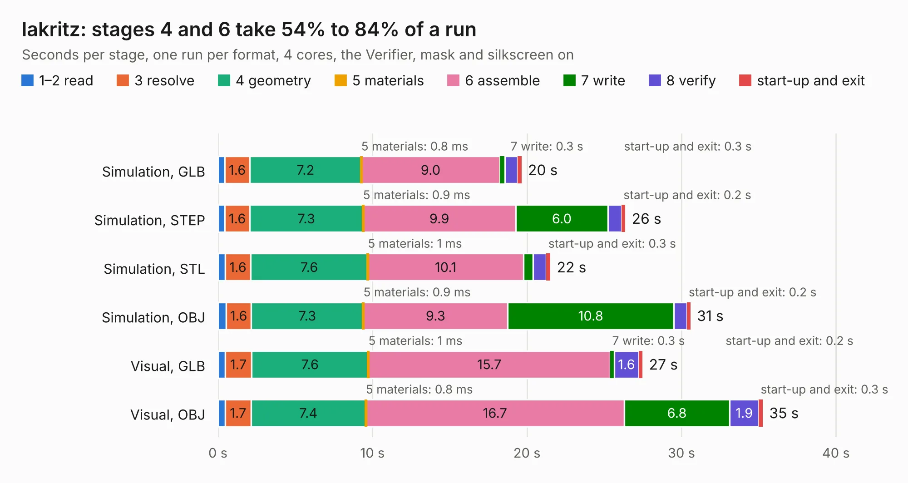

# 1574. lakritz

Board 1,574 of the 3,101 of [Corpus Testing](../Corpus-Testing.md), on [Corpus Page 15](../CorpusTestingPages/Corpus-Testing-15.md#1574-lakritz).

| Mode and format | 1–2 read | 3 resolve | 4 geometry | 5 materials | 6 assemble | 7 write | 8 verify | start-up and exit | Total |
|---|---:|---:|---:|---:|---:|---:|---:|---:|---:|
| Simulation, GLB | 0.4 | 1.6 | 7.2 | 0.8&nbsp;ms | 9.0 | 0.3 | 0.8 | 0.3 | 19.6 |
| Simulation, STEP | 0.5 | 1.6 | 7.3 | 0.9&nbsp;ms | 9.9 | 6.0 | 0.9 | 0.2 | 26.4 |
| Simulation, STL | 0.5 | 1.6 | 7.6 | 1&nbsp;ms | 10.1 | 0.6 | 0.9 | 0.3 | 21.5 |
| Simulation, OBJ | 0.5 | 1.6 | 7.3 | 0.9&nbsp;ms | 9.3 | 10.8 | 0.8 | 0.2 | 30.6 |
| Visual, GLB | 0.5 | 1.7 | 7.6 | 1&nbsp;ms | 15.7 | 0.3 | 1.6 | 0.2 | 27.5 |
| Visual, OBJ | 0.5 | 1.7 | 7.4 | 0.8&nbsp;ms | 16.7 | 6.8 | 1.9 | 0.3 | 35.3 |

<table align="center"><tr><td valign="top">

| Board | Repo: [machdyne/lakritz](https://github.com/machdyne/lakritz) Board: `lakritz.kicad_pcb` |
|---|---|
| Folder | pcb / v0 |
| Complexity | 390&nbsp;/&nbsp;1000 (size&nbsp;260, features&nbsp;130) |
| KESE&nbsp;features | through vias, slotted holes, rounded, trapezoid or chamfered pads, arc tracks, filled zones, curved board outline, stack-up, dielectric εr and tanδ, copper finish, mask and silkscreen colours |
| Tested | 9th November 2026 |
| Copper&nbsp;layers | 4 |
| File&nbsp;format | KiCad 8 (20240108) |
| Parts,&nbsp;tracks,&nbsp;vias | 103, 1,372, 209 |
| Triangles,&nbsp;simulation | 1,936,052 in 266 parts |
| Verifier | PASS in all six runs |

</td><td valign="top">

<table>
<tr><th>File type</th><th>File size</th><th>Peak memory used</th></tr>
<tr><th colspan="3" align="left">Simulation</th></tr>
<tr><td>GLB</td><td align="right">65&nbsp;MB</td><td align="right">711&nbsp;MB</td></tr>
<tr><td>STEP</td><td align="right">293&nbsp;MB</td><td align="right">891&nbsp;MB</td></tr>
<tr><td>STL</td><td align="right">97&nbsp;MB</td><td align="right">733&nbsp;MB</td></tr>
<tr><td>OBJ</td><td align="right">201&nbsp;MB</td><td align="right">1.3&nbsp;GB</td></tr>
<tr><th colspan="3" align="left">Visual</th></tr>
<tr><td>GLB</td><td align="right">42&nbsp;MB</td><td align="right">904&nbsp;MB</td></tr>
<tr><td>OBJ</td><td align="right">130&nbsp;MB</td><td align="right">944&nbsp;MB</td></tr>
</table>

</td></tr></table>

| Previous | Next |
|:---|---:|
| [1573. kuchen](b1573b_kuchen_kuchen.md) | [1575. obst](b1575b_obst_obst.md) |
