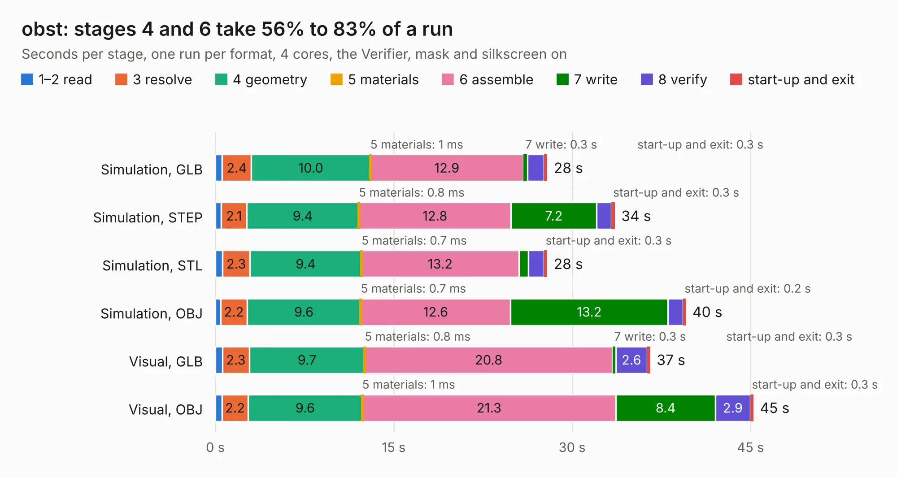

# 1574. obst

Board 1,574 of the 3,100 of [Corpus Testing](../Corpus-Testing.md), on [Corpus Page 15](../CorpusTestingPages/Corpus-Testing-15.md#1574-obst).

| Mode and format | 1–2 read | 3 resolve | 4 geometry | 5 materials | 6 assemble | 7 write | 8 verify | start-up and exit | Total |
|---|---:|---:|---:|---:|---:|---:|---:|---:|---:|
| Simulation, GLB | 0.6 | 2.4 | 10.0 | 1&nbsp;ms | 12.9 | 0.3 | 1.4 | 0.3 | 27.9 |
| Simulation, STEP | 0.5 | 2.1 | 9.4 | 0.8&nbsp;ms | 12.8 | 7.2 | 1.2 | 0.3 | 33.6 |
| Simulation, STL | 0.6 | 2.3 | 9.4 | 0.7&nbsp;ms | 13.2 | 0.8 | 1.3 | 0.3 | 27.9 |
| Simulation, OBJ | 0.5 | 2.2 | 9.6 | 0.7&nbsp;ms | 12.6 | 13.2 | 1.3 | 0.2 | 39.6 |
| Visual, GLB | 0.6 | 2.3 | 9.7 | 0.8&nbsp;ms | 20.8 | 0.3 | 2.6 | 0.3 | 36.6 |
| Visual, OBJ | 0.6 | 2.2 | 9.6 | 1&nbsp;ms | 21.3 | 8.4 | 2.9 | 0.3 | 45.3 |

<table align="center"><tr><td valign="top">

| Board | Repo: [machdyne/obst](https://github.com/machdyne/obst) Board: `obst.kicad_pcb` |
|---|---|
| Folder | pcb / mdr_v0b |
| Complexity | 363&nbsp;/&nbsp;1000 (size&nbsp;268, features&nbsp;95) |
| KESE&nbsp;features | through vias, slotted holes, rounded, trapezoid or chamfered pads, filled zones, curved board outline, stack-up, dielectric εr and tanδ |
| Tested | 9th November 2026 |
| Copper&nbsp;layers | 4 |
| File&nbsp;format | KiCad 8 (20240108) |
| Parts,&nbsp;tracks,&nbsp;vias | 142, 1,666, 308 |
| Triangles,&nbsp;simulation | 2,753,452 in 280 parts |
| Verifier | PASS in all six runs |

</td><td valign="top">

<table>
<tr><th>File type</th><th>File size</th><th>Peak memory used</th></tr>
<tr><th colspan="3" align="left">Simulation</th></tr>
<tr><td>GLB</td><td align="right">94&nbsp;MB</td><td align="right">922&nbsp;MB</td></tr>
<tr><td>STEP</td><td align="right">393&nbsp;MB</td><td align="right">1.1&nbsp;GB</td></tr>
<tr><td>STL</td><td align="right">138&nbsp;MB</td><td align="right">923&nbsp;MB</td></tr>
<tr><td>OBJ</td><td align="right">288&nbsp;MB</td><td align="right">1.8&nbsp;GB</td></tr>
<tr><th colspan="3" align="left">Visual</th></tr>
<tr><td>GLB</td><td align="right">58&nbsp;MB</td><td align="right">1.3&nbsp;GB</td></tr>
<tr><td>OBJ</td><td align="right">182&nbsp;MB</td><td align="right">1.2&nbsp;GB</td></tr>
</table>

</td></tr></table>

| Previous | Next |
|:---|---:|
| [1573. lakritz](b1573b_lakritz_lakritz.md) | [1575. riegel](b1575b_riegel_riegel.md) |
