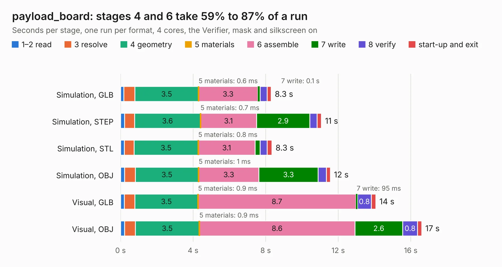

# 1577. payload_board

Board 1,577 of the 3,118 of [Corpus Testing](../Corpus-Testing.md), on [Corpus Page 15](../CorpusTestingPages/Corpus-Testing-15.md#1577-payload_board).

| Mode and format | 1–2 read | 3 resolve | 4 geometry | 5 materials | 6 assemble | 7 write | 8 verify | start-up and exit | Total |
|---|---:|---:|---:|---:|---:|---:|---:|---:|---:|
| Simulation, GLB | 0.2 | 0.6 | 3.5 | 0.6&nbsp;ms | 3.3 | 0.1 | 0.4 | 0.2 | 8.3 |
| Simulation, STEP | 0.2 | 0.6 | 3.6 | 0.7&nbsp;ms | 3.1 | 2.9 | 0.4 | 0.2 | 11.1 |
| Simulation, STL | 0.2 | 0.5 | 3.5 | 0.8&nbsp;ms | 3.1 | 0.3 | 0.4 | 0.3 | 8.3 |
| Simulation, OBJ | 0.2 | 0.6 | 3.5 | 1&nbsp;ms | 3.3 | 3.3 | 0.4 | 0.2 | 11.6 |
| Visual, GLB | 0.2 | 0.6 | 3.5 | 0.9&nbsp;ms | 8.7 | 95&nbsp;ms | 0.8 | 0.3 | 14.1 |
| Visual, OBJ | 0.2 | 0.6 | 3.5 | 0.9&nbsp;ms | 8.6 | 2.6 | 0.8 | 0.2 | 16.6 |

<table align="center"><tr><td valign="top">

| Board | Repo: [M2I-CySat/SDR-Carrier-Board](https://github.com/M2I-CySat/SDR-Carrier-Board) Board: `payload_board.kicad_pcb` |
|---|---|
| Folder | schematics / breakoutBoard |
| Complexity | 164&nbsp;/&nbsp;1000 (size&nbsp;129, features&nbsp;35) |
| KESE&nbsp;features | through vias, filled zones |
| Tested | 9th November 2026 |
| Copper&nbsp;layers | 2 |
| File&nbsp;format | KiCad 5 (20171130) |
| Parts,&nbsp;tracks,&nbsp;vias | 7, 172, 21 |
| Triangles,&nbsp;simulation | 714,524 in 392 parts |
| Verifier | PASS in all six runs |

</td><td valign="top">

<table>
<tr><th>File type</th><th>File size</th><th>Peak memory used</th></tr>
<tr><th colspan="3" align="left">Simulation</th></tr>
<tr><td>GLB</td><td align="right">24&nbsp;MB</td><td align="right">396&nbsp;MB</td></tr>
<tr><td>STEP</td><td align="right">126&nbsp;MB</td><td align="right">477&nbsp;MB</td></tr>
<tr><td>STL</td><td align="right">36&nbsp;MB</td><td align="right">405&nbsp;MB</td></tr>
<tr><td>OBJ</td><td align="right">72&nbsp;MB</td><td align="right">521&nbsp;MB</td></tr>
<tr><th colspan="3" align="left">Visual</th></tr>
<tr><td>GLB</td><td align="right">20&nbsp;MB</td><td align="right">551&nbsp;MB</td></tr>
<tr><td>OBJ</td><td align="right">59&nbsp;MB</td><td align="right">585&nbsp;MB</td></tr>
</table>

</td></tr></table>

| Previous | Next |
|:---|---:|
| [1576. DepthABC](b1576b_depthai-hardware_DepthABC.md) | [1578. Mupi](b1578b_custom-3d-printer-controller_Mupi.md) |
