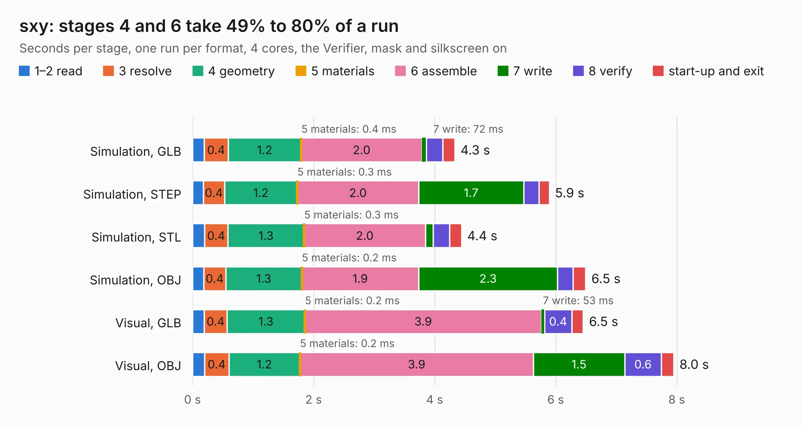

# 1577. sxy

Board 1,577 of the 3,109 of [Corpus Testing](../Corpus-Testing.md), on [Corpus Page 15](../CorpusTestingPages/Corpus-Testing-15.md#1577-sxy).

| Mode and format | 1–2 read | 3 resolve | 4 geometry | 5 materials | 6 assemble | 7 write | 8 verify | start-up and exit | Total |
|---|---:|---:|---:|---:|---:|---:|---:|---:|---:|
| Simulation, GLB | 0.2 | 0.4 | 1.2 | 0.4&nbsp;ms | 2.0 | 72&nbsp;ms | 0.3 | 0.2 | 4.3 |
| Simulation, STEP | 0.2 | 0.4 | 1.2 | 0.3&nbsp;ms | 2.0 | 1.7 | 0.3 | 0.2 | 5.9 |
| Simulation, STL | 0.2 | 0.4 | 1.3 | 0.3&nbsp;ms | 2.0 | 0.1 | 0.3 | 0.2 | 4.4 |
| Simulation, OBJ | 0.2 | 0.4 | 1.3 | 0.2&nbsp;ms | 1.9 | 2.3 | 0.3 | 0.2 | 6.5 |
| Visual, GLB | 0.2 | 0.4 | 1.3 | 0.2&nbsp;ms | 3.9 | 53&nbsp;ms | 0.4 | 0.2 | 6.5 |
| Visual, OBJ | 0.2 | 0.4 | 1.2 | 0.2&nbsp;ms | 3.9 | 1.5 | 0.6 | 0.2 | 8.0 |

<table align="center"><tr><td valign="top">

| Board | Repo: [machdyne/ferrit](https://github.com/machdyne/ferrit) Board: `sxy.kicad_pcb` |
|---|---|
| Folder | hw / ferrit-cy |
| Complexity | 349&nbsp;/&nbsp;1000 (size&nbsp;224, features&nbsp;125) |
| KESE&nbsp;features | through vias, slotted holes, rounded, trapezoid or chamfered pads, arc tracks, filled zones, curved board outline, TrueType text, stack-up, dielectric εr and tanδ |
| Tested | 9th November 2026 |
| Copper&nbsp;layers | 4 |
| File&nbsp;format | KiCad 8 (20240108) |
| Parts,&nbsp;tracks,&nbsp;vias | 45, 591, 64 |
| Triangles,&nbsp;simulation | 564,848 in 87 parts |
| Verifier | PASS in all six runs |

</td><td valign="top">

<table>
<tr><th>File type</th><th>File size</th><th>Peak memory used</th></tr>
<tr><th colspan="3" align="left">Simulation</th></tr>
<tr><td>GLB</td><td align="right">19&nbsp;MB</td><td align="right">329&nbsp;MB</td></tr>
<tr><td>STEP</td><td align="right">84&nbsp;MB</td><td align="right">385&nbsp;MB</td></tr>
<tr><td>STL</td><td align="right">28&nbsp;MB</td><td align="right">321&nbsp;MB</td></tr>
<tr><td>OBJ</td><td align="right">56&nbsp;MB</td><td align="right">415&nbsp;MB</td></tr>
<tr><th colspan="3" align="left">Visual</th></tr>
<tr><td>GLB</td><td align="right">13&nbsp;MB</td><td align="right">415&nbsp;MB</td></tr>
<tr><td>OBJ</td><td align="right">38&nbsp;MB</td><td align="right">352&nbsp;MB</td></tr>
</table>

</td></tr></table>

| Previous | Next |
|:---|---:|
| [1576. ssu](b1576b_ferrit_ssu.md) | [1578. sxa](b1578b_ferrit_sxa.md) |
