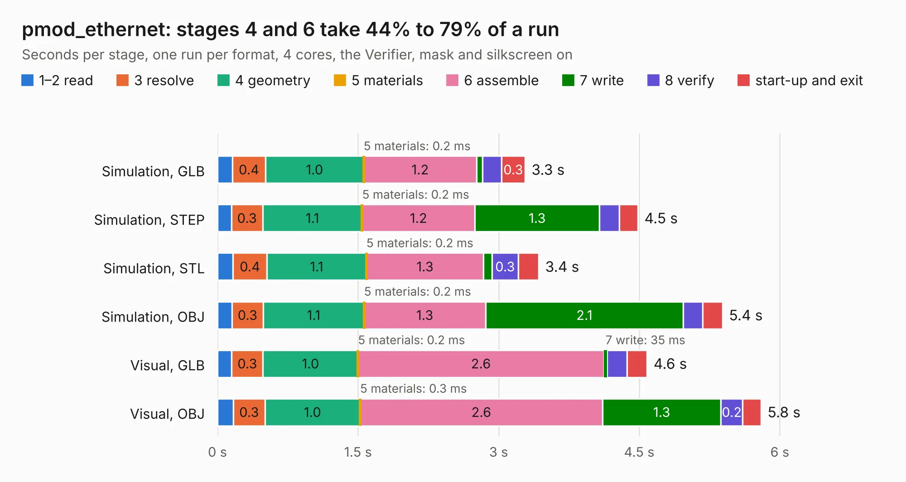

# 1577. pmod_ethernet

Board 1,577 of the 3,106 of [Corpus Testing](../Corpus-Testing.md), on [Corpus Page 15](../CorpusTestingPages/Corpus-Testing-15.md#1577-pmod_ethernet).

| Mode and format | 1–2 read | 3 resolve | 4 geometry | 5 materials | 6 assemble | 7 write | 8 verify | start-up and exit | Total |
|---|---:|---:|---:|---:|---:|---:|---:|---:|---:|
| Simulation, GLB | 0.2 | 0.4 | 1.0 | 0.2&nbsp;ms | 1.2 | 60&nbsp;ms | 0.2 | 0.3 | 3.3 |
| Simulation, STEP | 0.1 | 0.3 | 1.1 | 0.2&nbsp;ms | 1.2 | 1.3 | 0.2 | 0.2 | 4.5 |
| Simulation, STL | 0.2 | 0.4 | 1.1 | 0.2&nbsp;ms | 1.3 | 88&nbsp;ms | 0.3 | 0.2 | 3.4 |
| Simulation, OBJ | 0.2 | 0.3 | 1.1 | 0.2&nbsp;ms | 1.3 | 2.1 | 0.2 | 0.2 | 5.4 |
| Visual, GLB | 0.2 | 0.3 | 1.0 | 0.2&nbsp;ms | 2.6 | 35&nbsp;ms | 0.2 | 0.2 | 4.6 |
| Visual, OBJ | 0.2 | 0.3 | 1.0 | 0.3&nbsp;ms | 2.6 | 1.3 | 0.2 | 0.2 | 5.8 |

<table align="center"><tr><td valign="top">

| Board | Repo: [machdyne/katze](https://github.com/machdyne/katze) Board: `pmod_ethernet.kicad_pcb` |
|---|---|
| Folder | pcb / katze_v1 |
| Complexity | 248&nbsp;/&nbsp;1000 (size&nbsp;163, features&nbsp;85) |
| KESE&nbsp;features | through vias, rounded, trapezoid or chamfered pads, filled zones, curved board outline, stack-up, dielectric εr and tanδ |
| Tested | 9th November 2026 |
| Copper&nbsp;layers | 4 |
| File&nbsp;format | KiCad 6 (20211014) |
| Parts,&nbsp;tracks,&nbsp;vias | 21, 257, 30 |
| Triangles,&nbsp;simulation | 385,774 in 40 parts |
| Verifier | PASS in all six runs |

</td><td valign="top">

<table>
<tr><th>File type</th><th>File size</th><th>Peak memory used</th></tr>
<tr><th colspan="3" align="left">Simulation</th></tr>
<tr><td>GLB</td><td align="right">13&nbsp;MB</td><td align="right">261&nbsp;MB</td></tr>
<tr><td>STEP</td><td align="right">48&nbsp;MB</td><td align="right">273&nbsp;MB</td></tr>
<tr><td>STL</td><td align="right">19&nbsp;MB</td><td align="right">255&nbsp;MB</td></tr>
<tr><td>OBJ</td><td align="right">38&nbsp;MB</td><td align="right">278&nbsp;MB</td></tr>
<tr><th colspan="3" align="left">Visual</th></tr>
<tr><td>GLB</td><td align="right">7.7&nbsp;MB</td><td align="right">261&nbsp;MB</td></tr>
<tr><td>OBJ</td><td align="right">23&nbsp;MB</td><td align="right">259&nbsp;MB</td></tr>
</table>

</td></tr></table>

| Previous | Next |
|:---|---:|
| [1576. kaltstahl](b1576b_kaltstahl_kaltstahl.md) | [1578. kuchen](b1578b_kuchen_kuchen.md) |
