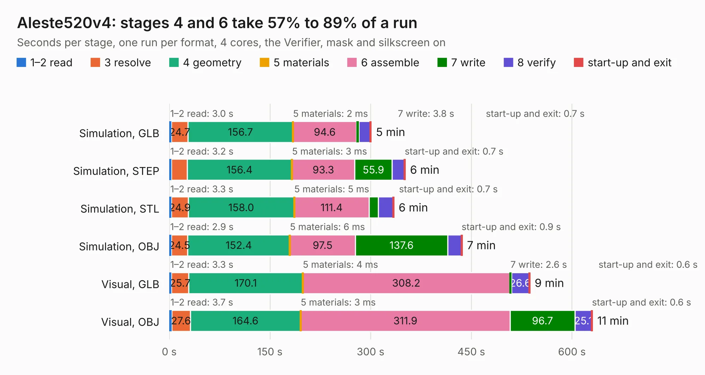

# 1580. Aleste520v4

Board 1,580 of the 3,126 of [Corpus Testing](../Corpus-Testing.md), on [Corpus Page 15](../CorpusTestingPages/Corpus-Testing-15.md#1580-aleste520v4).

| Mode and format | 1–2 read | 3 resolve | 4 geometry | 5 materials | 6 assemble | 7 write | 8 verify | start-up and exit | Total |
|---|---:|---:|---:|---:|---:|---:|---:|---:|---:|
| Simulation, GLB | 3.0 | 24.7 | 156.7 | 2&nbsp;ms | 94.6 | 3.8 | 16.9 | 0.7 | 300.4 |
| Simulation, STEP | 3.2 | 23.4 | 156.4 | 3&nbsp;ms | 93.3 | 55.9 | 18.5 | 0.7 | 351.3 |
| Simulation, STL | 3.3 | 24.9 | 158.0 | 5&nbsp;ms | 111.4 | 14.0 | 21.9 | 0.7 | 334.3 |
| Simulation, OBJ | 2.9 | 24.5 | 152.4 | 6&nbsp;ms | 97.5 | 137.6 | 20.2 | 0.9 | 436.1 |
| Visual, GLB | 3.3 | 25.7 | 170.1 | 4&nbsp;ms | 308.2 | 2.6 | 26.6 | 0.6 | 536.9 |
| Visual, OBJ | 3.7 | 27.6 | 164.6 | 3&nbsp;ms | 311.9 | 96.7 | 25.1 | 0.6 | 630.2 |

<table align="center"><tr><td valign="top">

| Board | Repo: [lucedoriente/Aleste520ex](https://github.com/lucedoriente/Aleste520ex) Board: `Aleste520v4.kicad_pcb` |
|---|---|
| Folder | board |
| Complexity | 318&nbsp;/&nbsp;1000 (size&nbsp;243, features&nbsp;75) |
| KESE&nbsp;features | through vias, rounded, trapezoid or chamfered pads, filled zones, stack-up, dielectric εr and tanδ |
| Tested | 9th November 2026 to 10th November 2026 |
| Copper&nbsp;layers | 2 |
| File&nbsp;format | KiCad 9 (20241229) |
| Parts,&nbsp;tracks,&nbsp;vias | 326, 9,389, 4,195 |
| Triangles,&nbsp;simulation | 19,250,030 in 466 parts |
| Verifier | PASS in all six runs |
| Run&nbsp;again | Simulation, OBJ: failed in the corpus run, run again with the memory cap raised from 11 GB to 14.5 GB, and passed |

</td><td valign="top">

<table>
<tr><th>File type</th><th>File size</th><th>Peak memory used</th></tr>
<tr><th colspan="3" align="left">Simulation</th></tr>
<tr><td>GLB</td><td align="right">660&nbsp;MB</td><td align="right">5.3&nbsp;GB</td></tr>
<tr><td>STEP</td><td align="right">3.1&nbsp;GB</td><td align="right">6.9&nbsp;GB</td></tr>
<tr><td>STL</td><td align="right">963&nbsp;MB</td><td align="right">5.7&nbsp;GB</td></tr>
<tr><td>OBJ</td><td align="right">2.1&nbsp;GB</td><td align="right">12&nbsp;GB</td></tr>
<tr><th colspan="3" align="left">Visual</th></tr>
<tr><td>GLB</td><td align="right">430&nbsp;MB</td><td align="right">6.7&nbsp;GB</td></tr>
<tr><td>OBJ</td><td align="right">1.4&nbsp;GB</td><td align="right">8.4&nbsp;GB</td></tr>
</table>

</td></tr></table>

| Previous | Next |
|:---|---:|
| [1579. [DFR1142]Lite Carrier for LattePanda Mu](b1579b_mubook_DFR1142-Lite-Carrier-for-LattePanda-Mu.md) | [1581. Aleste520_Keyboard](b1581b_Aleste520ex_Aleste520-Keyboard.md) |
