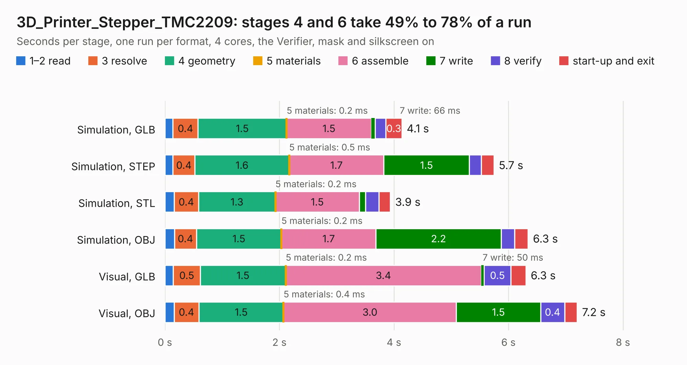

# 1581. 3D_Printer_Stepper_TMC2209

Board 1,581 of the 3,119 of [Corpus Testing](../Corpus-Testing.md), on [Corpus Page 15](../CorpusTestingPages/Corpus-Testing-15.md#1581-3d_printer_stepper_tmc2209).

| Mode and format | 1–2 read | 3 resolve | 4 geometry | 5 materials | 6 assemble | 7 write | 8 verify | start-up and exit | Total |
|---|---:|---:|---:|---:|---:|---:|---:|---:|---:|
| Simulation, GLB | 0.1 | 0.4 | 1.5 | 0.2&nbsp;ms | 1.5 | 66&nbsp;ms | 0.2 | 0.3 | 4.1 |
| Simulation, STEP | 0.1 | 0.4 | 1.6 | 0.5&nbsp;ms | 1.7 | 1.5 | 0.2 | 0.2 | 5.7 |
| Simulation, STL | 0.2 | 0.4 | 1.3 | 0.2&nbsp;ms | 1.5 | 0.1 | 0.2 | 0.2 | 3.9 |
| Simulation, OBJ | 0.2 | 0.4 | 1.5 | 0.2&nbsp;ms | 1.7 | 2.2 | 0.2 | 0.2 | 6.3 |
| Visual, GLB | 0.1 | 0.5 | 1.5 | 0.2&nbsp;ms | 3.4 | 50&nbsp;ms | 0.5 | 0.3 | 6.3 |
| Visual, OBJ | 0.2 | 0.4 | 1.5 | 0.4&nbsp;ms | 3.0 | 1.5 | 0.4 | 0.2 | 7.2 |

<table align="center"><tr><td valign="top">

| Board | Repo: [m47812/custom-3d-printer-controller](https://github.com/m47812/custom-3d-printer-controller) Board: `3D_Printer_Stepper_TMC2209.kicad_pcb` |
|---|---|
| Folder | 3D_Printer_Motor_Driver |
| Complexity | 257&nbsp;/&nbsp;1000 (size&nbsp;187, features&nbsp;70) |
| KESE&nbsp;features | through vias, custom pads, rounded, trapezoid or chamfered pads, filled zones, copper drawings |
| Tested | 9th November 2026 |
| Copper&nbsp;layers | 2 |
| File&nbsp;format | KiCad 5 (20171130) |
| Parts,&nbsp;tracks,&nbsp;vias | 21, 227, 44 |
| Triangles,&nbsp;simulation | 417,724 in 38 parts |
| Verifier | PASS in all six runs |

</td><td valign="top">

<table>
<tr><th>File type</th><th>File size</th><th>Peak memory used</th></tr>
<tr><th colspan="3" align="left">Simulation</th></tr>
<tr><td>GLB</td><td align="right">14&nbsp;MB</td><td align="right">276&nbsp;MB</td></tr>
<tr><td>STEP</td><td align="right">77&nbsp;MB</td><td align="right">311&nbsp;MB</td></tr>
<tr><td>STL</td><td align="right">21&nbsp;MB</td><td align="right">291&nbsp;MB</td></tr>
<tr><td>OBJ</td><td align="right">42&nbsp;MB</td><td align="right">337&nbsp;MB</td></tr>
<tr><th colspan="3" align="left">Visual</th></tr>
<tr><td>GLB</td><td align="right">11&nbsp;MB</td><td align="right">289&nbsp;MB</td></tr>
<tr><td>OBJ</td><td align="right">31&nbsp;MB</td><td align="right">303&nbsp;MB</td></tr>
</table>

</td></tr></table>

| Previous | Next |
|:---|---:|
| [1580. 3D_Printer_Mainboard_STM32](b1580b_custom-3d-printer-controller_3D-Printer-Mainboard-STM32.md) | [1582. blaustahl](b1582b_blaustahl_blaustahl.md) |
