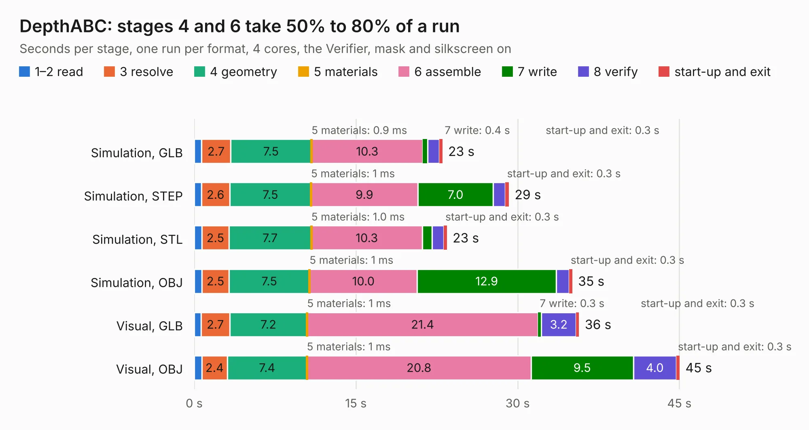

# 1582. DepthABC

Board 1,582 of the 3,126 of [Corpus Testing](../Corpus-Testing.md), on [Corpus Page 15](../CorpusTestingPages/Corpus-Testing-15.md#1582-depthabc).

| Mode and format | 1–2 read | 3 resolve | 4 geometry | 5 materials | 6 assemble | 7 write | 8 verify | start-up and exit | Total |
|---|---:|---:|---:|---:|---:|---:|---:|---:|---:|
| Simulation, GLB | 0.7 | 2.7 | 7.5 | 0.9&nbsp;ms | 10.3 | 0.4 | 1.1 | 0.3 | 23.0 |
| Simulation, STEP | 0.7 | 2.6 | 7.5 | 1&nbsp;ms | 9.9 | 7.0 | 1.1 | 0.3 | 29.2 |
| Simulation, STL | 0.7 | 2.5 | 7.7 | 1.0&nbsp;ms | 10.3 | 0.9 | 1.1 | 0.3 | 23.4 |
| Simulation, OBJ | 0.7 | 2.5 | 7.5 | 1&nbsp;ms | 10.0 | 12.9 | 1.2 | 0.3 | 35.1 |
| Visual, GLB | 0.6 | 2.7 | 7.2 | 1&nbsp;ms | 21.4 | 0.3 | 3.2 | 0.3 | 35.7 |
| Visual, OBJ | 0.7 | 2.4 | 7.4 | 1&nbsp;ms | 20.8 | 9.5 | 4.0 | 0.3 | 45.0 |

<table align="center"><tr><td valign="top">

| Board | Repo: [luxonis/depthai-hardware](https://github.com/luxonis/depthai-hardware) Board: `DepthABC.kicad_pcb` |
|---|---|
| Folder | OSHW_KiCad_Community / Reference Designs (In Progress) / DepthABC |
| Complexity | 315&nbsp;/&nbsp;1000 (size&nbsp;225, features&nbsp;90) |
| KESE&nbsp;features | through vias, custom pads, rounded, trapezoid or chamfered pads, filled zones, copper drawings, copper text, curved board outline |
| Tested | 9th November 2026 |
| Copper&nbsp;layers | 4 |
| File&nbsp;format | KiCad 5 (20171130) |
| Parts,&nbsp;tracks,&nbsp;vias | 83, 5,199, 450 |
| Triangles,&nbsp;simulation | 2,455,628 in 177 parts |
| Verifier | PASS in all six runs |

</td><td valign="top">

<table>
<tr><th>File type</th><th>File size</th><th>Peak memory used</th></tr>
<tr><th colspan="3" align="left">Simulation</th></tr>
<tr><td>GLB</td><td align="right">84&nbsp;MB</td><td align="right">856&nbsp;MB</td></tr>
<tr><td>STEP</td><td align="right">332&nbsp;MB</td><td align="right">1.1&nbsp;GB</td></tr>
<tr><td>STL</td><td align="right">123&nbsp;MB</td><td align="right">859&nbsp;MB</td></tr>
<tr><td>OBJ</td><td align="right">257&nbsp;MB</td><td align="right">1.6&nbsp;GB</td></tr>
<tr><th colspan="3" align="left">Visual</th></tr>
<tr><td>GLB</td><td align="right">60&nbsp;MB</td><td align="right">1.1&nbsp;GB</td></tr>
<tr><td>OBJ</td><td align="right">190&nbsp;MB</td><td align="right">1.3&nbsp;GB</td></tr>
</table>

</td></tr></table>

| Previous | Next |
|:---|---:|
| [1581. Aleste520_Keyboard](b1581b_Aleste520ex_Aleste520-Keyboard.md) | [1583. payload_board](b1583b_SDR-Carrier-Board_payload-board.md) |
