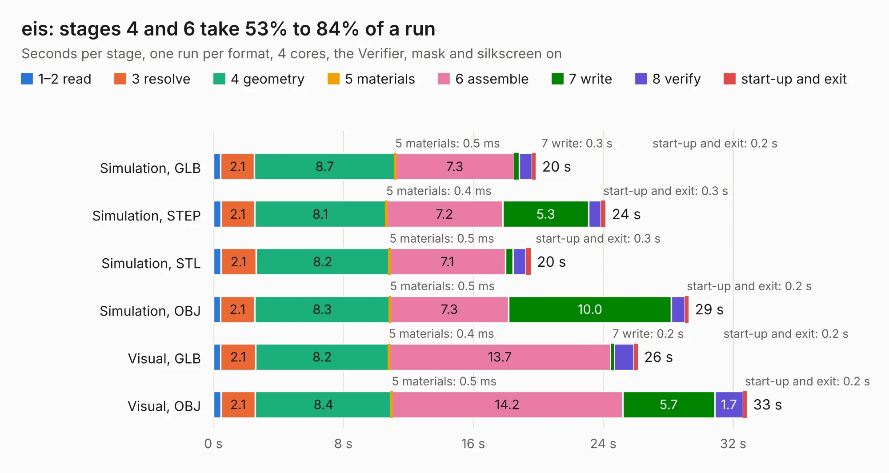

# 1582. eis

Board 1,582 of the 3,118 of [Corpus Testing](../Corpus-Testing.md), on [Corpus Page 15](../CorpusTestingPages/Corpus-Testing-15.md#1582-eis).

| Mode and format | 1–2 read | 3 resolve | 4 geometry | 5 materials | 6 assemble | 7 write | 8 verify | start-up and exit | Total |
|---|---:|---:|---:|---:|---:|---:|---:|---:|---:|
| Simulation, GLB | 0.4 | 2.1 | 8.7 | 0.5&nbsp;ms | 7.3 | 0.3 | 0.8 | 0.2 | 19.8 |
| Simulation, STEP | 0.5 | 2.1 | 8.1 | 0.4&nbsp;ms | 7.2 | 5.3 | 0.8 | 0.3 | 24.1 |
| Simulation, STL | 0.5 | 2.1 | 8.2 | 0.5&nbsp;ms | 7.1 | 0.5 | 0.8 | 0.3 | 19.5 |
| Simulation, OBJ | 0.4 | 2.1 | 8.3 | 0.5&nbsp;ms | 7.3 | 10.0 | 0.8 | 0.2 | 29.3 |
| Visual, GLB | 0.5 | 2.1 | 8.2 | 0.4&nbsp;ms | 13.7 | 0.2 | 1.2 | 0.2 | 26.1 |
| Visual, OBJ | 0.5 | 2.1 | 8.4 | 0.5&nbsp;ms | 14.2 | 5.7 | 1.7 | 0.2 | 32.8 |

<table align="center"><tr><td valign="top">

| Board | Repo: [machdyne/eis](https://github.com/machdyne/eis) Board: `eis.kicad_pcb` |
|---|---|
| Folder | pcb / eis_v0 |
| Complexity | 364&nbsp;/&nbsp;1000 (size&nbsp;269, features&nbsp;95) |
| KESE&nbsp;features | through vias, slotted holes, rounded, trapezoid or chamfered pads, filled zones, curved board outline, stack-up, dielectric εr and tanδ |
| Tested | 9th November 2026 |
| Copper&nbsp;layers | 4 |
| File&nbsp;format | KiCad 6 (20211014) |
| Parts,&nbsp;tracks,&nbsp;vias | 103, 1,474, 220 |
| Triangles,&nbsp;simulation | 1,893,902 in 185 parts |
| Verifier | PASS in all six runs |

</td><td valign="top">

<table>
<tr><th>File type</th><th>File size</th><th>Peak memory used</th></tr>
<tr><th colspan="3" align="left">Simulation</th></tr>
<tr><td>GLB</td><td align="right">65&nbsp;MB</td><td align="right">753&nbsp;MB</td></tr>
<tr><td>STEP</td><td align="right">306&nbsp;MB</td><td align="right">895&nbsp;MB</td></tr>
<tr><td>STL</td><td align="right">95&nbsp;MB</td><td align="right">762&nbsp;MB</td></tr>
<tr><td>OBJ</td><td align="right">200&nbsp;MB</td><td align="right">1.3&nbsp;GB</td></tr>
<tr><th colspan="3" align="left">Visual</th></tr>
<tr><td>GLB</td><td align="right">37&nbsp;MB</td><td align="right">759&nbsp;MB</td></tr>
<tr><td>OBJ</td><td align="right">116&nbsp;MB</td><td align="right">927&nbsp;MB</td></tr>
</table>

</td></tr></table>

| Previous | Next |
|:---|---:|
| [1581. blaustahl](b1581b_blaustahl_blaustahl.md) | [1583. ssx](b1583b_ferrit_ssx.md) |
