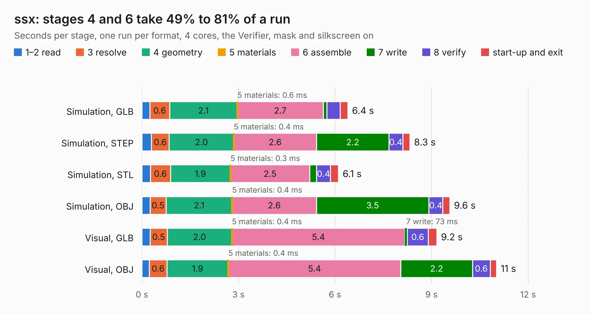

# 1582. ssx

Board 1,582 of the 3,117 of [Corpus Testing](../Corpus-Testing.md), on [Corpus Page 15](../CorpusTestingPages/Corpus-Testing-15.md#1582-ssx).

| Mode and format | 1–2 read | 3 resolve | 4 geometry | 5 materials | 6 assemble | 7 write | 8 verify | start-up and exit | Total |
|---|---:|---:|---:|---:|---:|---:|---:|---:|---:|
| Simulation, GLB | 0.2 | 0.6 | 2.1 | 0.6&nbsp;ms | 2.7 | 0.1 | 0.4 | 0.2 | 6.4 |
| Simulation, STEP | 0.3 | 0.6 | 2.0 | 0.4&nbsp;ms | 2.6 | 2.2 | 0.4 | 0.2 | 8.3 |
| Simulation, STL | 0.3 | 0.6 | 1.9 | 0.3&nbsp;ms | 2.5 | 0.2 | 0.4 | 0.2 | 6.1 |
| Simulation, OBJ | 0.3 | 0.5 | 2.1 | 0.4&nbsp;ms | 2.6 | 3.5 | 0.4 | 0.2 | 9.6 |
| Visual, GLB | 0.3 | 0.5 | 2.0 | 0.4&nbsp;ms | 5.4 | 73&nbsp;ms | 0.6 | 0.3 | 9.2 |
| Visual, OBJ | 0.2 | 0.6 | 1.9 | 0.4&nbsp;ms | 5.4 | 2.2 | 0.6 | 0.2 | 11.0 |

<table align="center"><tr><td valign="top">

| Board | Repo: [machdyne/ferrit](https://github.com/machdyne/ferrit) Board: `ssx.kicad_pcb` |
|---|---|
| Folder | hw / ferrit-1 |
| Complexity | 347&nbsp;/&nbsp;1000 (size&nbsp;222, features&nbsp;125) |
| KESE&nbsp;features | through vias, slotted holes, rounded, trapezoid or chamfered pads, arc tracks, filled zones, curved board outline, TrueType text, stack-up, dielectric εr and tanδ |
| Tested | 9th November 2026 |
| Copper&nbsp;layers | 4 |
| File&nbsp;format | KiCad 10 (20260206) |
| Parts,&nbsp;tracks,&nbsp;vias | 43, 546, 60 |
| Triangles,&nbsp;simulation | 719,896 in 85 parts |
| Verifier | PASS in all six runs |

</td><td valign="top">

<table>
<tr><th>File type</th><th>File size</th><th>Peak memory used</th></tr>
<tr><th colspan="3" align="left">Simulation</th></tr>
<tr><td>GLB</td><td align="right">24&nbsp;MB</td><td align="right">349&nbsp;MB</td></tr>
<tr><td>STEP</td><td align="right">97&nbsp;MB</td><td align="right">435&nbsp;MB</td></tr>
<tr><td>STL</td><td align="right">36&nbsp;MB</td><td align="right">350&nbsp;MB</td></tr>
<tr><td>OBJ</td><td align="right">72&nbsp;MB</td><td align="right">533&nbsp;MB</td></tr>
<tr><th colspan="3" align="left">Visual</th></tr>
<tr><td>GLB</td><td align="right">15&nbsp;MB</td><td align="right">378&nbsp;MB</td></tr>
<tr><td>OBJ</td><td align="right">44&nbsp;MB</td><td align="right">405&nbsp;MB</td></tr>
</table>

</td></tr></table>

| Previous | Next |
|:---|---:|
| [1581. eis](b1581b_eis_eis.md) | [1583. ssu](b1583b_ferrit_ssu.md) |
