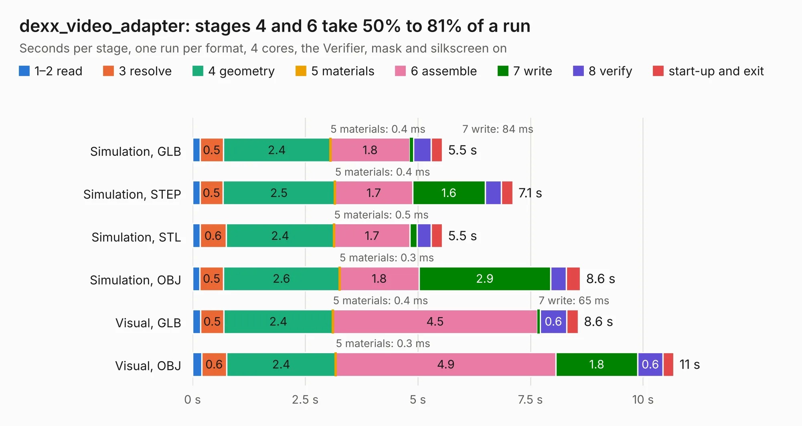

# 1585. dexx_video_adapter

Board 1,585 of the 3,104 of [Corpus Testing](../Corpus-Testing.md), on [Corpus Page 15](../CorpusTestingPages/Corpus-Testing-15.md#1585-dexx_video_adapter).

| Mode and format | 1–2 read | 3 resolve | 4 geometry | 5 materials | 6 assemble | 7 write | 8 verify | start-up and exit | Total |
|---|---:|---:|---:|---:|---:|---:|---:|---:|---:|
| Simulation, GLB | 0.2 | 0.5 | 2.4 | 0.4&nbsp;ms | 1.8 | 84&nbsp;ms | 0.4 | 0.2 | 5.5 |
| Simulation, STEP | 0.2 | 0.5 | 2.5 | 0.4&nbsp;ms | 1.7 | 1.6 | 0.4 | 0.3 | 7.1 |
| Simulation, STL | 0.2 | 0.6 | 2.4 | 0.5&nbsp;ms | 1.7 | 0.2 | 0.3 | 0.2 | 5.5 |
| Simulation, OBJ | 0.2 | 0.5 | 2.6 | 0.3&nbsp;ms | 1.8 | 2.9 | 0.3 | 0.3 | 8.6 |
| Visual, GLB | 0.2 | 0.5 | 2.4 | 0.4&nbsp;ms | 4.5 | 65&nbsp;ms | 0.6 | 0.3 | 8.6 |
| Visual, OBJ | 0.2 | 0.6 | 2.4 | 0.3&nbsp;ms | 4.9 | 1.8 | 0.6 | 0.2 | 10.7 |

<table align="center"><tr><td valign="top">

| Board | Repo: [marqs85/ossc_pro_hw](https://github.com/marqs85/ossc_pro_hw) Board: `dexx_video_adapter.kicad_pcb` |
|---|---|
| Folder | adapters / av_adapter |
| Complexity | 228&nbsp;/&nbsp;1000 (size&nbsp;143, features&nbsp;85) |
| KESE&nbsp;features | through vias, slotted holes, rounded, trapezoid or chamfered pads, filled zones, stack-up, dielectric εr and tanδ |
| Tested | 9th November 2026 |
| Copper&nbsp;layers | 2 |
| File&nbsp;format | KiCad 10 (20260206) |
| Parts,&nbsp;tracks,&nbsp;vias | 11, 107, 109 |
| Triangles,&nbsp;simulation | 538,966 in 36 parts |
| Verifier | PASS in all six runs |

</td><td valign="top">

<table>
<tr><th>File type</th><th>File size</th><th>Peak memory used</th></tr>
<tr><th colspan="3" align="left">Simulation</th></tr>
<tr><td>GLB</td><td align="right">18&nbsp;MB</td><td align="right">317&nbsp;MB</td></tr>
<tr><td>STEP</td><td align="right">64&nbsp;MB</td><td align="right">351&nbsp;MB</td></tr>
<tr><td>STL</td><td align="right">27&nbsp;MB</td><td align="right">331&nbsp;MB</td></tr>
<tr><td>OBJ</td><td align="right">54&nbsp;MB</td><td align="right">397&nbsp;MB</td></tr>
<tr><th colspan="3" align="left">Visual</th></tr>
<tr><td>GLB</td><td align="right">13&nbsp;MB</td><td align="right">366&nbsp;MB</td></tr>
<tr><td>OBJ</td><td align="right">38&nbsp;MB</td><td align="right">358&nbsp;MB</td></tr>
</table>

</td></tr></table>

| Previous | Next |
|:---|---:|
| [1584. pcb](b1584b_huma-rocket-flight-computer_pcb.md) | [1586. pcb1p5_hv_syncfix](b1586b_ossc-pro-hw_pcb1p5-hv-syncfix.md) |
