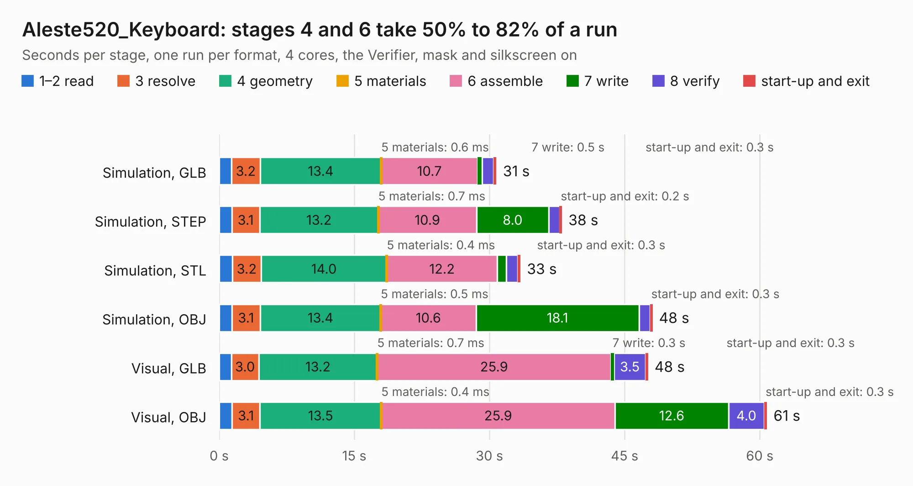

# 1589. Aleste520_Keyboard

Board 1,589 of the 3,138 of [Corpus Testing](../Corpus-Testing.md), on [Corpus Page 15](../CorpusTestingPages/Corpus-Testing-15.md#1589-aleste520_keyboard).

| Mode and format | 1–2 read | 3 resolve | 4 geometry | 5 materials | 6 assemble | 7 write | 8 verify | start-up and exit | Total |
|---|---:|---:|---:|---:|---:|---:|---:|---:|---:|
| Simulation, GLB | 1.4 | 3.2 | 13.4 | 0.6&nbsp;ms | 10.7 | 0.5 | 1.3 | 0.3 | 30.8 |
| Simulation, STEP | 1.4 | 3.1 | 13.2 | 0.7&nbsp;ms | 10.9 | 8.0 | 1.2 | 0.2 | 38.0 |
| Simulation, STL | 1.5 | 3.2 | 14.0 | 0.4&nbsp;ms | 12.2 | 1.0 | 1.2 | 0.3 | 33.4 |
| Simulation, OBJ | 1.4 | 3.1 | 13.4 | 0.5&nbsp;ms | 10.6 | 18.1 | 1.2 | 0.3 | 48.1 |
| Visual, GLB | 1.4 | 3.0 | 13.2 | 0.7&nbsp;ms | 25.9 | 0.3 | 3.5 | 0.3 | 47.6 |
| Visual, OBJ | 1.4 | 3.1 | 13.5 | 0.4&nbsp;ms | 25.9 | 12.6 | 4.0 | 0.3 | 60.8 |

<table align="center"><tr><td valign="top">

| Board | Repo: [lucedoriente/Aleste520ex](https://github.com/lucedoriente/Aleste520ex) Board: `Aleste520_Keyboard.kicad_pcb` |
|---|---|
| Folder | keyboard |
| Complexity | 268&nbsp;/&nbsp;1000 (size&nbsp;233, features&nbsp;35) |
| KESE&nbsp;features | through vias, filled zones |
| Tested | 9th November 2026 |
| Copper&nbsp;layers | 2 |
| File&nbsp;format | KiCad 9 (20241229) |
| Parts,&nbsp;tracks,&nbsp;vias | 167, 17,707, 141 |
| Triangles,&nbsp;simulation | 3,352,674 in 114 parts |
| Verifier | PASS in all six runs |

</td><td valign="top">

<table>
<tr><th>File type</th><th>File size</th><th>Peak memory used</th></tr>
<tr><th colspan="3" align="left">Simulation</th></tr>
<tr><td>GLB</td><td align="right">112&nbsp;MB</td><td align="right">1.4&nbsp;GB</td></tr>
<tr><td>STEP</td><td align="right">438&nbsp;MB</td><td align="right">1.5&nbsp;GB</td></tr>
<tr><td>STL</td><td align="right">168&nbsp;MB</td><td align="right">1.3&nbsp;GB</td></tr>
<tr><td>OBJ</td><td align="right">351&nbsp;MB</td><td align="right">2.2&nbsp;GB</td></tr>
<tr><th colspan="3" align="left">Visual</th></tr>
<tr><td>GLB</td><td align="right">79&nbsp;MB</td><td align="right">1.6&nbsp;GB</td></tr>
<tr><td>OBJ</td><td align="right">246&nbsp;MB</td><td align="right">1.7&nbsp;GB</td></tr>
</table>

</td></tr></table>

| Previous | Next |
|:---|---:|
| [1588. Aleste520v4](b1588b_Aleste520ex_Aleste520v4.md) | [1590. DepthABC](b1590b_depthai-hardware_DepthABC.md) |
