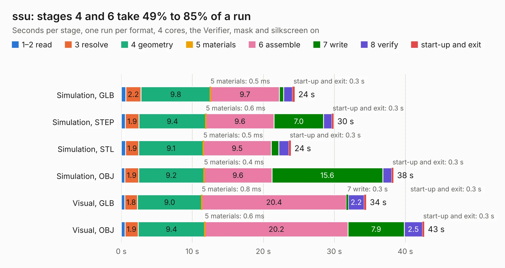

# 1590. ssu

Board 1,590 of the 3,126 of [Corpus Testing](../Corpus-Testing.md), on [Corpus Page 15](../CorpusTestingPages/Corpus-Testing-15.md#1590-ssu).

| Mode and format | 1–2 read | 3 resolve | 4 geometry | 5 materials | 6 assemble | 7 write | 8 verify | start-up and exit | Total |
|---|---:|---:|---:|---:|---:|---:|---:|---:|---:|
| Simulation, GLB | 0.6 | 2.2 | 9.8 | 0.5&nbsp;ms | 9.7 | 0.6 | 1.2 | 0.3 | 24.4 |
| Simulation, STEP | 0.6 | 1.9 | 9.4 | 0.6&nbsp;ms | 9.6 | 7.0 | 1.2 | 0.3 | 29.9 |
| Simulation, STL | 0.6 | 1.9 | 9.1 | 0.5&nbsp;ms | 9.5 | 1.1 | 1.4 | 0.3 | 23.9 |
| Simulation, OBJ | 0.5 | 1.9 | 9.2 | 0.4&nbsp;ms | 9.6 | 15.6 | 1.3 | 0.3 | 38.3 |
| Visual, GLB | 0.5 | 1.8 | 9.0 | 0.8&nbsp;ms | 20.4 | 0.3 | 2.2 | 0.3 | 34.5 |
| Visual, OBJ | 0.5 | 1.9 | 9.4 | 0.6&nbsp;ms | 20.2 | 7.9 | 2.5 | 0.3 | 42.7 |

<table align="center"><tr><td valign="top">

| Board | Repo: [machdyne/ferrit](https://github.com/machdyne/ferrit) Board: `ssu.kicad_pcb` |
|---|---|
| Folder | hw / ferrit-16 |
| Complexity | 306&nbsp;/&nbsp;1000 (size&nbsp;191, features&nbsp;115) |
| KESE&nbsp;features | through vias, rounded, trapezoid or chamfered pads, arc tracks, filled zones, curved board outline, TrueType text, stack-up, dielectric εr and tanδ |
| Tested | 9th November 2026 |
| Copper&nbsp;layers | 4 |
| File&nbsp;format | KiCad 8 (20240108) |
| Parts,&nbsp;tracks,&nbsp;vias | 37, 1,219, 50 |
| Triangles,&nbsp;simulation | 2,954,306 in 46 parts |
| Verifier | PASS in all six runs |

</td><td valign="top">

<table>
<tr><th>File type</th><th>File size</th><th>Peak memory used</th></tr>
<tr><th colspan="3" align="left">Simulation</th></tr>
<tr><td>GLB</td><td align="right">100&nbsp;MB</td><td align="right">1.1&nbsp;GB</td></tr>
<tr><td>STEP</td><td align="right">396&nbsp;MB</td><td align="right">1.2&nbsp;GB</td></tr>
<tr><td>STL</td><td align="right">148&nbsp;MB</td><td align="right">1.0&nbsp;GB</td></tr>
<tr><td>OBJ</td><td align="right">310&nbsp;MB</td><td align="right">1.9&nbsp;GB</td></tr>
<tr><th colspan="3" align="left">Visual</th></tr>
<tr><td>GLB</td><td align="right">52&nbsp;MB</td><td align="right">989&nbsp;MB</td></tr>
<tr><td>OBJ</td><td align="right">161&nbsp;MB</td><td align="right">1.2&nbsp;GB</td></tr>
</table>

</td></tr></table>

| Previous | Next |
|:---|---:|
| [1589. ssx](b1589b_ferrit_ssx.md) | [1591. sxy](b1591b_ferrit_sxy.md) |
