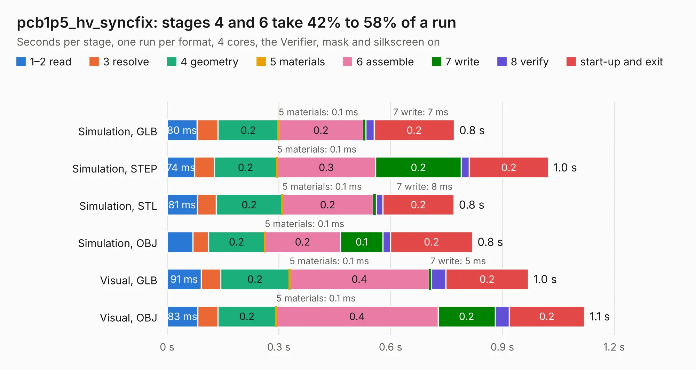

# 1590. pcb1p5_hv_syncfix

Board 1,590 of the 3,108 of [Corpus Testing](../Corpus-Testing.md), on [Corpus Page 15](../CorpusTestingPages/Corpus-Testing-15.md#1590-pcb1p5_hv_syncfix).

| Mode and format | 1–2 read | 3 resolve | 4 geometry | 5 materials | 6 assemble | 7 write | 8 verify | start-up and exit | Total |
|---|---:|---:|---:|---:|---:|---:|---:|---:|---:|
| Simulation, GLB | 80&nbsp;ms | 57&nbsp;ms | 0.2 | 0.1&nbsp;ms | 0.2 | 7&nbsp;ms | 23&nbsp;ms | 0.2 | 0.8 |
| Simulation, STEP | 74&nbsp;ms | 53&nbsp;ms | 0.2 | 0.1&nbsp;ms | 0.3 | 0.2 | 22&nbsp;ms | 0.2 | 1.0 |
| Simulation, STL | 81&nbsp;ms | 51&nbsp;ms | 0.2 | 0.1&nbsp;ms | 0.2 | 8&nbsp;ms | 18&nbsp;ms | 0.2 | 0.8 |
| Simulation, OBJ | 69&nbsp;ms | 42&nbsp;ms | 0.2 | 0.1&nbsp;ms | 0.2 | 0.1 | 20&nbsp;ms | 0.2 | 0.8 |
| Visual, GLB | 91&nbsp;ms | 52&nbsp;ms | 0.2 | 0.1&nbsp;ms | 0.4 | 5&nbsp;ms | 39&nbsp;ms | 0.2 | 1.0 |
| Visual, OBJ | 83&nbsp;ms | 54&nbsp;ms | 0.2 | 0.1&nbsp;ms | 0.4 | 0.2 | 37&nbsp;ms | 0.2 | 1.1 |

<table align="center"><tr><td valign="top">

| Board | Repo: [marqs85/ossc_pro_hw](https://github.com/marqs85/ossc_pro_hw) Board: `pcb1p5_hv_syncfix.kicad_pcb` |
|---|---|
| Folder | adapters / pcb1p5_hv_syncfix |
| Complexity | 170&nbsp;/&nbsp;1000 (size&nbsp;95, features&nbsp;75) |
| KESE&nbsp;features | through vias, rounded, trapezoid or chamfered pads, filled zones, stack-up, dielectric εr and tanδ |
| Tested | 9th November 2026 |
| Copper&nbsp;layers | 2 |
| File&nbsp;format | KiCad 9 (20241229) |
| Parts,&nbsp;tracks,&nbsp;vias | 2, 34, 8 |
| Triangles,&nbsp;simulation | 30,502 in 14 parts |
| Verifier | PASS in all six runs |

</td><td valign="top">

<table>
<tr><th>File type</th><th>File size</th><th>Peak memory used</th></tr>
<tr><th colspan="3" align="left">Simulation</th></tr>
<tr><td>GLB</td><td align="right">1.1&nbsp;MB</td><td align="right">66&nbsp;MB</td></tr>
<tr><td>STEP</td><td align="right">5.1&nbsp;MB</td><td align="right">70&nbsp;MB</td></tr>
<tr><td>STL</td><td align="right">1.5&nbsp;MB</td><td align="right">66&nbsp;MB</td></tr>
<tr><td>OBJ</td><td align="right">2.9&nbsp;MB</td><td align="right">71&nbsp;MB</td></tr>
<tr><th colspan="3" align="left">Visual</th></tr>
<tr><td>GLB</td><td align="right">954&nbsp;kB</td><td align="right">96&nbsp;MB</td></tr>
<tr><td>OBJ</td><td align="right">2.5&nbsp;MB</td><td align="right">98&nbsp;MB</td></tr>
</table>

</td></tr></table>

| Previous | Next |
|:---|---:|
| [1589. dexx_video_adapter](b1589b_ossc-pro-hw_dexx-video-adapter.md) | [1591. panel](b1591b_ossc-pro-hw_panel.md) |
