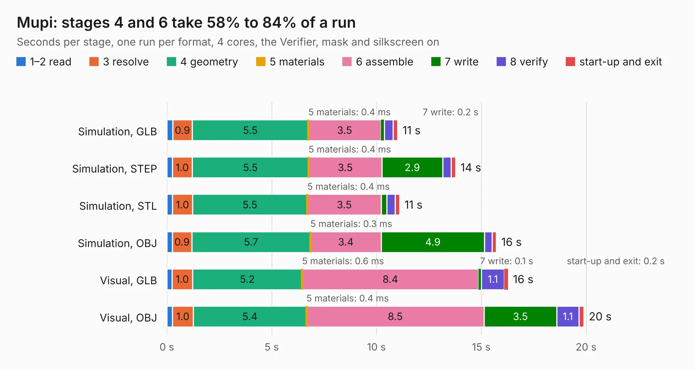

# 1592. Mupi

Board 1,592 of the 3,139 of [Corpus Testing](../Corpus-Testing.md), on [Corpus Page 15](../CorpusTestingPages/Corpus-Testing-15.md#1592-mupi).

| Mode and format | 1–2 read | 3 resolve | 4 geometry | 5 materials | 6 assemble | 7 write | 8 verify | start-up and exit | Total |
|---|---:|---:|---:|---:|---:|---:|---:|---:|---:|
| Simulation, GLB | 0.3 | 0.9 | 5.5 | 0.4&nbsp;ms | 3.5 | 0.2 | 0.4 | 0.2 | 11.0 |
| Simulation, STEP | 0.3 | 1.0 | 5.5 | 0.4&nbsp;ms | 3.5 | 2.9 | 0.4 | 0.2 | 13.8 |
| Simulation, STL | 0.3 | 1.0 | 5.5 | 0.4&nbsp;ms | 3.5 | 0.3 | 0.4 | 0.2 | 11.1 |
| Simulation, OBJ | 0.3 | 0.9 | 5.7 | 0.3&nbsp;ms | 3.4 | 4.9 | 0.4 | 0.2 | 15.7 |
| Visual, GLB | 0.2 | 1.0 | 5.2 | 0.6&nbsp;ms | 8.4 | 0.1 | 1.1 | 0.2 | 16.3 |
| Visual, OBJ | 0.3 | 1.0 | 5.4 | 0.4&nbsp;ms | 8.5 | 3.5 | 1.1 | 0.2 | 19.9 |

<table align="center"><tr><td valign="top">

| Board | Repo: [m47812/custom-3d-printer-controller](https://github.com/m47812/custom-3d-printer-controller) Board: `Mupi.kicad_pcb` |
|---|---|
| Folder | 3D_Printer_Handheld |
| Complexity | 227&nbsp;/&nbsp;1000 (size&nbsp;172, features&nbsp;55) |
| KESE&nbsp;features | through vias, slotted holes, rounded, trapezoid or chamfered pads, filled zones |
| Tested | 9th November 2026 |
| Copper&nbsp;layers | 2 |
| File&nbsp;format | KiCad 5 (20171130) |
| Parts,&nbsp;tracks,&nbsp;vias | 84, 497, 68 |
| Triangles,&nbsp;simulation | 1,166,542 in 73 parts |
| Verifier | PASS in all six runs |

</td><td valign="top">

<table>
<tr><th>File type</th><th>File size</th><th>Peak memory used</th></tr>
<tr><th colspan="3" align="left">Simulation</th></tr>
<tr><td>GLB</td><td align="right">41&nbsp;MB</td><td align="right">562&nbsp;MB</td></tr>
<tr><td>STEP</td><td align="right">213&nbsp;MB</td><td align="right">621&nbsp;MB</td></tr>
<tr><td>STL</td><td align="right">58&nbsp;MB</td><td align="right">563&nbsp;MB</td></tr>
<tr><td>OBJ</td><td align="right">121&nbsp;MB</td><td align="right">801&nbsp;MB</td></tr>
<tr><th colspan="3" align="left">Visual</th></tr>
<tr><td>GLB</td><td align="right">29&nbsp;MB</td><td align="right">608&nbsp;MB</td></tr>
<tr><td>OBJ</td><td align="right">87&nbsp;MB</td><td align="right">665&nbsp;MB</td></tr>
</table>

</td></tr></table>

| Previous | Next |
|:---|---:|
| [1591. payload_board](b1591b_SDR-Carrier-Board_payload-board.md) | [1593. 3D_Printer_Mainboard_STM32](b1593b_custom-3d-printer-controller_3D-Printer-Mainboard-STM32.md) |
