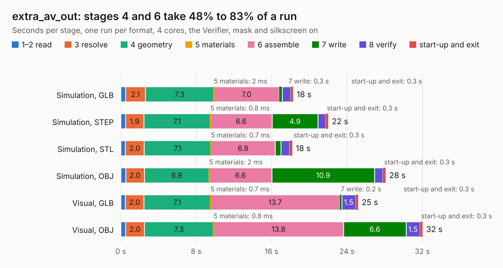

# 1592. extra_av_out

Board 1,592 of the 3,108 of [Corpus Testing](../Corpus-Testing.md), on [Corpus Page 15](../CorpusTestingPages/Corpus-Testing-15.md#1592-extra_av_out).

| Mode and format | 1–2 read | 3 resolve | 4 geometry | 5 materials | 6 assemble | 7 write | 8 verify | start-up and exit | Total |
|---|---:|---:|---:|---:|---:|---:|---:|---:|---:|
| Simulation, GLB | 0.5 | 2.1 | 7.3 | 2&nbsp;ms | 7.0 | 0.3 | 0.9 | 0.3 | 18.3 |
| Simulation, STEP | 0.5 | 1.9 | 7.1 | 0.8&nbsp;ms | 6.6 | 4.9 | 0.8 | 0.3 | 22.0 |
| Simulation, STL | 0.5 | 2.0 | 7.1 | 0.7&nbsp;ms | 6.8 | 0.6 | 0.9 | 0.3 | 18.2 |
| Simulation, OBJ | 0.5 | 2.0 | 6.9 | 2&nbsp;ms | 6.6 | 10.9 | 0.9 | 0.3 | 28.1 |
| Visual, GLB | 0.5 | 2.0 | 7.1 | 0.7&nbsp;ms | 13.7 | 0.2 | 1.5 | 0.3 | 25.2 |
| Visual, OBJ | 0.5 | 2.0 | 7.3 | 0.8&nbsp;ms | 13.8 | 6.6 | 1.5 | 0.3 | 32.0 |

<table align="center"><tr><td valign="top">

| Board | Repo: [marqs85/ossc_pro_hw](https://github.com/marqs85/ossc_pro_hw) Board: `extra_av_out.kicad_pcb` |
|---|---|
| Folder | expansions / extra_av_out |
| Complexity | 297&nbsp;/&nbsp;1000 (size&nbsp;242, features&nbsp;55) |
| KESE&nbsp;features | through vias, slotted holes, rounded, trapezoid or chamfered pads, filled zones |
| Tested | 9th November 2026 |
| Copper&nbsp;layers | 4 |
| File&nbsp;format | KiCad 10 (20260206) |
| Parts,&nbsp;tracks,&nbsp;vias | 73, 800, 316 |
| Triangles,&nbsp;simulation | 1,899,088 in 111 parts |
| Verifier | PASS in all six runs |

</td><td valign="top">

<table>
<tr><th>File type</th><th>File size</th><th>Peak memory used</th></tr>
<tr><th colspan="3" align="left">Simulation</th></tr>
<tr><td>GLB</td><td align="right">64&nbsp;MB</td><td align="right">723&nbsp;MB</td></tr>
<tr><td>STEP</td><td align="right">215&nbsp;MB</td><td align="right">860&nbsp;MB</td></tr>
<tr><td>STL</td><td align="right">95&nbsp;MB</td><td align="right">712&nbsp;MB</td></tr>
<tr><td>OBJ</td><td align="right">196&nbsp;MB</td><td align="right">1.3&nbsp;GB</td></tr>
<tr><th colspan="3" align="left">Visual</th></tr>
<tr><td>GLB</td><td align="right">38&nbsp;MB</td><td align="right">744&nbsp;MB</td></tr>
<tr><td>OBJ</td><td align="right">114&nbsp;MB</td><td align="right">861&nbsp;MB</td></tr>
</table>

</td></tr></table>

| Previous | Next |
|:---|---:|
| [1591. panel](b1591b_ossc-pro-hw_panel.md) | [1593. legacy_av_in](b1593b_ossc-pro-hw_legacy-av-in.md) |
