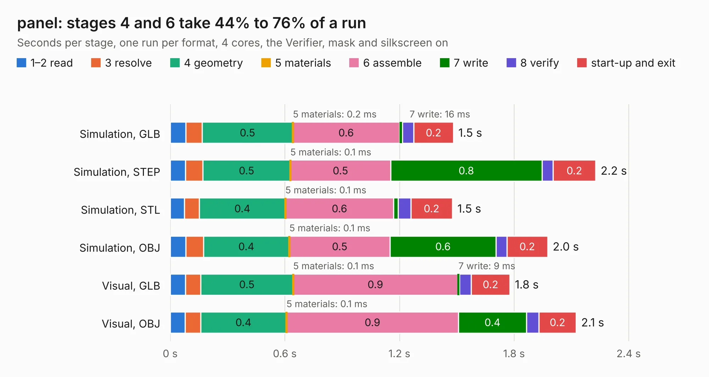

# 1592. panel

Board 1,592 of the 3,109 of [Corpus Testing](../Corpus-Testing.md), on [Corpus Page 15](../CorpusTestingPages/Corpus-Testing-15.md#1592-panel).

| Mode and format | 1–2 read | 3 resolve | 4 geometry | 5 materials | 6 assemble | 7 write | 8 verify | start-up and exit | Total |
|---|---:|---:|---:|---:|---:|---:|---:|---:|---:|
| Simulation, GLB | 82&nbsp;ms | 85&nbsp;ms | 0.5 | 0.2&nbsp;ms | 0.6 | 16&nbsp;ms | 59&nbsp;ms | 0.2 | 1.5 |
| Simulation, STEP | 80&nbsp;ms | 91&nbsp;ms | 0.5 | 0.1&nbsp;ms | 0.5 | 0.8 | 58&nbsp;ms | 0.2 | 2.2 |
| Simulation, STL | 74&nbsp;ms | 79&nbsp;ms | 0.4 | 0.1&nbsp;ms | 0.6 | 23&nbsp;ms | 67&nbsp;ms | 0.2 | 1.5 |
| Simulation, OBJ | 81&nbsp;ms | 93&nbsp;ms | 0.4 | 0.1&nbsp;ms | 0.5 | 0.6 | 57&nbsp;ms | 0.2 | 2.0 |
| Visual, GLB | 79&nbsp;ms | 80&nbsp;ms | 0.5 | 0.1&nbsp;ms | 0.9 | 9&nbsp;ms | 62&nbsp;ms | 0.2 | 1.8 |
| Visual, OBJ | 78&nbsp;ms | 81&nbsp;ms | 0.4 | 0.1&nbsp;ms | 0.9 | 0.4 | 65&nbsp;ms | 0.2 | 2.1 |

<table align="center"><tr><td valign="top">

| Board | Repo: [marqs85/ossc_pro_hw](https://github.com/marqs85/ossc_pro_hw) Board: `panel.kicad_pcb` |
|---|---|
| Folder | buttonpanel |
| Complexity | 87&nbsp;/&nbsp;1000 (size&nbsp;87, features&nbsp;0) |
| Tested | 9th November 2026 |
| Copper&nbsp;layers | 2 |
| File&nbsp;format | KiCad 5 (20171130) |
| Parts,&nbsp;tracks,&nbsp;vias | 5, 21, 0 |
| Triangles,&nbsp;simulation | 100,836 in 19 parts |
| Note | panel |
| Verifier | PASS in all six runs |

</td><td valign="top">

<table>
<tr><th>File type</th><th>File size</th><th>Peak memory used</th></tr>
<tr><th colspan="3" align="left">Simulation</th></tr>
<tr><td>GLB</td><td align="right">3.5&nbsp;MB</td><td align="right">176&nbsp;MB</td></tr>
<tr><td>STEP</td><td align="right">15&nbsp;MB</td><td align="right">182&nbsp;MB</td></tr>
<tr><td>STL</td><td align="right">5.0&nbsp;MB</td><td align="right">181&nbsp;MB</td></tr>
<tr><td>OBJ</td><td align="right">9.7&nbsp;MB</td><td align="right">178&nbsp;MB</td></tr>
<tr><th colspan="3" align="left">Visual</th></tr>
<tr><td>GLB</td><td align="right">1.7&nbsp;MB</td><td align="right">154&nbsp;MB</td></tr>
<tr><td>OBJ</td><td align="right">4.7&nbsp;MB</td><td align="right">153&nbsp;MB</td></tr>
</table>

</td></tr></table>

| Previous | Next |
|:---|---:|
| [1591. pcb1p5_hv_syncfix](b1591b_ossc-pro-hw_pcb1p5-hv-syncfix.md) | [1593. extra_av_out](b1593b_ossc-pro-hw_extra-av-out.md) |
