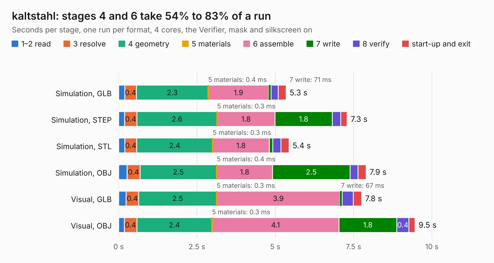

# 1593. kaltstahl

Board 1,593 of the 3,128 of [Corpus Testing](../Corpus-Testing.md), on [Corpus Page 15](../CorpusTestingPages/Corpus-Testing-15.md#1593-kaltstahl).

| Mode and format | 1–2 read | 3 resolve | 4 geometry | 5 materials | 6 assemble | 7 write | 8 verify | start-up and exit | Total |
|---|---:|---:|---:|---:|---:|---:|---:|---:|---:|
| Simulation, GLB | 0.2 | 0.4 | 2.3 | 0.4&nbsp;ms | 1.9 | 71&nbsp;ms | 0.2 | 0.3 | 5.3 |
| Simulation, STEP | 0.2 | 0.4 | 2.6 | 0.3&nbsp;ms | 1.8 | 1.8 | 0.3 | 0.2 | 7.3 |
| Simulation, STL | 0.2 | 0.4 | 2.4 | 0.3&nbsp;ms | 1.8 | 0.1 | 0.3 | 0.3 | 5.4 |
| Simulation, OBJ | 0.3 | 0.4 | 2.5 | 0.4&nbsp;ms | 1.8 | 2.5 | 0.2 | 0.3 | 7.9 |
| Visual, GLB | 0.2 | 0.4 | 2.5 | 0.3&nbsp;ms | 3.9 | 67&nbsp;ms | 0.4 | 0.3 | 7.8 |
| Visual, OBJ | 0.2 | 0.4 | 2.4 | 0.3&nbsp;ms | 4.1 | 1.8 | 0.4 | 0.2 | 9.5 |

<table align="center"><tr><td valign="top">

| Board | Repo: [machdyne/kaltstahl](https://github.com/machdyne/kaltstahl) Board: `kaltstahl.kicad_pcb` |
|---|---|
| Folder | pcb / kaltstahl_v0 |
| Complexity | 296&nbsp;/&nbsp;1000 (size&nbsp;201, features&nbsp;95) |
| KESE&nbsp;features | through vias, slotted holes, rounded, trapezoid or chamfered pads, filled zones, curved board outline, stack-up, dielectric εr and tanδ |
| Tested | 9th November 2026 |
| Copper&nbsp;layers | 2 |
| File&nbsp;format | KiCad 8 (20240108) |
| Parts,&nbsp;tracks,&nbsp;vias | 39, 409, 61 |
| Triangles,&nbsp;simulation | 393,460 in 66 parts |
| Verifier | PASS in all six runs |

</td><td valign="top">

<table>
<tr><th>File type</th><th>File size</th><th>Peak memory used</th></tr>
<tr><th colspan="3" align="left">Simulation</th></tr>
<tr><td>GLB</td><td align="right">14&nbsp;MB</td><td align="right">293&nbsp;MB</td></tr>
<tr><td>STEP</td><td align="right">76&nbsp;MB</td><td align="right">341&nbsp;MB</td></tr>
<tr><td>STL</td><td align="right">20&nbsp;MB</td><td align="right">287&nbsp;MB</td></tr>
<tr><td>OBJ</td><td align="right">40&nbsp;MB</td><td align="right">331&nbsp;MB</td></tr>
<tr><th colspan="3" align="left">Visual</th></tr>
<tr><td>GLB</td><td align="right">9.9&nbsp;MB</td><td align="right">313&nbsp;MB</td></tr>
<tr><td>OBJ</td><td align="right">29&nbsp;MB</td><td align="right">318&nbsp;MB</td></tr>
</table>

</td></tr></table>

| Previous | Next |
|:---|---:|
| [1592. sxa](b1592b_ferrit_sxa.md) | [1594. pmod_ethernet](b1594b_katze_pmod-ethernet.md) |
