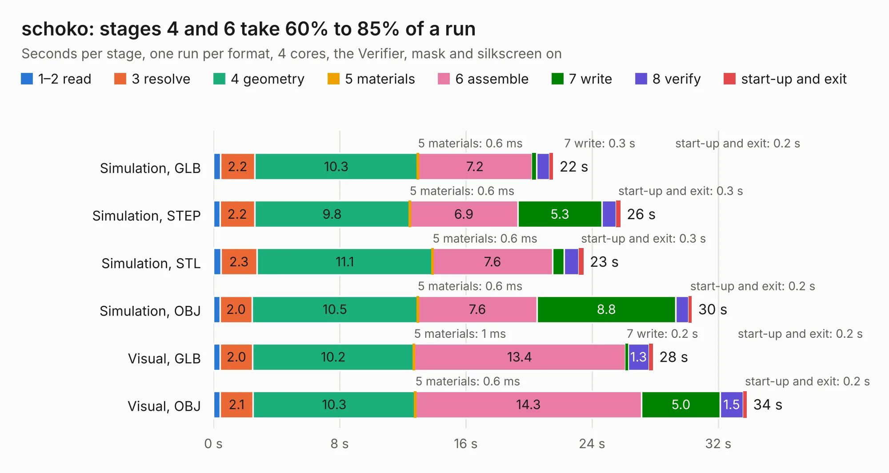

# 1594. schoko

Board 1,594 of the 3,119 of [Corpus Testing](../Corpus-Testing.md), on [Corpus Page 15](../CorpusTestingPages/Corpus-Testing-15.md#1594-schoko).

| Mode and format | 1–2 read | 3 resolve | 4 geometry | 5 materials | 6 assemble | 7 write | 8 verify | start-up and exit | Total |
|---|---:|---:|---:|---:|---:|---:|---:|---:|---:|
| Simulation, GLB | 0.4 | 2.2 | 10.3 | 0.6&nbsp;ms | 7.2 | 0.3 | 0.8 | 0.2 | 21.5 |
| Simulation, STEP | 0.4 | 2.2 | 9.8 | 0.6&nbsp;ms | 6.9 | 5.3 | 0.9 | 0.3 | 25.8 |
| Simulation, STL | 0.5 | 2.3 | 11.1 | 0.6&nbsp;ms | 7.6 | 0.7 | 0.9 | 0.3 | 23.5 |
| Simulation, OBJ | 0.4 | 2.0 | 10.5 | 0.6&nbsp;ms | 7.6 | 8.8 | 0.8 | 0.2 | 30.3 |
| Visual, GLB | 0.4 | 2.0 | 10.2 | 1&nbsp;ms | 13.4 | 0.2 | 1.3 | 0.2 | 27.9 |
| Visual, OBJ | 0.4 | 2.1 | 10.3 | 0.6&nbsp;ms | 14.3 | 5.0 | 1.5 | 0.2 | 33.8 |

<table align="center"><tr><td valign="top">

| Board | Repo: [machdyne/schoko](https://github.com/machdyne/schoko) Board: `schoko.kicad_pcb` |
|---|---|
| Folder | pcb / schoko_v2 |
| Complexity | 357&nbsp;/&nbsp;1000 (size&nbsp;262, features&nbsp;95) |
| KESE&nbsp;features | through vias, slotted holes, rounded, trapezoid or chamfered pads, filled zones, curved board outline, stack-up, dielectric εr and tanδ |
| Tested | 9th November 2026 |
| Copper&nbsp;layers | 4 |
| File&nbsp;format | KiCad 6 (20211014) |
| Parts,&nbsp;tracks,&nbsp;vias | 108, 1,544, 207 |
| Triangles,&nbsp;simulation | 2,133,590 in 269 parts |
| Verifier | PASS in all six runs |

</td><td valign="top">

<table>
<tr><th>File type</th><th>File size</th><th>Peak memory used</th></tr>
<tr><th colspan="3" align="left">Simulation</th></tr>
<tr><td>GLB</td><td align="right">73&nbsp;MB</td><td align="right">774&nbsp;MB</td></tr>
<tr><td>STEP</td><td align="right">349&nbsp;MB</td><td align="right">972&nbsp;MB</td></tr>
<tr><td>STL</td><td align="right">107&nbsp;MB</td><td align="right">728&nbsp;MB</td></tr>
<tr><td>OBJ</td><td align="right">227&nbsp;MB</td><td align="right">1.4&nbsp;GB</td></tr>
<tr><th colspan="3" align="left">Visual</th></tr>
<tr><td>GLB</td><td align="right">41&nbsp;MB</td><td align="right">978&nbsp;MB</td></tr>
<tr><td>OBJ</td><td align="right">127&nbsp;MB</td><td align="right">1.0&nbsp;GB</td></tr>
</table>

</td></tr></table>

| Previous | Next |
|:---|---:|
| [1593. riegel](b1593b_riegel_riegel.md) | [1595. Main](b1595b_oomwoo-pcb_Main.md) |
