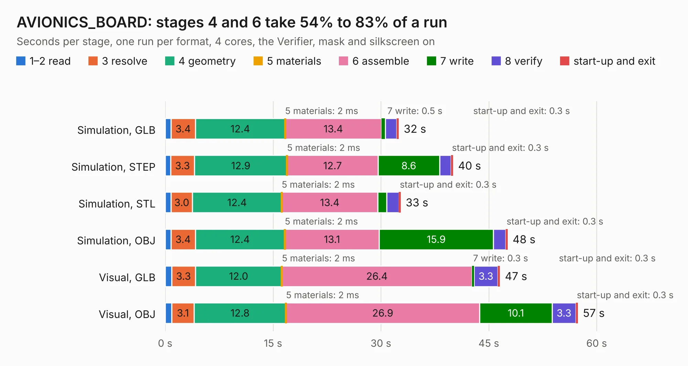

# 1597. AVIONICS_BOARD

Board 1,597 of the 3,107 of [Corpus Testing](../Corpus-Testing.md), on [Corpus Page 15](../CorpusTestingPages/Corpus-Testing-15.md#1597-avionics_board).

| Mode and format | 1–2 read | 3 resolve | 4 geometry | 5 materials | 6 assemble | 7 write | 8 verify | start-up and exit | Total |
|---|---:|---:|---:|---:|---:|---:|---:|---:|---:|
| Simulation, GLB | 0.8 | 3.4 | 12.4 | 2&nbsp;ms | 13.4 | 0.5 | 1.6 | 0.3 | 32.5 |
| Simulation, STEP | 0.7 | 3.3 | 12.9 | 2&nbsp;ms | 12.7 | 8.6 | 1.6 | 0.3 | 40.0 |
| Simulation, STL | 0.8 | 3.0 | 12.4 | 2&nbsp;ms | 13.4 | 1.2 | 1.7 | 0.3 | 32.8 |
| Simulation, OBJ | 0.8 | 3.4 | 12.4 | 2&nbsp;ms | 13.1 | 15.9 | 1.7 | 0.3 | 47.6 |
| Visual, GLB | 0.9 | 3.3 | 12.0 | 2&nbsp;ms | 26.4 | 0.3 | 3.3 | 0.3 | 46.6 |
| Visual, OBJ | 0.9 | 3.1 | 12.8 | 2&nbsp;ms | 26.9 | 10.1 | 3.3 | 0.3 | 57.4 |

<table align="center"><tr><td valign="top">

| Board | Repo: [matthiasgeorgimhof/hardware_csat](https://github.com/matthiasgeorgimhof/hardware_csat) Board: `AVIONICS_BOARD.kicad_pcb` |
|---|---|
| Folder | avionics_board |
| Complexity | 367&nbsp;/&nbsp;1000 (size&nbsp;262, features&nbsp;105) |
| KESE&nbsp;features | through vias, slotted holes, rounded, trapezoid or chamfered pads, drill offsets, filled zones, curved board outline, stack-up, dielectric εr and tanδ |
| Tested | 9th November 2026 |
| Copper&nbsp;layers | 4 |
| File&nbsp;format | KiCad 9 (20241229) |
| Parts,&nbsp;tracks,&nbsp;vias | 182, 2,001, 367 |
| Triangles,&nbsp;simulation | 3,369,990 in 275 parts |
| Verifier | PASS in all six runs |

</td><td valign="top">

<table>
<tr><th>File type</th><th>File size</th><th>Peak memory used</th></tr>
<tr><th colspan="3" align="left">Simulation</th></tr>
<tr><td>GLB</td><td align="right">113&nbsp;MB</td><td align="right">1.1&nbsp;GB</td></tr>
<tr><td>STEP</td><td align="right">435&nbsp;MB</td><td align="right">1.4&nbsp;GB</td></tr>
<tr><td>STL</td><td align="right">169&nbsp;MB</td><td align="right">1.1&nbsp;GB</td></tr>
<tr><td>OBJ</td><td align="right">355&nbsp;MB</td><td align="right">2.2&nbsp;GB</td></tr>
<tr><th colspan="3" align="left">Visual</th></tr>
<tr><td>GLB</td><td align="right">69&nbsp;MB</td><td align="right">1.3&nbsp;GB</td></tr>
<tr><td>OBJ</td><td align="right">217&nbsp;MB</td><td align="right">1.4&nbsp;GB</td></tr>
</table>

</td></tr></table>

| Previous | Next |
|:---|---:|
| [1596. auxio_board](b1596b_hardware-csat_auxio-board.md) | [1598. comm_board](b1598b_hardware-csat_comm-board.md) |
