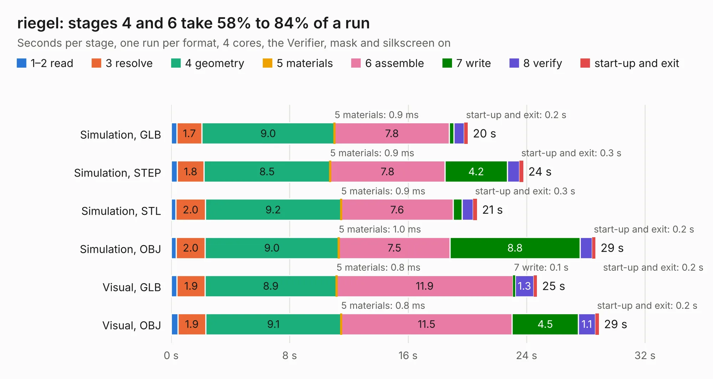

# 1597. riegel

Board 1,597 of the 3,125 of [Corpus Testing](../Corpus-Testing.md), on [Corpus Page 15](../CorpusTestingPages/Corpus-Testing-15.md#1597-riegel).

| Mode and format | 1–2 read | 3 resolve | 4 geometry | 5 materials | 6 assemble | 7 write | 8 verify | start-up and exit | Total |
|---|---:|---:|---:|---:|---:|---:|---:|---:|---:|
| Simulation, GLB | 0.4 | 1.7 | 9.0 | 0.9&nbsp;ms | 7.8 | 0.3 | 0.7 | 0.2 | 20.0 |
| Simulation, STEP | 0.4 | 1.8 | 8.5 | 0.9&nbsp;ms | 7.8 | 4.2 | 0.8 | 0.3 | 23.8 |
| Simulation, STL | 0.3 | 2.0 | 9.2 | 0.9&nbsp;ms | 7.6 | 0.6 | 0.8 | 0.3 | 20.7 |
| Simulation, OBJ | 0.3 | 2.0 | 9.0 | 1.0&nbsp;ms | 7.5 | 8.8 | 0.8 | 0.2 | 28.7 |
| Visual, GLB | 0.4 | 1.9 | 8.9 | 0.8&nbsp;ms | 11.9 | 0.1 | 1.3 | 0.2 | 24.7 |
| Visual, OBJ | 0.5 | 1.9 | 9.1 | 0.8&nbsp;ms | 11.5 | 4.5 | 1.1 | 0.2 | 28.9 |

<table align="center"><tr><td valign="top">

| Board | Repo: [machdyne/riegel](https://github.com/machdyne/riegel) Board: `riegel.kicad_pcb` |
|---|---|
| Folder | pcb / riegel_v4 |
| Complexity | 358&nbsp;/&nbsp;1000 (size&nbsp;263, features&nbsp;95) |
| KESE&nbsp;features | through vias, slotted holes, rounded, trapezoid or chamfered pads, filled zones, curved board outline, stack-up, dielectric εr and tanδ |
| Tested | 9th November 2026 |
| Copper&nbsp;layers | 4 |
| File&nbsp;format | KiCad 6 (20211014) |
| Parts,&nbsp;tracks,&nbsp;vias | 89, 1,297, 157 |
| Triangles,&nbsp;simulation | 1,733,082 in 152 parts |
| Verifier | PASS in all six runs |

</td><td valign="top">

<table>
<tr><th>File type</th><th>File size</th><th>Peak memory used</th></tr>
<tr><th colspan="3" align="left">Simulation</th></tr>
<tr><td>GLB</td><td align="right">59&nbsp;MB</td><td align="right">622&nbsp;MB</td></tr>
<tr><td>STEP</td><td align="right">278&nbsp;MB</td><td align="right">791&nbsp;MB</td></tr>
<tr><td>STL</td><td align="right">87&nbsp;MB</td><td align="right">617&nbsp;MB</td></tr>
<tr><td>OBJ</td><td align="right">182&nbsp;MB</td><td align="right">1.2&nbsp;GB</td></tr>
<tr><th colspan="3" align="left">Visual</th></tr>
<tr><td>GLB</td><td align="right">33&nbsp;MB</td><td align="right">682&nbsp;MB</td></tr>
<tr><td>OBJ</td><td align="right">100&nbsp;MB</td><td align="right">790&nbsp;MB</td></tr>
</table>

</td></tr></table>

| Previous | Next |
|:---|---:|
| [1596. obst](b1596b_obst_obst.md) | [1598. schoko](b1598b_schoko_schoko.md) |
