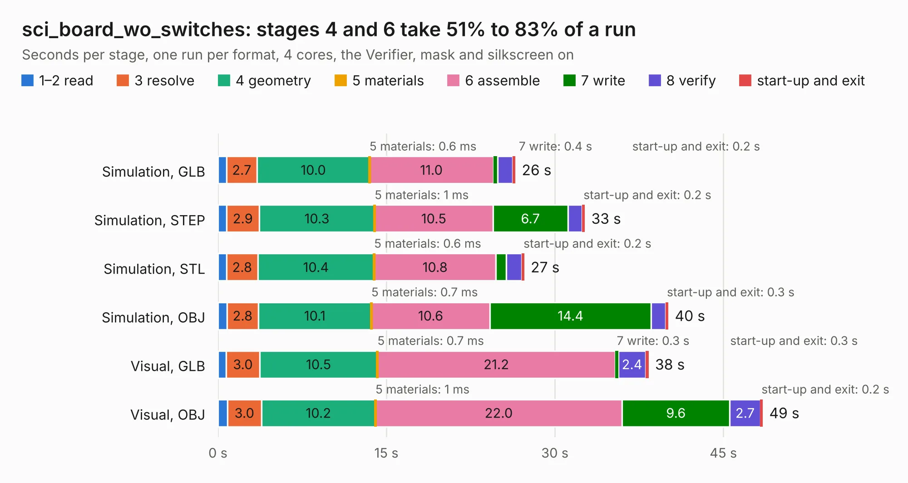

# 1600. sci_board_wo_switches

Board 1,600 of the 3,106 of [Corpus Testing](../Corpus-Testing.md), on [Corpus Page 15](../CorpusTestingPages/Corpus-Testing-15.md#1600-sci_board_wo_switches).

| Mode and format | 1–2 read | 3 resolve | 4 geometry | 5 materials | 6 assemble | 7 write | 8 verify | start-up and exit | Total |
|---|---:|---:|---:|---:|---:|---:|---:|---:|---:|
| Simulation, GLB | 0.8 | 2.7 | 10.0 | 0.6&nbsp;ms | 11.0 | 0.4 | 1.3 | 0.2 | 26.5 |
| Simulation, STEP | 0.8 | 2.9 | 10.3 | 1&nbsp;ms | 10.5 | 6.7 | 1.3 | 0.2 | 32.7 |
| Simulation, STL | 0.8 | 2.8 | 10.4 | 0.6&nbsp;ms | 10.8 | 0.9 | 1.4 | 0.2 | 27.3 |
| Simulation, OBJ | 0.8 | 2.8 | 10.1 | 0.7&nbsp;ms | 10.6 | 14.4 | 1.3 | 0.3 | 40.1 |
| Visual, GLB | 0.7 | 3.0 | 10.5 | 0.7&nbsp;ms | 21.2 | 0.3 | 2.4 | 0.3 | 38.3 |
| Visual, OBJ | 0.8 | 3.0 | 10.2 | 1&nbsp;ms | 22.0 | 9.6 | 2.7 | 0.2 | 48.5 |

<table align="center"><tr><td valign="top">

| Board | Repo: [matthiasgeorgimhof/hardware_csat](https://github.com/matthiasgeorgimhof/hardware_csat) Board: `sci_board_wo_switches.kicad_pcb` |
|---|---|
| Folder | sci_board_wo_switches |
| Complexity | 391&nbsp;/&nbsp;1000 (size&nbsp;261, features&nbsp;130) |
| KESE&nbsp;features | through vias, slotted holes, custom pads, rounded, trapezoid or chamfered pads, drill offsets, filled zones, copper drawings, curved board outline, stack-up, dielectric εr and tanδ |
| Tested | 9th November 2026 |
| Copper&nbsp;layers | 4 |
| File&nbsp;format | KiCad 9 (20241229) |
| Parts,&nbsp;tracks,&nbsp;vias | 181, 1,838, 364 |
| Triangles,&nbsp;simulation | 2,773,664 in 240 parts |
| Verifier | PASS in all six runs |

</td><td valign="top">

<table>
<tr><th>File type</th><th>File size</th><th>Peak memory used</th></tr>
<tr><th colspan="3" align="left">Simulation</th></tr>
<tr><td>GLB</td><td align="right">93&nbsp;MB</td><td align="right">918&nbsp;MB</td></tr>
<tr><td>STEP</td><td align="right">370&nbsp;MB</td><td align="right">1.1&nbsp;GB</td></tr>
<tr><td>STL</td><td align="right">139&nbsp;MB</td><td align="right">927&nbsp;MB</td></tr>
<tr><td>OBJ</td><td align="right">291&nbsp;MB</td><td align="right">1.8&nbsp;GB</td></tr>
<tr><th colspan="3" align="left">Visual</th></tr>
<tr><td>GLB</td><td align="right">62&nbsp;MB</td><td align="right">1.1&nbsp;GB</td></tr>
<tr><td>OBJ</td><td align="right">194&nbsp;MB</td><td align="right">1.3&nbsp;GB</td></tr>
</table>

</td></tr></table>

| Previous | Next |
|:---|---:|
| [1599. sci_board](b1599b_hardware-csat_sci-board.md) | [1601. bodge](b1601b_hardware-csat_bodge.md) |
