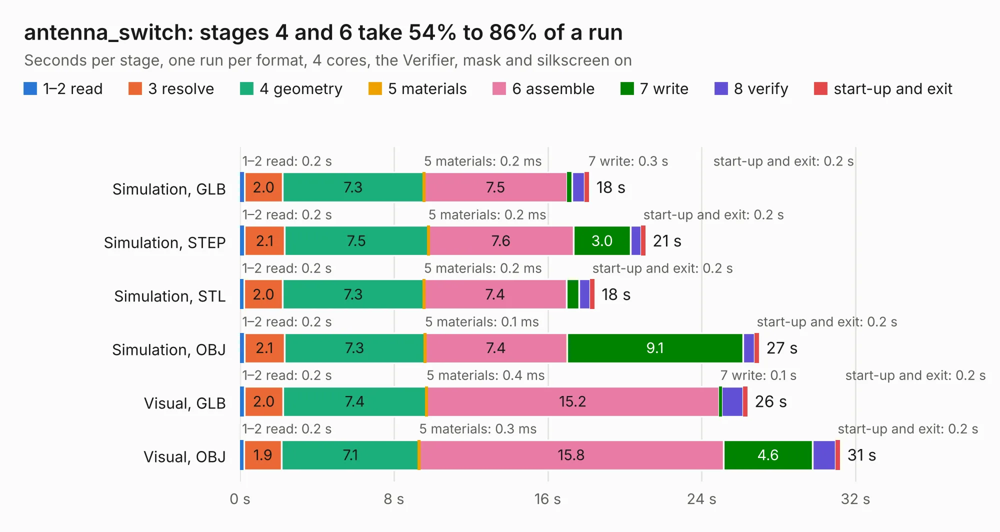

# 1601. antenna_switch

Board 1,601 of the 3,104 of [Corpus Testing](../Corpus-Testing.md), on [Corpus Page 15](../CorpusTestingPages/Corpus-Testing-15.md#1601-antenna_switch).

| Mode and format | 1–2 read | 3 resolve | 4 geometry | 5 materials | 6 assemble | 7 write | 8 verify | start-up and exit | Total |
|---|---:|---:|---:|---:|---:|---:|---:|---:|---:|
| Simulation, GLB | 0.2 | 2.0 | 7.3 | 0.2&nbsp;ms | 7.5 | 0.3 | 0.6 | 0.2 | 18.2 |
| Simulation, STEP | 0.2 | 2.1 | 7.5 | 0.2&nbsp;ms | 7.6 | 3.0 | 0.6 | 0.2 | 21.1 |
| Simulation, STL | 0.2 | 2.0 | 7.3 | 0.2&nbsp;ms | 7.4 | 0.7 | 0.6 | 0.2 | 18.4 |
| Simulation, OBJ | 0.2 | 2.1 | 7.3 | 0.1&nbsp;ms | 7.4 | 9.1 | 0.6 | 0.2 | 27.0 |
| Visual, GLB | 0.2 | 2.0 | 7.4 | 0.4&nbsp;ms | 15.2 | 0.1 | 1.1 | 0.2 | 26.4 |
| Visual, OBJ | 0.2 | 1.9 | 7.1 | 0.3&nbsp;ms | 15.8 | 4.6 | 1.2 | 0.2 | 31.2 |

<table align="center"><tr><td valign="top">

| Board | Repo: [matthuszagh/fmcw](https://github.com/matthuszagh/fmcw) Board: `antenna_switch.kicad_pcb` |
|---|---|
| Folder | hardware / antenna-switch |
| Complexity | 238&nbsp;/&nbsp;1000 (size&nbsp;193, features&nbsp;45) |
| KESE&nbsp;features | through vias, rounded, trapezoid or chamfered pads, filled zones |
| Tested | 9th November 2026 |
| Copper&nbsp;layers | 4 |
| File&nbsp;format | KiCad 6 (20190905) |
| Parts,&nbsp;tracks,&nbsp;vias | 32, 143, 525 |
| Triangles,&nbsp;simulation | 1,784,972 in 40 parts |
| Verifier | PASS in all six runs |

</td><td valign="top">

<table>
<tr><th>File type</th><th>File size</th><th>Peak memory used</th></tr>
<tr><th colspan="3" align="left">Simulation</th></tr>
<tr><td>GLB</td><td align="right">59&nbsp;MB</td><td align="right">786&nbsp;MB</td></tr>
<tr><td>STEP</td><td align="right">138&nbsp;MB</td><td align="right">845&nbsp;MB</td></tr>
<tr><td>STL</td><td align="right">89&nbsp;MB</td><td align="right">750&nbsp;MB</td></tr>
<tr><td>OBJ</td><td align="right">185&nbsp;MB</td><td align="right">1.2&nbsp;GB</td></tr>
<tr><th colspan="3" align="left">Visual</th></tr>
<tr><td>GLB</td><td align="right">29&nbsp;MB</td><td align="right">719&nbsp;MB</td></tr>
<tr><td>OBJ</td><td align="right">91&nbsp;MB</td><td align="right">777&nbsp;MB</td></tr>
</table>

</td></tr></table>

| Previous | Next |
|:---|---:|
| [1600. bodge_oshkosh](b1600b_hardware-csat_bodge-oshkosh.md) | [1602. fmcw](b1602b_fmcw_hardware-boards-rev1_fmcw.md) |
