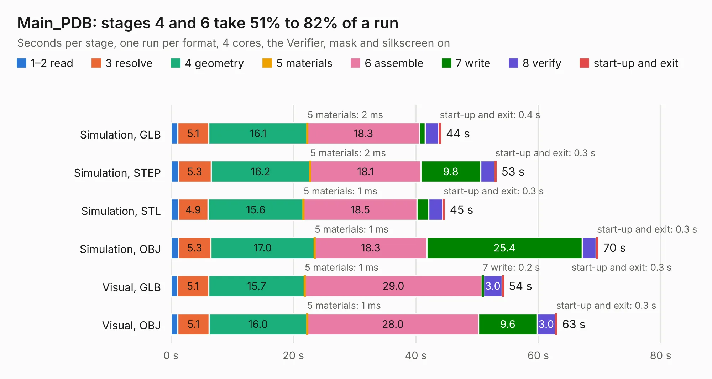

# 1601. Main_PDB

Board 1,601 of the 3,127 of [Corpus Testing](../Corpus-Testing.md), on [Corpus Page 15](../CorpusTestingPages/Corpus-Testing-15.md#1601-main_pdb).

| Mode and format | 1–2 read | 3 resolve | 4 geometry | 5 materials | 6 assemble | 7 write | 8 verify | start-up and exit | Total |
|---|---:|---:|---:|---:|---:|---:|---:|---:|---:|
| Simulation, GLB | 1.1 | 5.1 | 16.1 | 2&nbsp;ms | 18.3 | 0.9 | 2.2 | 0.4 | 44.1 |
| Simulation, STEP | 1.2 | 5.3 | 16.2 | 2&nbsp;ms | 18.1 | 9.8 | 2.2 | 0.3 | 53.2 |
| Simulation, STL | 1.2 | 4.9 | 15.6 | 1&nbsp;ms | 18.5 | 1.9 | 2.3 | 0.3 | 44.7 |
| Simulation, OBJ | 1.2 | 5.3 | 17.0 | 1&nbsp;ms | 18.3 | 25.4 | 2.3 | 0.3 | 69.8 |
| Visual, GLB | 1.0 | 5.1 | 15.7 | 1&nbsp;ms | 29.0 | 0.2 | 3.0 | 0.3 | 54.4 |
| Visual, OBJ | 1.1 | 5.1 | 16.0 | 1&nbsp;ms | 28.0 | 9.6 | 3.0 | 0.3 | 63.1 |

<table align="center"><tr><td valign="top">

| Board | Repo: [malcollm/pdb](https://github.com/malcollm/pdb) Board: `Main_PDB.kicad_pcb` |
|---|---|
| Complexity | 325&nbsp;/&nbsp;1000 (size&nbsp;215, features&nbsp;110) |
| KESE&nbsp;features | through vias, slotted holes, custom pads, rounded, trapezoid or chamfered pads, filled zones, copper drawings, stack-up, dielectric εr and tanδ |
| Tested | 9th November 2026 |
| Copper&nbsp;layers | 6 |
| File&nbsp;format | KiCad 10 (20260206) |
| Parts,&nbsp;tracks,&nbsp;vias | 186, 454, 216 |
| Triangles,&nbsp;simulation | 5,174,936 in 122 parts |
| Verifier | PASS in all six runs |

</td><td valign="top">

<table>
<tr><th>File type</th><th>File size</th><th>Peak memory used</th></tr>
<tr><th colspan="3" align="left">Simulation</th></tr>
<tr><td>GLB</td><td align="right">171&nbsp;MB</td><td align="right">1.3&nbsp;GB</td></tr>
<tr><td>STEP</td><td align="right">574&nbsp;MB</td><td align="right">1.5&nbsp;GB</td></tr>
<tr><td>STL</td><td align="right">259&nbsp;MB</td><td align="right">1.3&nbsp;GB</td></tr>
<tr><td>OBJ</td><td align="right">543&nbsp;MB</td><td align="right">3.3&nbsp;GB</td></tr>
<tr><th colspan="3" align="left">Visual</th></tr>
<tr><td>GLB</td><td align="right">67&nbsp;MB</td><td align="right">1.3&nbsp;GB</td></tr>
<tr><td>OBJ</td><td align="right">211&nbsp;MB</td><td align="right">1.6&nbsp;GB</td></tr>
</table>

</td></tr></table>

| Previous | Next |
|:---|---:|
| [1600. Main](b1600b_oomwoo-pcb_Main.md) | [1602. homebrew_486](b1602b_m8sbc-486_homebrew-486.md) |
