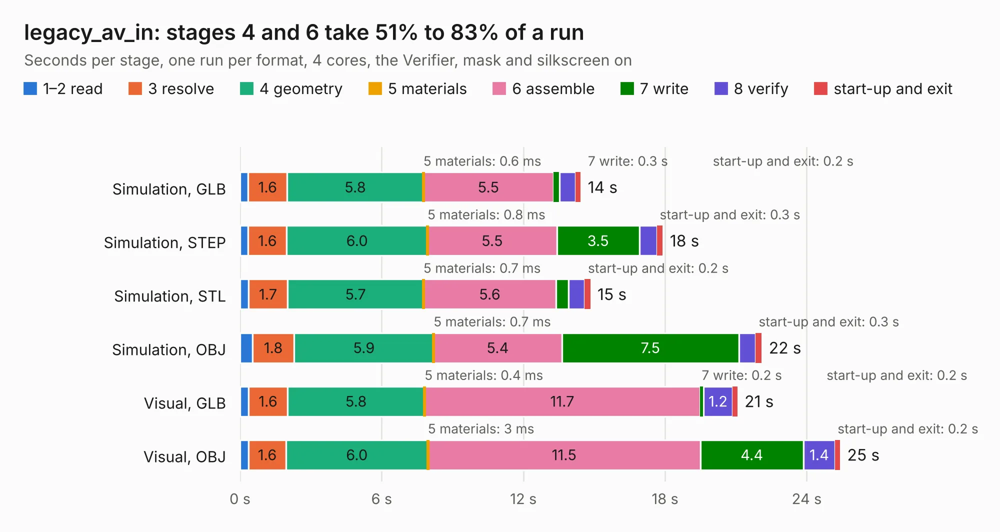

# 1602. legacy_av_in

Board 1,602 of the 3,118 of [Corpus Testing](../Corpus-Testing.md), on [Corpus Page 15](../CorpusTestingPages/Corpus-Testing-15.md#1602-legacy_av_in).

| Mode and format | 1–2 read | 3 resolve | 4 geometry | 5 materials | 6 assemble | 7 write | 8 verify | start-up and exit | Total |
|---|---:|---:|---:|---:|---:|---:|---:|---:|---:|
| Simulation, GLB | 0.3 | 1.6 | 5.8 | 0.6&nbsp;ms | 5.5 | 0.3 | 0.7 | 0.2 | 14.4 |
| Simulation, STEP | 0.3 | 1.6 | 6.0 | 0.8&nbsp;ms | 5.5 | 3.5 | 0.7 | 0.3 | 17.9 |
| Simulation, STL | 0.4 | 1.7 | 5.7 | 0.7&nbsp;ms | 5.6 | 0.5 | 0.7 | 0.2 | 14.8 |
| Simulation, OBJ | 0.5 | 1.8 | 5.9 | 0.7&nbsp;ms | 5.4 | 7.5 | 0.7 | 0.3 | 22.1 |
| Visual, GLB | 0.4 | 1.6 | 5.8 | 0.4&nbsp;ms | 11.7 | 0.2 | 1.2 | 0.2 | 21.1 |
| Visual, OBJ | 0.4 | 1.6 | 6.0 | 3&nbsp;ms | 11.5 | 4.4 | 1.4 | 0.2 | 25.4 |

<table align="center"><tr><td valign="top">

| Board | Repo: [marqs85/ossc_pro_hw](https://github.com/marqs85/ossc_pro_hw) Board: `legacy_av_in.kicad_pcb` |
|---|---|
| Folder | expansions / legacy_av_in |
| Complexity | 341&nbsp;/&nbsp;1000 (size&nbsp;261, features&nbsp;80) |
| KESE&nbsp;features | through vias, slotted holes, custom pads, rounded, trapezoid or chamfered pads, filled zones, copper drawings |
| Tested | 9th November 2026 |
| Copper&nbsp;layers | 4 |
| File&nbsp;format | KiCad 9 (20241229) |
| Parts,&nbsp;tracks,&nbsp;vias | 87, 786, 394 |
| Triangles,&nbsp;simulation | 1,904,396 in 119 parts |
| Verifier | PASS in all six runs |

</td><td valign="top">

<table>
<tr><th>File type</th><th>File size</th><th>Peak memory used</th></tr>
<tr><th colspan="3" align="left">Simulation</th></tr>
<tr><td>GLB</td><td align="right">64&nbsp;MB</td><td align="right">838&nbsp;MB</td></tr>
<tr><td>STEP</td><td align="right">192&nbsp;MB</td><td align="right">862&nbsp;MB</td></tr>
<tr><td>STL</td><td align="right">95&nbsp;MB</td><td align="right">820&nbsp;MB</td></tr>
<tr><td>OBJ</td><td align="right">197&nbsp;MB</td><td align="right">1.3&nbsp;GB</td></tr>
<tr><th colspan="3" align="left">Visual</th></tr>
<tr><td>GLB</td><td align="right">38&nbsp;MB</td><td align="right">744&nbsp;MB</td></tr>
<tr><td>OBJ</td><td align="right">114&nbsp;MB</td><td align="right">844&nbsp;MB</td></tr>
</table>

</td></tr></table>

| Previous | Next |
|:---|---:|
| [1601. extra_av_out](b1601b_ossc-pro-hw_extra-av-out.md) | [1603. ram_board](b1603b_ossc-pro-hw_ram-board.md) |
