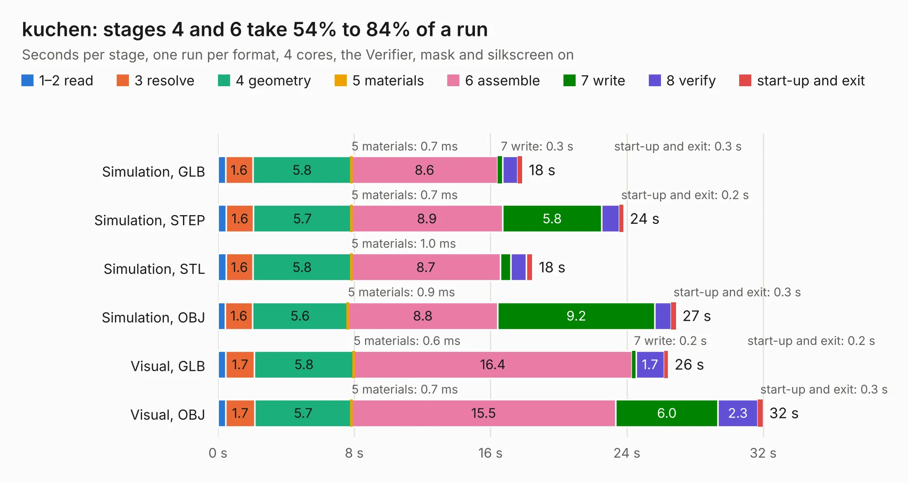

# 1603. kuchen

Board 1,603 of the 3,139 of [Corpus Testing](../Corpus-Testing.md), on [Corpus Page 15](../CorpusTestingPages/Corpus-Testing-15.md#1603-kuchen).

| Mode and format | 1–2 read | 3 resolve | 4 geometry | 5 materials | 6 assemble | 7 write | 8 verify | start-up and exit | Total |
|---|---:|---:|---:|---:|---:|---:|---:|---:|---:|
| Simulation, GLB | 0.4 | 1.6 | 5.8 | 0.7&nbsp;ms | 8.6 | 0.3 | 0.9 | 0.3 | 17.9 |
| Simulation, STEP | 0.5 | 1.6 | 5.7 | 0.7&nbsp;ms | 8.9 | 5.8 | 1.0 | 0.2 | 23.8 |
| Simulation, STL | 0.5 | 1.6 | 5.8 | 1.0&nbsp;ms | 8.7 | 0.6 | 0.9 | 0.4 | 18.5 |
| Simulation, OBJ | 0.4 | 1.6 | 5.6 | 0.9&nbsp;ms | 8.8 | 9.2 | 1.0 | 0.3 | 26.9 |
| Visual, GLB | 0.5 | 1.7 | 5.8 | 0.6&nbsp;ms | 16.4 | 0.2 | 1.7 | 0.2 | 26.4 |
| Visual, OBJ | 0.5 | 1.7 | 5.7 | 0.7&nbsp;ms | 15.5 | 6.0 | 2.3 | 0.3 | 32.0 |

<table align="center"><tr><td valign="top">

| Board | Repo: [machdyne/kuchen](https://github.com/machdyne/kuchen) Board: `kuchen.kicad_pcb` |
|---|---|
| Folder | pcb / kuchen_v0 |
| Complexity | 367&nbsp;/&nbsp;1000 (size&nbsp;257, features&nbsp;110) |
| KESE&nbsp;features | through vias, slotted holes, rounded, trapezoid or chamfered pads, arc tracks, filled zones, curved board outline, stack-up, dielectric εr and tanδ |
| Tested | 9th November 2026 |
| Copper&nbsp;layers | 4 |
| File&nbsp;format | KiCad 6 (20211014) |
| Parts,&nbsp;tracks,&nbsp;vias | 94, 1,189, 193 |
| Triangles,&nbsp;simulation | 1,833,026 in 266 parts |
| Verifier | PASS in all six runs |

</td><td valign="top">

<table>
<tr><th>File type</th><th>File size</th><th>Peak memory used</th></tr>
<tr><th colspan="3" align="left">Simulation</th></tr>
<tr><td>GLB</td><td align="right">61&nbsp;MB</td><td align="right">703&nbsp;MB</td></tr>
<tr><td>STEP</td><td align="right">267&nbsp;MB</td><td align="right">832&nbsp;MB</td></tr>
<tr><td>STL</td><td align="right">92&nbsp;MB</td><td align="right">698&nbsp;MB</td></tr>
<tr><td>OBJ</td><td align="right">194&nbsp;MB</td><td align="right">1.2&nbsp;GB</td></tr>
<tr><th colspan="3" align="left">Visual</th></tr>
<tr><td>GLB</td><td align="right">41&nbsp;MB</td><td align="right">981&nbsp;MB</td></tr>
<tr><td>OBJ</td><td align="right">130&nbsp;MB</td><td align="right">910&nbsp;MB</td></tr>
</table>

</td></tr></table>

| Previous | Next |
|:---|---:|
| [1602. pmod_ethernet](b1602b_katze_pmod-ethernet.md) | [1604. lakritz](b1604b_lakritz_lakritz.md) |
