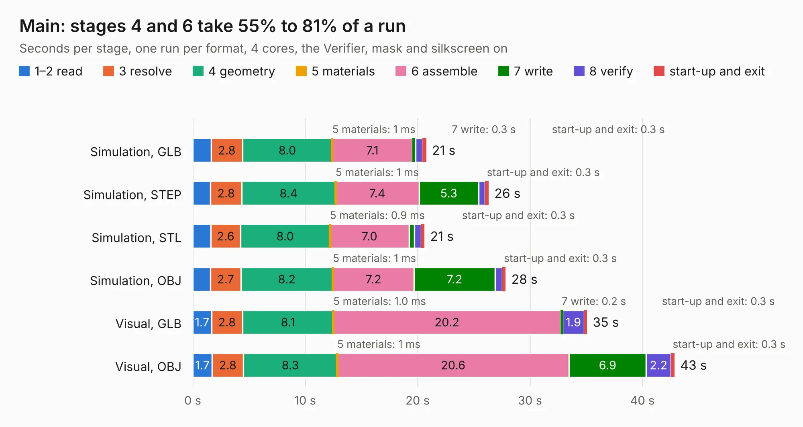

# 1603. Main

Board 1,603 of the 3,131 of [Corpus Testing](../Corpus-Testing.md), on [Corpus Page 15](../CorpusTestingPages/Corpus-Testing-15.md#1603-main).

| Mode and format | 1–2 read | 3 resolve | 4 geometry | 5 materials | 6 assemble | 7 write | 8 verify | start-up and exit | Total |
|---|---:|---:|---:|---:|---:|---:|---:|---:|---:|
| Simulation, GLB | 1.6 | 2.8 | 8.0 | 1&nbsp;ms | 7.1 | 0.3 | 0.6 | 0.3 | 20.8 |
| Simulation, STEP | 1.6 | 2.8 | 8.4 | 1&nbsp;ms | 7.4 | 5.3 | 0.6 | 0.3 | 26.3 |
| Simulation, STL | 1.6 | 2.6 | 8.0 | 0.9&nbsp;ms | 7.0 | 0.5 | 0.6 | 0.3 | 20.6 |
| Simulation, OBJ | 1.6 | 2.7 | 8.2 | 1&nbsp;ms | 7.2 | 7.2 | 0.7 | 0.3 | 27.8 |
| Visual, GLB | 1.7 | 2.8 | 8.1 | 1.0&nbsp;ms | 20.2 | 0.2 | 1.9 | 0.3 | 35.1 |
| Visual, OBJ | 1.7 | 2.8 | 8.3 | 1&nbsp;ms | 20.6 | 6.9 | 2.2 | 0.3 | 42.9 |

<table align="center"><tr><td valign="top">

| Board | Repo: [makerspet/oomwoo-pcb](https://github.com/makerspet/oomwoo-pcb) Board: `Main.kicad_pcb` |
|---|---|
| Folder | kicad / main |
| Complexity | 228&nbsp;/&nbsp;1000 (size&nbsp;138, features&nbsp;90) |
| KESE&nbsp;features | slotted holes, custom pads, rounded, trapezoid or chamfered pads, copper drawings, copper text, stack-up, dielectric εr and tanδ, mask and silkscreen colours |
| Tested | 9th November 2026 |
| Copper&nbsp;layers | 4 |
| File&nbsp;format | KiCad 10 (20260206) |
| Parts,&nbsp;tracks,&nbsp;vias | 385, 0, 0 |
| Triangles,&nbsp;simulation | 1,448,360 in 433 parts |
| Note | mostly unrouted |
| Verifier | PASS in all six runs |

</td><td valign="top">

<table>
<tr><th>File type</th><th>File size</th><th>Peak memory used</th></tr>
<tr><th colspan="3" align="left">Simulation</th></tr>
<tr><td>GLB</td><td align="right">52&nbsp;MB</td><td align="right">861&nbsp;MB</td></tr>
<tr><td>STEP</td><td align="right">259&nbsp;MB</td><td align="right">904&nbsp;MB</td></tr>
<tr><td>STL</td><td align="right">72&nbsp;MB</td><td align="right">837&nbsp;MB</td></tr>
<tr><td>OBJ</td><td align="right">157&nbsp;MB</td><td align="right">1.1&nbsp;GB</td></tr>
<tr><th colspan="3" align="left">Visual</th></tr>
<tr><td>GLB</td><td align="right">47&nbsp;MB</td><td align="right">1.1&nbsp;GB</td></tr>
<tr><td>OBJ</td><td align="right">140&nbsp;MB</td><td align="right">1.1&nbsp;GB</td></tr>
</table>

</td></tr></table>

| Previous | Next |
|:---|---:|
| [1602. schoko](b1602b_schoko_schoko.md) | [1604. Main_PDB](b1604b_pdb_Main-PDB.md) |
