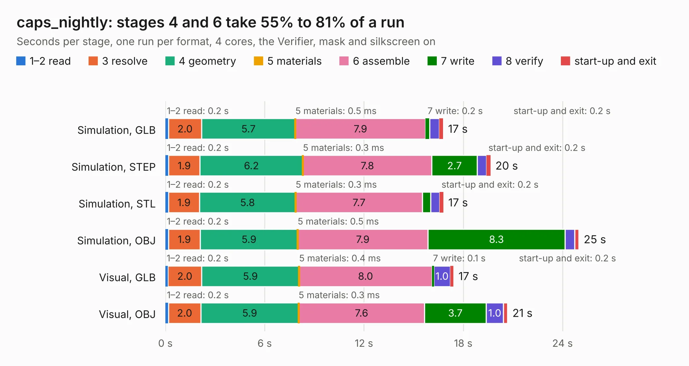

# 1605. caps_nightly

Board 1,605 of the 3,102 of [Corpus Testing](../Corpus-Testing.md), on [Corpus Page 15](../CorpusTestingPages/Corpus-Testing-15.md#1605-caps_nightly).

| Mode and format | 1–2 read | 3 resolve | 4 geometry | 5 materials | 6 assemble | 7 write | 8 verify | start-up and exit | Total |
|---|---:|---:|---:|---:|---:|---:|---:|---:|---:|
| Simulation, GLB | 0.2 | 2.0 | 5.7 | 0.5&nbsp;ms | 7.9 | 0.2 | 0.6 | 0.2 | 16.8 |
| Simulation, STEP | 0.2 | 1.9 | 6.2 | 0.3&nbsp;ms | 7.8 | 2.7 | 0.6 | 0.2 | 19.6 |
| Simulation, STL | 0.2 | 1.9 | 5.8 | 0.3&nbsp;ms | 7.7 | 0.5 | 0.6 | 0.2 | 16.8 |
| Simulation, OBJ | 0.2 | 1.9 | 5.9 | 0.5&nbsp;ms | 7.9 | 8.3 | 0.6 | 0.3 | 25.0 |
| Visual, GLB | 0.2 | 2.0 | 5.9 | 0.4&nbsp;ms | 8.0 | 0.1 | 1.0 | 0.2 | 17.4 |
| Visual, OBJ | 0.2 | 2.0 | 5.9 | 0.3&nbsp;ms | 7.6 | 3.7 | 1.0 | 0.3 | 20.7 |

<table align="center"><tr><td valign="top">

| Board | Repo: [matthuszagh/fmcw](https://github.com/matthuszagh/fmcw) Board: `caps_nightly.kicad_pcb` |
|---|---|
| Folder | hardware / prototypes / caps |
| Complexity | 264&nbsp;/&nbsp;1000 (size&nbsp;184, features&nbsp;80) |
| KESE&nbsp;features | through vias, rounded, trapezoid or chamfered pads, filled zones, stack-up, dielectric εr and tanδ, mask and silkscreen colours |
| Tested | 9th November 2026 |
| Copper&nbsp;layers | 4 |
| File&nbsp;format | KiCad 6 (20200119) |
| Parts,&nbsp;tracks,&nbsp;vias | 11, 11, 636 |
| Triangles,&nbsp;simulation | 1,737,368 in 19 parts |
| Verifier | PASS in all six runs |

</td><td valign="top">

<table>
<tr><th>File type</th><th>File size</th><th>Peak memory used</th></tr>
<tr><th colspan="3" align="left">Simulation</th></tr>
<tr><td>GLB</td><td align="right">55&nbsp;MB</td><td align="right">783&nbsp;MB</td></tr>
<tr><td>STEP</td><td align="right">118&nbsp;MB</td><td align="right">861&nbsp;MB</td></tr>
<tr><td>STL</td><td align="right">87&nbsp;MB</td><td align="right">770&nbsp;MB</td></tr>
<tr><td>OBJ</td><td align="right">176&nbsp;MB</td><td align="right">1.1&nbsp;GB</td></tr>
<tr><th colspan="3" align="left">Visual</th></tr>
<tr><td>GLB</td><td align="right">25&nbsp;MB</td><td align="right">706&nbsp;MB</td></tr>
<tr><td>OBJ</td><td align="right">77&nbsp;MB</td><td align="right">738&nbsp;MB</td></tr>
</table>

</td></tr></table>

| Previous | Next |
|:---|---:|
| [1604. caps](b1604b_fmcw_caps.md) | [1606. coupler](b1606b_fmcw_coupler.md) |
