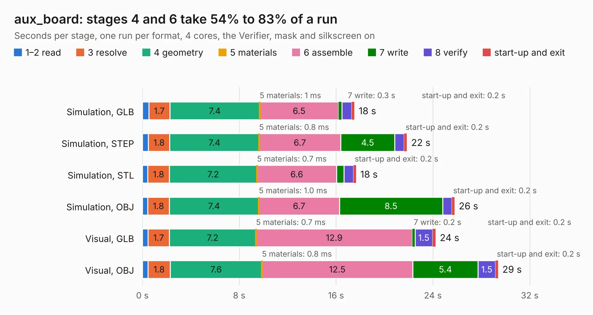

# 1606. aux_board

Board 1,606 of the 3,119 of [Corpus Testing](../Corpus-Testing.md), on [Corpus Page 15](../CorpusTestingPages/Corpus-Testing-15.md#1606-aux_board).

| Mode and format | 1–2 read | 3 resolve | 4 geometry | 5 materials | 6 assemble | 7 write | 8 verify | start-up and exit | Total |
|---|---:|---:|---:|---:|---:|---:|---:|---:|---:|
| Simulation, GLB | 0.5 | 1.7 | 7.4 | 1&nbsp;ms | 6.5 | 0.3 | 0.8 | 0.2 | 17.5 |
| Simulation, STEP | 0.5 | 1.8 | 7.4 | 0.8&nbsp;ms | 6.7 | 4.5 | 0.8 | 0.2 | 21.9 |
| Simulation, STL | 0.4 | 1.8 | 7.2 | 0.7&nbsp;ms | 6.6 | 0.6 | 0.8 | 0.2 | 17.7 |
| Simulation, OBJ | 0.4 | 1.8 | 7.4 | 1.0&nbsp;ms | 6.7 | 8.5 | 0.8 | 0.2 | 25.8 |
| Visual, GLB | 0.5 | 1.7 | 7.2 | 0.7&nbsp;ms | 12.9 | 0.2 | 1.5 | 0.2 | 24.2 |
| Visual, OBJ | 0.5 | 1.8 | 7.6 | 0.8&nbsp;ms | 12.5 | 5.4 | 1.5 | 0.2 | 29.4 |

<table align="center"><tr><td valign="top">

| Board | Repo: [matthiasgeorgimhof/hardware_csat](https://github.com/matthiasgeorgimhof/hardware_csat) Board: `aux_board.kicad_pcb` |
|---|---|
| Folder | aux_board |
| Complexity | 350&nbsp;/&nbsp;1000 (size&nbsp;245, features&nbsp;105) |
| KESE&nbsp;features | through vias, slotted holes, rounded, trapezoid or chamfered pads, drill offsets, filled zones, curved board outline, stack-up, dielectric εr and tanδ |
| Tested | 9th November 2026 |
| Copper&nbsp;layers | 4 |
| File&nbsp;format | KiCad 9 (20241229) |
| Parts,&nbsp;tracks,&nbsp;vias | 125, 825, 201 |
| Triangles,&nbsp;simulation | 2,157,750 in 180 parts |
| Verifier | PASS in all six runs |

</td><td valign="top">

<table>
<tr><th>File type</th><th>File size</th><th>Peak memory used</th></tr>
<tr><th colspan="3" align="left">Simulation</th></tr>
<tr><td>GLB</td><td align="right">72&nbsp;MB</td><td align="right">693&nbsp;MB</td></tr>
<tr><td>STEP</td><td align="right">266&nbsp;MB</td><td align="right">890&nbsp;MB</td></tr>
<tr><td>STL</td><td align="right">108&nbsp;MB</td><td align="right">709&nbsp;MB</td></tr>
<tr><td>OBJ</td><td align="right">224&nbsp;MB</td><td align="right">1.4&nbsp;GB</td></tr>
<tr><th colspan="3" align="left">Visual</th></tr>
<tr><td>GLB</td><td align="right">43&nbsp;MB</td><td align="right">955&nbsp;MB</td></tr>
<tr><td>OBJ</td><td align="right">130&nbsp;MB</td><td align="right">958&nbsp;MB</td></tr>
</table>

</td></tr></table>

| Previous | Next |
|:---|---:|
| [1605. ossc_pro](b1605b_ossc-pro-hw_ossc-pro.md) | [1607. auxio_board](b1607b_hardware-csat_auxio-board.md) |
