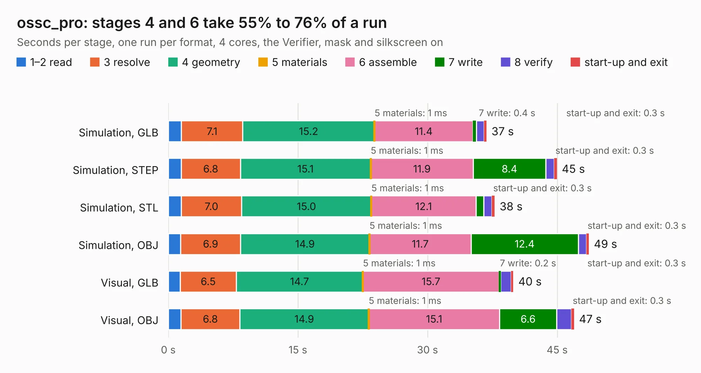

# 1606. ossc_pro

Board 1,606 of the 3,120 of [Corpus Testing](../Corpus-Testing.md), on [Corpus Page 15](../CorpusTestingPages/Corpus-Testing-15.md#1606-ossc_pro).

| Mode and format | 1–2 read | 3 resolve | 4 geometry | 5 materials | 6 assemble | 7 write | 8 verify | start-up and exit | Total |
|---|---:|---:|---:|---:|---:|---:|---:|---:|---:|
| Simulation, GLB | 1.5 | 7.1 | 15.2 | 1&nbsp;ms | 11.4 | 0.4 | 0.9 | 0.3 | 36.8 |
| Simulation, STEP | 1.5 | 6.8 | 15.1 | 1&nbsp;ms | 11.9 | 8.4 | 1.0 | 0.3 | 45.0 |
| Simulation, STL | 1.5 | 7.0 | 15.0 | 1&nbsp;ms | 12.1 | 0.9 | 1.0 | 0.3 | 37.8 |
| Simulation, OBJ | 1.4 | 6.9 | 14.9 | 1&nbsp;ms | 11.7 | 12.4 | 0.9 | 0.3 | 48.7 |
| Visual, GLB | 1.4 | 6.5 | 14.7 | 1&nbsp;ms | 15.7 | 0.2 | 1.2 | 0.3 | 39.9 |
| Visual, OBJ | 1.5 | 6.8 | 14.9 | 1&nbsp;ms | 15.1 | 6.6 | 1.7 | 0.3 | 47.0 |

<table align="center"><tr><td valign="top">

| Board | Repo: [marqs85/ossc_pro_hw](https://github.com/marqs85/ossc_pro_hw) Board: `ossc_pro.kicad_pcb` |
|---|---|
| Complexity | 154&nbsp;/&nbsp;1000 (size&nbsp;134, features&nbsp;20) |
| KESE&nbsp;features | slotted holes, rounded, trapezoid or chamfered pads |
| Tested | 9th November 2026 |
| Copper&nbsp;layers | 2 |
| File&nbsp;format | KiCad 9 (20241229) |
| Parts,&nbsp;tracks,&nbsp;vias | 492, 0, 0 |
| Triangles,&nbsp;simulation | 2,163,518 in 533 parts |
| Note | mostly unrouted |
| Verifier | PASS in all six runs |

</td><td valign="top">

<table>
<tr><th>File type</th><th>File size</th><th>Peak memory used</th></tr>
<tr><th colspan="3" align="left">Simulation</th></tr>
<tr><td>GLB</td><td align="right">74&nbsp;MB</td><td align="right">818&nbsp;MB</td></tr>
<tr><td>STEP</td><td align="right">389&nbsp;MB</td><td align="right">1.1&nbsp;GB</td></tr>
<tr><td>STL</td><td align="right">108&nbsp;MB</td><td align="right">828&nbsp;MB</td></tr>
<tr><td>OBJ</td><td align="right">229&nbsp;MB</td><td align="right">1.5&nbsp;GB</td></tr>
<tr><th colspan="3" align="left">Visual</th></tr>
<tr><td>GLB</td><td align="right">38&nbsp;MB</td><td align="right">1.1&nbsp;GB</td></tr>
<tr><td>OBJ</td><td align="right">114&nbsp;MB</td><td align="right">913&nbsp;MB</td></tr>
</table>

</td></tr></table>

| Previous | Next |
|:---|---:|
| [1605. ram_board](b1605b_ossc-pro-hw_ram-board.md) | [1607. aux_board](b1607b_hardware-csat_aux-board.md) |
