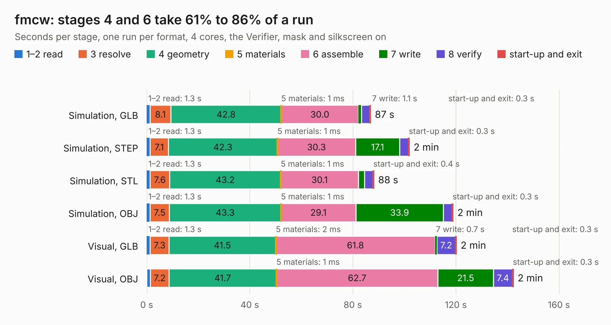

# 1607. fmcw

Board 1,607 of the 3,109 of [Corpus Testing](../Corpus-Testing.md), on [Corpus Page 15](../CorpusTestingPages/Corpus-Testing-15.md#1607-fmcw).

| Mode and format | 1–2 read | 3 resolve | 4 geometry | 5 materials | 6 assemble | 7 write | 8 verify | start-up and exit | Total |
|---|---:|---:|---:|---:|---:|---:|---:|---:|---:|
| Simulation, GLB | 1.3 | 8.1 | 42.8 | 1&nbsp;ms | 30.0 | 1.1 | 3.2 | 0.3 | 86.9 |
| Simulation, STEP | 1.3 | 7.1 | 42.3 | 1&nbsp;ms | 30.3 | 17.1 | 3.5 | 0.3 | 101.9 |
| Simulation, STL | 1.3 | 7.6 | 43.2 | 1&nbsp;ms | 30.1 | 2.3 | 3.3 | 0.4 | 88.2 |
| Simulation, OBJ | 1.3 | 7.5 | 43.3 | 1&nbsp;ms | 29.1 | 33.9 | 3.4 | 0.3 | 118.9 |
| Visual, GLB | 1.3 | 7.3 | 41.5 | 2&nbsp;ms | 61.8 | 0.7 | 7.2 | 0.3 | 120.2 |
| Visual, OBJ | 1.4 | 7.2 | 41.7 | 1&nbsp;ms | 62.7 | 21.5 | 7.4 | 0.3 | 142.3 |

<table align="center"><tr><td valign="top">

| Board | Repo: [matthuszagh/fmcw](https://github.com/matthuszagh/fmcw) Board: `fmcw.kicad_pcb` |
|---|---|
| Folder | hardware / boards / rev1 |
| Complexity | 387&nbsp;/&nbsp;1000 (size&nbsp;307, features&nbsp;80) |
| KESE&nbsp;features | through vias, slotted holes, custom pads, rounded, trapezoid or chamfered pads, filled zones, copper drawings |
| Tested | 9th November 2026 |
| Copper&nbsp;layers | 4 |
| File&nbsp;format | KiCad 5 (20171130) |
| Parts,&nbsp;tracks,&nbsp;vias | 406, 3,575, 947 |
| Triangles,&nbsp;simulation | 6,589,000 in 448 parts |
| Verifier | PASS in all six runs |

</td><td valign="top">

<table>
<tr><th>File type</th><th>File size</th><th>Peak memory used</th></tr>
<tr><th colspan="3" align="left">Simulation</th></tr>
<tr><td>GLB</td><td align="right">229&nbsp;MB</td><td align="right">1.9&nbsp;GB</td></tr>
<tr><td>STEP</td><td align="right">1.0&nbsp;GB</td><td align="right">2.5&nbsp;GB</td></tr>
<tr><td>STL</td><td align="right">329&nbsp;MB</td><td align="right">1.9&nbsp;GB</td></tr>
<tr><td>OBJ</td><td align="right">729&nbsp;MB</td><td align="right">4.3&nbsp;GB</td></tr>
<tr><th colspan="3" align="left">Visual</th></tr>
<tr><td>GLB</td><td align="right">143&nbsp;MB</td><td align="right">2.3&nbsp;GB</td></tr>
<tr><td>OBJ</td><td align="right">461&nbsp;MB</td><td align="right">3.0&nbsp;GB</td></tr>
</table>

</td></tr></table>

| Previous | Next |
|:---|---:|
| [1606. antenna_switch](b1606b_fmcw_antenna-switch.md) | [1608. fmcw](b1608b_fmcw_hardware-boards-rev2a_fmcw.md) |
