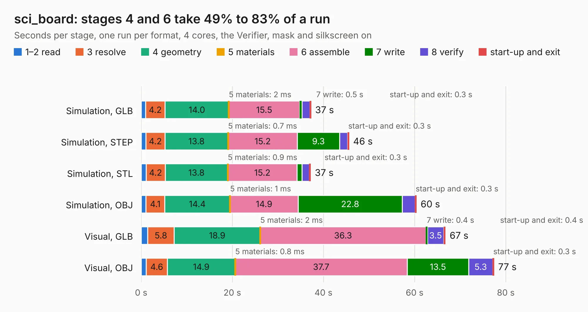

# 1608. sci_board

Board 1,608 of the 3,116 of [Corpus Testing](../Corpus-Testing.md), on [Corpus Page 15](../CorpusTestingPages/Corpus-Testing-15.md#1608-sci_board).

| Mode and format | 1–2 read | 3 resolve | 4 geometry | 5 materials | 6 assemble | 7 write | 8 verify | start-up and exit | Total |
|---|---:|---:|---:|---:|---:|---:|---:|---:|---:|
| Simulation, GLB | 1.0 | 4.2 | 14.0 | 2&nbsp;ms | 15.5 | 0.5 | 1.7 | 0.3 | 37.3 |
| Simulation, STEP | 1.0 | 4.2 | 13.8 | 0.7&nbsp;ms | 15.2 | 9.3 | 1.8 | 0.3 | 45.6 |
| Simulation, STL | 1.1 | 4.2 | 13.8 | 0.9&nbsp;ms | 15.2 | 1.1 | 1.6 | 0.3 | 37.2 |
| Simulation, OBJ | 1.1 | 4.1 | 14.4 | 1&nbsp;ms | 14.9 | 22.8 | 2.8 | 0.3 | 60.4 |
| Visual, GLB | 1.4 | 5.8 | 18.9 | 2&nbsp;ms | 36.3 | 0.4 | 3.5 | 0.4 | 66.8 |
| Visual, OBJ | 1.1 | 4.6 | 14.9 | 0.8&nbsp;ms | 37.7 | 13.5 | 5.3 | 0.3 | 77.4 |

<table align="center"><tr><td valign="top">

| Board | Repo: [matthiasgeorgimhof/hardware_csat](https://github.com/matthiasgeorgimhof/hardware_csat) Board: `sci_board.kicad_pcb` |
|---|---|
| Folder | sci_board.inactive |
| Complexity | 397&nbsp;/&nbsp;1000 (size&nbsp;267, features&nbsp;130) |
| KESE&nbsp;features | through vias, slotted holes, custom pads, rounded, trapezoid or chamfered pads, drill offsets, filled zones, copper drawings, curved board outline, stack-up, dielectric εr and tanδ |
| Tested | 9th November 2026 |
| Copper&nbsp;layers | 4 |
| File&nbsp;format | KiCad 9 (20241229) |
| Parts,&nbsp;tracks,&nbsp;vias | 210, 2,498, 466 |
| Triangles,&nbsp;simulation | 3,299,186 in 282 parts |
| Verifier | PASS in all six runs |

</td><td valign="top">

<table>
<tr><th>File type</th><th>File size</th><th>Peak memory used</th></tr>
<tr><th colspan="3" align="left">Simulation</th></tr>
<tr><td>GLB</td><td align="right">111&nbsp;MB</td><td align="right">1.1&nbsp;GB</td></tr>
<tr><td>STEP</td><td align="right">450&nbsp;MB</td><td align="right">1.4&nbsp;GB</td></tr>
<tr><td>STL</td><td align="right">165&nbsp;MB</td><td align="right">1.1&nbsp;GB</td></tr>
<tr><td>OBJ</td><td align="right">348&nbsp;MB</td><td align="right">2.2&nbsp;GB</td></tr>
<tr><th colspan="3" align="left">Visual</th></tr>
<tr><td>GLB</td><td align="right">75&nbsp;MB</td><td align="right">1.5&nbsp;GB</td></tr>
<tr><td>OBJ</td><td align="right">237&nbsp;MB</td><td align="right">1.6&nbsp;GB</td></tr>
</table>

</td></tr></table>

| Previous | Next |
|:---|---:|
| [1607. EPS](b1607b_hardware-csat_EPS.md) | [1609. sci_board_wo_switches](b1609b_hardware-csat_sci-board-wo-switches.md) |
