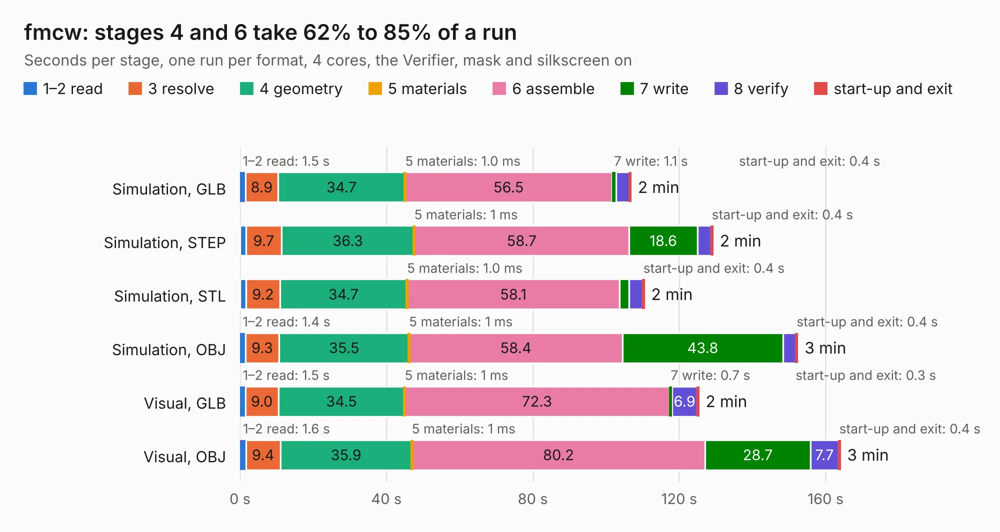

# 1609. fmcw

Board 1,609 of the 3,110 of [Corpus Testing](../Corpus-Testing.md), on [Corpus Page 15](../CorpusTestingPages/Corpus-Testing-15.md#1609-fmcw).

| Mode and format | 1–2 read | 3 resolve | 4 geometry | 5 materials | 6 assemble | 7 write | 8 verify | start-up and exit | Total |
|---|---:|---:|---:|---:|---:|---:|---:|---:|---:|
| Simulation, GLB | 1.5 | 8.9 | 34.7 | 1.0&nbsp;ms | 56.5 | 1.1 | 3.6 | 0.4 | 106.8 |
| Simulation, STEP | 1.6 | 9.7 | 36.3 | 1&nbsp;ms | 58.7 | 18.6 | 3.7 | 0.4 | 129.1 |
| Simulation, STL | 1.7 | 9.2 | 34.7 | 1.0&nbsp;ms | 58.1 | 2.6 | 3.7 | 0.4 | 110.4 |
| Simulation, OBJ | 1.4 | 9.3 | 35.5 | 1&nbsp;ms | 58.4 | 43.8 | 3.6 | 0.4 | 152.3 |
| Visual, GLB | 1.5 | 9.0 | 34.5 | 1&nbsp;ms | 72.3 | 0.7 | 6.9 | 0.3 | 125.3 |
| Visual, OBJ | 1.6 | 9.4 | 35.9 | 1&nbsp;ms | 80.2 | 28.7 | 7.7 | 0.4 | 163.9 |

<table align="center"><tr><td valign="top">

| Board | Repo: [matthuszagh/fmcw](https://github.com/matthuszagh/fmcw) Board: `fmcw.kicad_pcb` |
|---|---|
| Folder | hardware / boards / rev2a |
| Complexity | 400&nbsp;/&nbsp;1000 (size&nbsp;310, features&nbsp;90) |
| KESE&nbsp;features | through vias, slotted holes, custom pads, rounded, trapezoid or chamfered pads, filled zones, copper drawings, curved board outline |
| Tested | 9th November 2026 |
| Copper&nbsp;layers | 4 |
| File&nbsp;format | KiCad 5 (20171130) |
| Parts,&nbsp;tracks,&nbsp;vias | 436, 3,927, 835 |
| Triangles,&nbsp;simulation | 6,594,472 in 280 parts |
| Verifier | PASS in all six runs |

</td><td valign="top">

<table>
<tr><th>File type</th><th>File size</th><th>Peak memory used</th></tr>
<tr><th colspan="3" align="left">Simulation</th></tr>
<tr><td>GLB</td><td align="right">228&nbsp;MB</td><td align="right">1.7&nbsp;GB</td></tr>
<tr><td>STEP</td><td align="right">1.0&nbsp;GB</td><td align="right">2.4&nbsp;GB</td></tr>
<tr><td>STL</td><td align="right">330&nbsp;MB</td><td align="right">1.7&nbsp;GB</td></tr>
<tr><td>OBJ</td><td align="right">726&nbsp;MB</td><td align="right">4.3&nbsp;GB</td></tr>
<tr><th colspan="3" align="left">Visual</th></tr>
<tr><td>GLB</td><td align="right">138&nbsp;MB</td><td align="right">2.3&nbsp;GB</td></tr>
<tr><td>OBJ</td><td align="right">447&nbsp;MB</td><td align="right">2.8&nbsp;GB</td></tr>
</table>

</td></tr></table>

| Previous | Next |
|:---|---:|
| [1608. fmcw](b1608b_fmcw_hardware-boards-rev1_fmcw.md) | [1610. fmcw](b1610b_fmcw_hardware-boards-rev2b_fmcw.md) |
