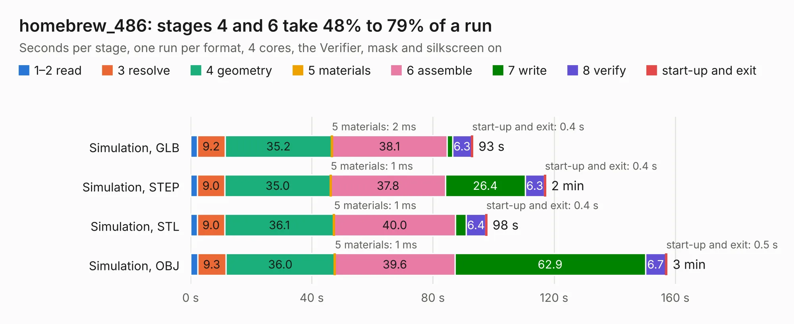

# 1610 homebrew_486

Board 1,610 of the 3,138 of [Corpus Testing](../Corpus-Testing.md), on [Corpus Page 15](../CorpusTestingPages/Corpus-Testing-15.md#1610-homebrew_486).

| Mode and format | 1–2 read | 3 resolve | 4 geometry | 5 materials | 6 assemble | 7 write | 8 verify | start-up and exit | Total |
|---|---:|---:|---:|---:|---:|---:|---:|---:|---:|
| Simulation, GLB | 2.2 | 9.2 | 35.2 | 2&nbsp;ms | 38.1 | 1.8 | 6.3 | 0.4 | 93.2 |
| Simulation, STEP | 2.2 | 9.0 | 35.0 | 1&nbsp;ms | 37.8 | 26.4 | 6.3 | 0.4 | 117.2 |
| Simulation, STL | 2.3 | 9.0 | 36.1 | 1&nbsp;ms | 40.0 | 3.6 | 6.4 | 0.4 | 97.8 |
| Simulation, OBJ | 2.3 | 9.3 | 36.0 | 1&nbsp;ms | 39.6 | 62.9 | 6.7 | 0.5 | 157.3 |
| Visual, GLB | 2.3 | 9.6 | 36.1 | 1&nbsp;ms | 90.1 | 1.0 | 9.1 | 0.3 | 148.5 |
| Visual, OBJ | 2.2 | 9.1 | 35.3 | 1&nbsp;ms | 87.3 | 38.3 | 9.1 | 0.3 | 181.6 |

<table align="center"><tr><td valign="top">

| Board | Repo: [maniekx86/m8sbc-486](https://github.com/maniekx86/m8sbc-486) Board: `homebrew_486.kicad_pcb` |
|---|---|
| Folder | pcb |
| Complexity | 393&nbsp;/&nbsp;1000 (size&nbsp;288, features&nbsp;105) |
| KESE&nbsp;features | through vias, slotted holes, rounded, trapezoid or chamfered pads, filled zones, TrueType text, stack-up, dielectric εr and tanδ, mask and silkscreen colours |
| Tested | 9th November 2026 |
| Copper&nbsp;layers | 4 |
| File&nbsp;format | KiCad 9 (20241229) |
| Parts,&nbsp;tracks,&nbsp;vias | 122, 10,279, 1,150 |
| Triangles,&nbsp;simulation | 10,969,982 in 348 parts |
| Verifier | PASS in all six runs |

</td><td valign="top">

<table>
<tr><th>File type</th><th>File size</th><th>Peak memory used</th></tr>
<tr><th colspan="3" align="left">Simulation</th></tr>
<tr><td>GLB</td><td align="right">372&nbsp;MB</td><td align="right">2.9&nbsp;GB</td></tr>
<tr><td>STEP</td><td align="right">1.5&nbsp;GB</td><td align="right">3.6&nbsp;GB</td></tr>
<tr><td>STL</td><td align="right">549&nbsp;MB</td><td align="right">2.8&nbsp;GB</td></tr>
<tr><td>OBJ</td><td align="right">1.2&nbsp;GB</td><td align="right">6.8&nbsp;GB</td></tr>
<tr><th colspan="3" align="left">Visual</th></tr>
<tr><td>GLB</td><td align="right">238&nbsp;MB</td><td align="right">3.7&nbsp;GB</td></tr>
<tr><td>OBJ</td><td align="right">768&nbsp;MB</td><td align="right">4.8&nbsp;GB</td></tr>
</table>

</td></tr></table>

| Previous | Next |
|:---|---:|
| [1609 Main_PDB](b1609b_pdb_Main-PDB.md) | [1611 pcb](b1611b_huma-rocket-flight-computer_pcb.md) |
