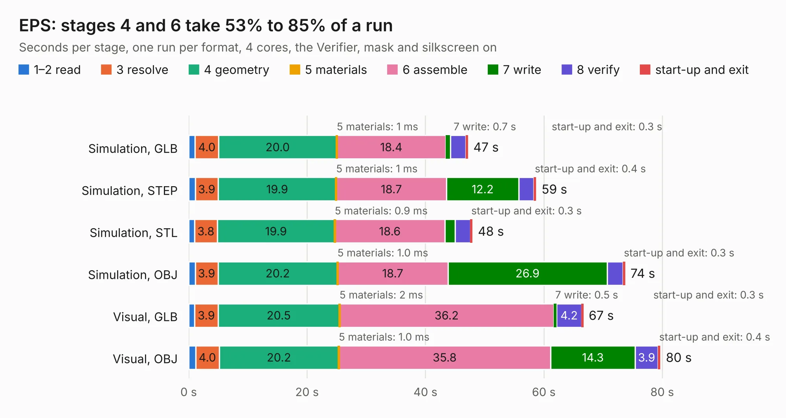

# 1611. EPS

Board 1,611 of the 3,121 of [Corpus Testing](../Corpus-Testing.md), on [Corpus Page 15](../CorpusTestingPages/Corpus-Testing-15.md#1611-eps).

| Mode and format | 1–2 read | 3 resolve | 4 geometry | 5 materials | 6 assemble | 7 write | 8 verify | start-up and exit | Total |
|---|---:|---:|---:|---:|---:|---:|---:|---:|---:|
| Simulation, GLB | 1.1 | 4.0 | 20.0 | 1&nbsp;ms | 18.4 | 0.7 | 2.6 | 0.3 | 47.1 |
| Simulation, STEP | 1.1 | 3.9 | 19.9 | 1&nbsp;ms | 18.7 | 12.2 | 2.6 | 0.4 | 58.7 |
| Simulation, STL | 1.0 | 3.8 | 19.9 | 0.9&nbsp;ms | 18.6 | 1.7 | 2.6 | 0.3 | 47.9 |
| Simulation, OBJ | 1.1 | 3.9 | 20.2 | 1.0&nbsp;ms | 18.7 | 26.9 | 2.7 | 0.3 | 73.7 |
| Visual, GLB | 1.0 | 3.9 | 20.5 | 2&nbsp;ms | 36.2 | 0.5 | 4.2 | 0.3 | 66.6 |
| Visual, OBJ | 1.2 | 4.0 | 20.2 | 1.0&nbsp;ms | 35.8 | 14.3 | 3.9 | 0.4 | 79.7 |

<table align="center"><tr><td valign="top">

| Board | Repo: [matthiasgeorgimhof/hardware_csat](https://github.com/matthiasgeorgimhof/hardware_csat) Board: `EPS.kicad_pcb` |
|---|---|
| Folder | eps_board |
| Complexity | 372&nbsp;/&nbsp;1000 (size&nbsp;267, features&nbsp;105) |
| KESE&nbsp;features | through vias, slotted holes, rounded, trapezoid or chamfered pads, drill offsets, filled zones, curved board outline, stack-up, dielectric εr and tanδ |
| Tested | 9th November 2026 |
| Copper&nbsp;layers | 4 |
| File&nbsp;format | KiCad 9 (20241229) |
| Parts,&nbsp;tracks,&nbsp;vias | 242, 2,354, 416 |
| Triangles,&nbsp;simulation | 4,561,054 in 261 parts |
| Verifier | PASS in all six runs |

</td><td valign="top">

<table>
<tr><th>File type</th><th>File size</th><th>Peak memory used</th></tr>
<tr><th colspan="3" align="left">Simulation</th></tr>
<tr><td>GLB</td><td align="right">153&nbsp;MB</td><td align="right">1.4&nbsp;GB</td></tr>
<tr><td>STEP</td><td align="right">630&nbsp;MB</td><td align="right">1.6&nbsp;GB</td></tr>
<tr><td>STL</td><td align="right">228&nbsp;MB</td><td align="right">1.3&nbsp;GB</td></tr>
<tr><td>OBJ</td><td align="right">484&nbsp;MB</td><td align="right">2.9&nbsp;GB</td></tr>
<tr><th colspan="3" align="left">Visual</th></tr>
<tr><td>GLB</td><td align="right">82&nbsp;MB</td><td align="right">1.5&nbsp;GB</td></tr>
<tr><td>OBJ</td><td align="right">259&nbsp;MB</td><td align="right">1.7&nbsp;GB</td></tr>
</table>

</td></tr></table>

| Previous | Next |
|:---|---:|
| [1610. comm_board](b1610b_hardware-csat_comm-board.md) | [1612. sci_board](b1612b_hardware-csat_sci-board.md) |
