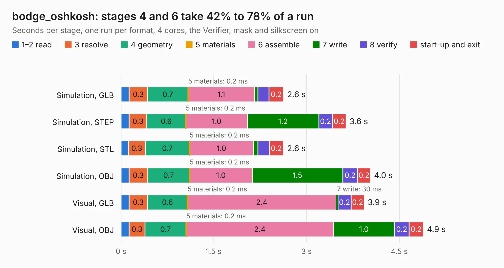

# 1611. bodge_oshkosh

Board 1,611 of the 3,116 of [Corpus Testing](../Corpus-Testing.md), on [Corpus Page 15](../CorpusTestingPages/Corpus-Testing-15.md#1611-bodge_oshkosh).

| Mode and format | 1–2 read | 3 resolve | 4 geometry | 5 materials | 6 assemble | 7 write | 8 verify | start-up and exit | Total |
|---|---:|---:|---:|---:|---:|---:|---:|---:|---:|
| Simulation, GLB | 0.1 | 0.3 | 0.7 | 0.2&nbsp;ms | 1.1 | 53&nbsp;ms | 0.2 | 0.2 | 2.6 |
| Simulation, STEP | 0.1 | 0.3 | 0.6 | 0.2&nbsp;ms | 1.0 | 1.2 | 0.2 | 0.2 | 3.6 |
| Simulation, STL | 0.1 | 0.3 | 0.7 | 0.2&nbsp;ms | 1.0 | 75&nbsp;ms | 0.2 | 0.2 | 2.6 |
| Simulation, OBJ | 0.1 | 0.3 | 0.7 | 0.2&nbsp;ms | 1.0 | 1.5 | 0.2 | 0.2 | 4.0 |
| Visual, GLB | 0.1 | 0.3 | 0.6 | 0.2&nbsp;ms | 2.4 | 30&nbsp;ms | 0.2 | 0.2 | 3.9 |
| Visual, OBJ | 0.1 | 0.3 | 0.7 | 0.2&nbsp;ms | 2.4 | 1.0 | 0.2 | 0.2 | 4.9 |

<table align="center"><tr><td valign="top">

| Board | Repo: [matthiasgeorgimhof/hardware_csat](https://github.com/matthiasgeorgimhof/hardware_csat) Board: `bodge_oshkosh.kicad_pcb` |
|---|---|
| Folder | sci_extra / bodge_oshkosh |
| Complexity | 234&nbsp;/&nbsp;1000 (size&nbsp;159, features&nbsp;75) |
| KESE&nbsp;features | through vias, rounded, trapezoid or chamfered pads, filled zones, stack-up, dielectric εr and tanδ |
| Tested | 9th November 2026 |
| Copper&nbsp;layers | 4 |
| File&nbsp;format | KiCad 9 (20241229) |
| Parts,&nbsp;tracks,&nbsp;vias | 9, 316, 48 |
| Triangles,&nbsp;simulation | 273,466 in 48 parts |
| Verifier | PASS in all six runs |

</td><td valign="top">

<table>
<tr><th>File type</th><th>File size</th><th>Peak memory used</th></tr>
<tr><th colspan="3" align="left">Simulation</th></tr>
<tr><td>GLB</td><td align="right">9.6&nbsp;MB</td><td align="right">241&nbsp;MB</td></tr>
<tr><td>STEP</td><td align="right">38&nbsp;MB</td><td align="right">247&nbsp;MB</td></tr>
<tr><td>STL</td><td align="right">14&nbsp;MB</td><td align="right">247&nbsp;MB</td></tr>
<tr><td>OBJ</td><td align="right">27&nbsp;MB</td><td align="right">239&nbsp;MB</td></tr>
<tr><th colspan="3" align="left">Visual</th></tr>
<tr><td>GLB</td><td align="right">6.4&nbsp;MB</td><td align="right">221&nbsp;MB</td></tr>
<tr><td>OBJ</td><td align="right">19&nbsp;MB</td><td align="right">243&nbsp;MB</td></tr>
</table>

</td></tr></table>

| Previous | Next |
|:---|---:|
| [1610. bodge](b1610b_hardware-csat_bodge.md) | [1612. antenna_switch](b1612b_fmcw_antenna-switch.md) |
