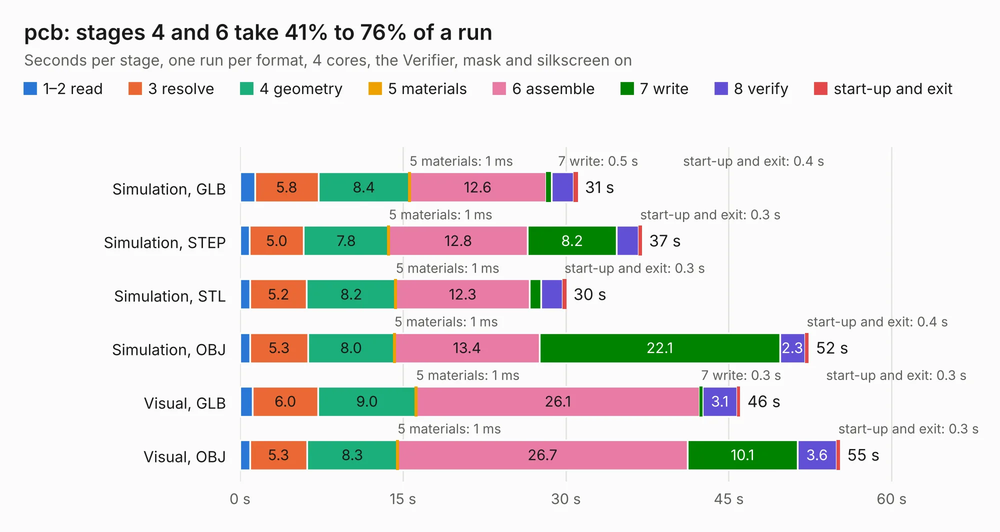

# 1611. pcb

Board 1,611 of the 3,138 of [Corpus Testing](../Corpus-Testing.md), on [Corpus Page 15](../CorpusTestingPages/Corpus-Testing-15.md#1611-pcb).

| Mode and format | 1–2 read | 3 resolve | 4 geometry | 5 materials | 6 assemble | 7 write | 8 verify | start-up and exit | Total |
|---|---:|---:|---:|---:|---:|---:|---:|---:|---:|
| Simulation, GLB | 1.4 | 5.8 | 8.4 | 1&nbsp;ms | 12.6 | 0.5 | 2.0 | 0.4 | 31.1 |
| Simulation, STEP | 0.9 | 5.0 | 7.8 | 1&nbsp;ms | 12.8 | 8.2 | 2.0 | 0.3 | 37.0 |
| Simulation, STL | 0.9 | 5.2 | 8.2 | 1&nbsp;ms | 12.3 | 1.1 | 2.0 | 0.3 | 30.0 |
| Simulation, OBJ | 0.9 | 5.3 | 8.0 | 1&nbsp;ms | 13.4 | 22.1 | 2.3 | 0.4 | 52.4 |
| Visual, GLB | 1.2 | 6.0 | 9.0 | 1&nbsp;ms | 26.1 | 0.3 | 3.1 | 0.3 | 46.1 |
| Visual, OBJ | 0.9 | 5.3 | 8.3 | 1&nbsp;ms | 26.7 | 10.1 | 3.6 | 0.3 | 55.2 |

<table align="center"><tr><td valign="top">

| Board | Repo: [manyetox/huma-rocket-flight-computer](https://github.com/manyetox/huma-rocket-flight-computer) Board: `pcb.kicad_pcb` |
|---|---|
| Folder | hardware |
| Complexity | 405&nbsp;/&nbsp;1000 (size&nbsp;270, features&nbsp;135) |
| KESE&nbsp;features | through vias, slotted holes, custom pads, rounded, trapezoid or chamfered pads, arc tracks, filled zones, copper drawings, curved board outline, stack-up, dielectric εr and tanδ |
| Tested | 9th November 2026 |
| Copper&nbsp;layers | 6 |
| File&nbsp;format | KiCad 9 (20241229) |
| Parts,&nbsp;tracks,&nbsp;vias | 151, 2,313, 327 |
| Triangles,&nbsp;simulation | 3,307,666 in 184 parts |
| Verifier | PASS in all six runs |

</td><td valign="top">

<table>
<tr><th>File type</th><th>File size</th><th>Peak memory used</th></tr>
<tr><th colspan="3" align="left">Simulation</th></tr>
<tr><td>GLB</td><td align="right">111&nbsp;MB</td><td align="right">949&nbsp;MB</td></tr>
<tr><td>STEP</td><td align="right">417&nbsp;MB</td><td align="right">1.3&nbsp;GB</td></tr>
<tr><td>STL</td><td align="right">165&nbsp;MB</td><td align="right">985&nbsp;MB</td></tr>
<tr><td>OBJ</td><td align="right">347&nbsp;MB</td><td align="right">2.1&nbsp;GB</td></tr>
<tr><th colspan="3" align="left">Visual</th></tr>
<tr><td>GLB</td><td align="right">61&nbsp;MB</td><td align="right">1.2&nbsp;GB</td></tr>
<tr><td>OBJ</td><td align="right">194&nbsp;MB</td><td align="right">1.3&nbsp;GB</td></tr>
</table>

</td></tr></table>

| Previous | Next |
|:---|---:|
| [1610. homebrew_486](b1610b_m8sbc-486_homebrew-486.md) | [1612. dexx_video_adapter](b1612b_ossc-pro-hw_dexx-video-adapter.md) |
